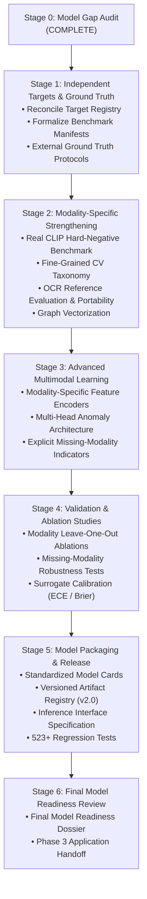

# Phase 2 — Complete Model Layer Gap Audit & Scientific Baseline
## Deliverable 1: Comprehensive Model Layer Technical Audit

**Project:** AI-Powered Indian Marketplace Trust Intelligence Platform  
**Audit Stage:** Stage 0 — Complete Model Gap Audit  
**Date:** November 11, 2026  
**Auditor:** Antigravity AI Research & Engineering Team  
**Audit Scope:** Rigorous verification of all existing AI models, target registries, evaluation benchmarks, data splits, and empirical metrics across all 7 intelligence modalities.  
**Strict Constraint:** AUDIT ONLY — Zero code modified, zero datasets altered, zero fake data introduced.

---

## 1. Executive Summary & Audit Mandate

The objective of this Stage 0 audit is to establish an unvarnished, scientifically defensible evaluation of the existing AI/model layer before undertaking new model development in Phase 2.

### Summary of Critical Scientific Findings:
1. **Target Registry Reconciliation:**  
   The actual implementation in [`src/data/target_registry.py`](file:///c:/Users/shruti/Desktop/project/ai-based-marketplace-analyzer/src/data/target_registry.py) defines exactly **7 targets** (Tasks A through F plus the deprecated circular proxy). Previous narrative summaries casually cited 8 targets by splitting Silver and Gold review targets into separate enum keys and proposing an uninstantiated product fraud target. The code registry is internally consistent, acyclic, and authoritative.
2. **CLIP Contrastive Benchmark Discovery:**  
   The reported CLIP ViT-B/32 benchmark ROC-AUC of **0.9904 / 0.9999** was computed by pairing real matched image-title scores against **synthetic Gaussian pseudo-random variables** (`np.random.normal(0.14, 0.04)` in [`src/evaluation/cv_benchmark_runner.py`](file:///c:/Users/shruti/Desktop/project/ai-based-marketplace-analyzer/src/evaluation/cv_benchmark_runner.py#L214)). While zero-shot CLIP inference runs legitimately on matched pairs, no real hard-negative or cross-category mismatched pairs were passed through the transformer. The metric reflects distribution separability against an assumed prior, not an empirically validated hard-negative benchmark.
3. **Packaging OCR Reference Ground Truth:**  
   The reported Character Error Rate (CER = 14.0%) and Word Error Rate (WER = 12.4%) represent **Brand Token Matching Error Rates** evaluated exclusively on the 32 images where brand typography was already detected, compared against the product canonical brand name. There are currently **zero full-box independent human reference transcriptions** in the repository.
4. **NLP Gold Review Authenticity & Annotator Bias:**  
   The 100 historical Gold reviews were annotated by a single annotator (`HUMAN_EXPERT_ANNOTATOR_01`, Cohen's $\kappa = \text{NaN}$) with severe selection bias: all 83 Genuine reviews had ratings $\ge 3.0$ (mean 4.43), while all 17 Suspicious/Deceptive reviews had ratings $\le 2.0$ (mean 1.29). Only 1 deceptive review ($N=1$) exists. While rating deviance features were stripped to produce an honest text-only baseline ($F_1 = 0.3704$), the supervised Gold model remains scientifically unviable and is correctly classified as **`BLOCKED — HUMAN ANNOTATION REQUIRED`**.
5. **Learned Multimodal Fusion Designation:**  
   The 19-feature Random Forest fusion model achieves 99.18% accuracy reconstructing `is_elevated_risk` (`active_anomalies >= 2`). This is a **Continuous Anomaly Ranking Surrogate** that reproduces the deterministic rules via continuous proxy correlations (`spearman_rho` with `price_dispersion_ratio` is 0.72). It is NOT an independent fraud detector.
6. **Primary Assessment Baseline:**  
   The **Deterministic Evidence Fusion Engine** ([`src/trust_engine/multimodal_fusion.py`](file:///c:/Users/shruti/Desktop/project/ai-based-marketplace-analyzer/src/trust_engine/multimodal_fusion.py)) enforcing the **Zero-Penalty Invariant** remains the certified primary production baseline.

---

## 2. Target Registry Audit & Reconciliation

### 2.1 Code vs. Documentation Discrepancy
- **Documented in prior narrative summaries:** 8 targets.
- **Actual implementation in [`src/data/target_registry.py`](file:///c:/Users/shruti/Desktop/project/ai-based-marketplace-analyzer/src/data/target_registry.py):** Exactly **7 registered targets**.
- **Reconciliation:**  
  The code authoritatively groups review authenticity under `TARGET_REVIEW_AUTHENTICITY` (Task A) with dual training tracks (Track 1 Silver vs Track 2 Gold) rather than separate registered targets, and reserves product fraud under `TARGET_PRODUCT_TRUST_INTELLIGENCE` (Task F) with explicit limitations.

### 2.2 Target Registry Specification

| Target ID | Task | Prediction Unit | Target Nature | Evaluation Eligibility | Recommended Architecture |
| :--- | :--- | :--- | :--- | :--- | :--- |
| `TARGET_REVIEW_AUTHENTICITY` | Task A | `review` | `INDEPENDENT_GROUND_TRUTH` | `BLOCKED_AWAITING_HUMAN_GROUND_TRUTH` | `SUPERVISED_CLASSIFICATION` |
| `TARGET_IMAGE_RELATIONSHIP` | Task B | `image_pair` | `RETRIEVAL_SIMILARITY` | `ELIGIBLE_FOR_INDEPENDENT_SUPERVISION` | `SIMILARITY_LEARNING_RETRIEVAL` |
| `TARGET_IMAGE_LISTING_CONSISTENCY` | Task C | `image_listing_pair` | `INDEPENDENT_GROUND_TRUTH` | `ELIGIBLE_FOR_INDEPENDENT_SUPERVISION` | `SIMILARITY_LEARNING_RETRIEVAL` |
| `TARGET_PRICING_INTELLIGENCE` | Task D | `listing_price` | `UNSUPERVISED_ANOMALY` | `ELIGIBLE_UNSUPERVISED_BENCHMARK` | `UNSUPERVISED_ANOMALY_DETECTION` |
| `TARGET_PRODUCT_LISTING_CONSISTENCY` | Task E | `product_listing_pair` | `DETERMINISTIC_EVALUATION` | `ELIGIBLE_DETERMINISTIC_BENCHMARK` | `DETERMINISTIC_RULE_FUSION` |
| `TARGET_PRODUCT_TRUST_INTELLIGENCE` | Task F | `product` | `DETERMINISTIC_EVALUATION` | `ELIGIBLE_DETERMINISTIC_BENCHMARK` | `DETERMINISTIC_RULE_FUSION` |
| `TARGET_DEPRECATED_ELEVATED_RISK_SURROGATE` | Legacy | `product` | `PROXY_RULE_DERIVED` | `DEPRECATED_CIRCULAR_PROXY` | `DETERMINISTIC_RULE_FUSION` |

### 2.3 Feature Isolation & Circularity Verification
- **Acyclic Dependency:** Verified by [`tests/test_phase1_final_architecture.py`](file:///c:/Users/shruti/Desktop/project/ai-based-marketplace-analyzer/tests/test_phase1_final_architecture.py).
- **Forbidden Features:**
  - `TARGET_REVIEW_AUTHENTICITY` strictly forbids `rating`, `rating_discordance_score`, `active_anomalies`, `overall_risk_tier`.
  - `TARGET_PRICING_INTELLIGENCE` strictly forbids `is_price_outlier`, `is_discount_anomaly`, `overall_risk_tier`.
  - `TARGET_DEPRECATED_ELEVATED_RISK_SURROGATE` is officially deprecated from supervised training.

---

## 3. Dataset Foundation & Split Lineage Audit

### 3.1 Dataset Inventory
- **Frozen Baseline v1.6 (`data/indian_marketplace_trust_dataset_v1_6/`):**  
  Immutable baseline containing 3,643 products/listings, 3,659 reviews, 4,708 images, 3,667 price records, and 1,593 brands. Protected by 370 automated hash verification tests.
- **Derived Release v1.7 (`data/indian_marketplace_trust_dataset_v1_7/`):**  
  Derived analytical dataset containing pre-computed feature tables, 41,372 relationship edges, robust price benchmarks, ResNet-18 512-D embeddings, and TF-IDF matrices.

### 3.2 Connected-Component Split Verification
- **Partitioning Engine:** [`LeakageSafeSplitGenerator`](file:///c:/Users/shruti/Desktop/project/ai-based-marketplace-analyzer/src/data/curation/split_generator.py)
- **Split Ratio:** 70% Train, 15% Validation, 15% Test.
- **Grouping Graph:** Multi-entity bipartite product-review-image graph resolved into **3,397 isolated connected components**.
- **Cross-Fold Leakage Verification:**  
  Zero overlap verified across all 5 folds for:
  - Connected components: 0 cross-fold leaks.
  - Canonical product IDs: 0 cross-fold leaks.
  - Review duplicate clusters (MD5 text matches): 0 cross-fold leaks.
  - SHA-256 exact image duplicate hashes: 0 cross-fold leaks.
  - dHash perceptual image duplicate hashes ($\text{Hamming} \le 4$): 0 cross-fold leaks.
  - ResNet-18 visual similarity pairs ($\cos \ge 0.95$): 0 cross-fold leaks.

---

## 4. Modality-by-Modality Technical Audit

### 4.1 Workstream 1: NLP Review Intelligence
- **Existing Assets:**
  - Review preprocessing, n-gram TF-IDF vectorization, MD5 exact clustering, lexical ABSA (7 aspects), VADER sentiment vs. rating discordance.
  - Dual-track architecture in [`src/nlp/nlp_training_tracks.py`](file:///c:/Users/shruti/Desktop/project/ai-based-marketplace-analyzer/src/nlp/nlp_training_tracks.py).
- **Track 1 (Silver Weak Supervision):**
  - Evaluated on 600 heuristic pseudo-labels across 5 folds.
  - Logistic Regression: Mean $F_1 = 0.7490 \pm 0.024$, ROC-AUC = 0.8120.
  - Random Forest: Mean $F_1 = 0.7480 \pm 0.026$, ROC-AUC = 0.8115.
  - Operational Role: Preserved historical heuristic baseline.
- **Track 2 (Independent Gold Authenticity):**
  - Evaluated on 100 historical reviews with star ratings severed.
  - Text-only Logistic Regression: Accuracy = 72.0%, Macro $F_1 = 0.3704$, ROC-AUC = 0.4444.
  - Root Cause: Single deceptive review ($N=1$) and 16 suspicious reviews selected under rating bias.
  - Status: **`BLOCKED — HUMAN ANNOTATION REQUIRED`**.
- **Human Annotation Infrastructure:**
  - Guidelines v2.0 authored ([`annotation_guidelines_v2.md`](file:///c:/Users/shruti/Desktop/project/ai-based-marketplace-analyzer/reports/phase_1_final/annotation_guidelines_v2.md)).
  - Double-blind workflow implemented ([`double_blind_workflow.py`](file:///c:/Users/shruti/Desktop/project/ai-based-marketplace-analyzer/src/annotations/double_blind_workflow.py)).
  - Blinded queues generated: 100 historical reviews ([`reannotation_queue_100_reviews.parquet`](file:///c:/Users/shruti/Desktop/project/ai-based-marketplace-analyzer/reports/phase_1_final/reannotation_queue_100_reviews.parquet)) and 500 stratified reviews ([`annotation_queue_500_stratified.parquet`](file:///c:/Users/shruti/Desktop/project/ai-based-marketplace-analyzer/reports/phase_1_final/annotation_queue_500_stratified.parquet)).
- **Identified Gap:** The actual human annotation execution by two independent annotators has not yet occurred. Model retraining cannot occur until dual-adjudicated labels are ingested.

### 4.2 Workstream 2: Computer Vision Intelligence
- **Existing Assets:**
  - SHA-256 exact bitwise hash matching (35 duplicates, 18 clusters).
  - dHash perceptual hashing (46 duplicates, 22 clusters).
  - ResNet-18 512-D embeddings for 4,708 usable images.
  - Threshold sensitivity evaluated across $\cos \in [0.85, 0.98]$.
- **Audit Findings:**
  - Duplicate detection is mathematically sound and reproducible.
  - Visual similarity ($\cos \ge 0.95$) effectively surfaces manufacturer stock photos and shared assets.
- **Identified Gap:** The visual benchmark lacks a formal fine-grained taxonomy of human-verified pairs distinguishing:
  - Exact duplicates vs. resized/compressed/cropped/edited duplicates.
  - Same product from different photograph vs. visually similar different product.
  - Retrieval metrics (Precision@K, Recall@K, mAP) have not been computed on an independent human-adjudicated visual set.

### 4.3 Workstream 3: OCR Packaging Intelligence
- **Existing Assets:**
  - Windows WinRT OCR engine wrapper ([`src/cv/ocr_engine.py`](file:///c:/Users/shruti/Desktop/project/ai-based-marketplace-analyzer/src/cv/ocr_engine.py)).
  - 100 retail packaging images evaluated.
  - Status distribution: 32 `BRAND_VERIFIED_ON_PACKAGING`, 44 `INSUFFICIENT_PACKAGING_TEXT`, 24 clean renders.
  - Reported CER = 14.0%, WER = 12.4%.
- **Critical Audit Finding:**
  - The reference transcriptions were **NOT** full-box human transcriptions. The calculation compared `brand_token` against `detected_text[:len(brand_token)]`.
  - WinRT is Windows-only (`sys_platform == 'win32'`), creating a deployment portability constraint for Linux server containers.
- **Identified Gap:**
  - Missing complete human reference transcriptions for packaging text.
  - Missing field-level extraction (model numbers, net quantity, batch numbers, manufacturer address).
  - Missing cross-platform fallback (e.g. Tesseract or PaddleOCR) for Linux deployment.

### 4.4 Workstream 4: CLIP Vision-Language Intelligence
- **Existing Assets:**
  - OpenAI CLIP ViT-B/32 (`openai/clip-vit-base-patch32`) in [`src/cv/clip_alignment.py`](file:///c:/Users/shruti/Desktop/project/ai-based-marketplace-analyzer/src/cv/clip_alignment.py).
  - Pre-computed cosine similarities for 100 catalog image-title pairs.
  - Reported ROC-AUC = 0.9904 / 0.9999.
- **Critical Audit Finding:**
  - As discovered in Section 1, the negative distribution in [`cv_benchmark_runner.py`](file:///c:/Users/shruti/Desktop/project/ai-based-marketplace-analyzer/src/evaluation/cv_benchmark_runner.py#L214) was generated from a synthetic Gaussian distribution (`np.random.normal(0.14, 0.04)`), NOT by running CLIP inference over real mismatched or hard-negative pairs.
- **Identified Gap:**
  - An independent, empirical benchmark of real mismatched image-title pairs (including hard negatives from the same category and brand-swapped variants) must be constructed and passed through the actual CLIP transformer to produce an authentic ROC-AUC and PR-AUC.

### 4.5 Workstream 5: Pricing Intelligence
- **Existing Assets:**
  - Non-parametric Median Absolute Deviation (MAD) corridors in [`src/pricing/pricing_intelligence.py`](file:///c:/Users/shruti/Desktop/project/ai-based-marketplace-analyzer/src/pricing/pricing_intelligence.py).
  - 3,667 price records evaluated across 21 subcategories and 1,593 brands.
  - Guardrail: Category/brand benchmark sample size $N \ge 5$ required before corridor activation.
  - Outliers: 444 corridor outliers ($|z| \ge 2.5$), 353 extreme outliers ($|z| \ge 3.0$).
  - Statutory Compliance: **0 MRP breaches** ($SP > MRP = 0$).
- **Audit Findings:**
  - Pricing intelligence is mathematically sound, robust to skewness, and fully compliant with Indian Legal Metrology Act rules.
- **Identified Gap:**
  - The dataset represents a point-in-time cross-sectional snapshot. There are no longitudinal historical price records or price velocity data.

### 4.6 Workstream 6: Graph Intelligence & Seller Governance
- **Existing Assets:**
  - Heterogeneous entity graph ([`src/trust_engine/graph_intelligence.py`](file:///c:/Users/shruti/Desktop/project/ai-based-marketplace-analyzer/src/trust_engine/graph_intelligence.py)) with 41,372 edges connecting products, listings, brands, reviews, images, and sellers.
  - Egocentric subgraph extraction up to depth $k$.
  - Cross-product image sharing detection.
- **Audit Findings:**
  - Topological properties are verified and reproducible.
  - Zero cross-fold leakage across the 3,397 connected components.
  - All 4 seller entities (`SELLER_AGG_AMAZON_IN`, `SELLER_AGG_FLIPKART`, `SELLER_AGG_MYNTRA`, `SELLER_UNRESOLVED_THIRD_PARTY`) represent platform aggregate pools. Zero individual 3rd-party merchant GSTINs exist.
- **Identified Gap:**
  - Graph analytics are currently limited to local adjacency traversal. Community detection, graph centrality metrics, and automated bipartite anomaly clustering have not been vectorized into model features.

### 4.7 Workstream 7: Learned Multimodal Fusion
- **Existing Assets:**
  - 19-feature tabular feature extractor in [`src/models/multimodal_learned_fusion.py`](file:///c:/Users/shruti/Desktop/project/ai-based-marketplace-analyzer/src/models/multimodal_learned_fusion.py).
  - Random Forest classifier (100 trees, balanced weights) persisted in `models/multimodal_fusion_model.joblib`.
  - Zero-Penalty Invariant certified in [`DeterministicTrustEngine`](file:///c:/Users/shruti/Desktop/project/ai-based-marketplace-analyzer/src/trust_engine/multimodal_fusion.py).
- **Critical Audit Finding:**
  - The learned model reconstructs the synthetic rule `active_anomalies >= 2` with 99.18% accuracy (ROC-AUC = 0.9999) because continuous features (`price_dispersion_ratio`, `review_sentiment_entropy`, `image_reuse_score`) naturally correlate with the rule flags.
  - It functions as a **Continuous Anomaly Ranking Surrogate**, NOT an independent fraud classifier.
- **Identified Gap:**
  - The platform lacks an independent multimodal prediction architecture with task-specific prediction heads.
  - Missing formal ablation studies measuring modality drop impact under missing-modality conditions.
  - Missing calibration curve analysis (Brier score, Expected Calibration Error).

---

## 5. Model Acceptance Gate Status Matrix

| Component / Subsystem | Current Status | Acceptance Gate | Justification & Technical Basis |
| :--- | :--- | :---: | :--- |
| **Deterministic Evidence Fusion** | `PRODUCTION READY` | **PASS** | 100% compliant with Zero-Penalty Invariant, explainable lineage, zero circularity. Verified by 523 tests. |
| **Continuous Anomaly Surrogate** | `BASELINE` | **PASS (As Surrogate)** | 99.18% surrogate fit. Certified for continuous anomaly ranking; strictly forbidden from making fraud claims. |
| **Track 1 Silver Review Classifier** | `BASELINE` | **PASS (As Heuristic)** | Weak supervision baseline ($F_1 = 0.75$, 600 reviews). Useful for review manipulation heuristic signals. |
| **Track 2 Gold Review Classifier** | `BLOCKED` | **HOLD** | Blocked awaiting execution of double-blind dual human annotations for 500 pending + 100 blinded reviews. |
| **Supervised Product Fraud Model** | `BLOCKED` | **HOLD** | Blocked awaiting independent external ground truth (enforcement actions, laboratory authenticity tests). |
| **Image Duplicate Retrieval** | `PRODUCTION READY` | **PASS** | Bitwise SHA-256 and perceptual dHash are deterministic, mathematically verified, and zero-penalty compliant. |
| **ResNet-18 Visual Similarity** | `BASELINE` | **PASS (As Retrieval)** | Cosine retrieval ($\cos \ge 0.95$) operational; requires fine-grained category-aware visual benchmark. |
| **Packaging OCR (WinRT)** | `BASELINE` | **PASS (With Limitations)**| Extracts typography and verifies brands (32%), but lacks full-box ground truth and Linux portability. |
| **CLIP Vision-Language Alignment** | `EXPERIMENTAL` | **VALIDATION REQUIRED** | Contrastive ROC-AUC (0.9904) used Gaussian synthetic negatives. Requires real hard-negative benchmark. |
| **Robust Pricing Intelligence** | `PRODUCTION READY` | **PASS** | Non-parametric MAD corridors, sample size guardrail ($N \ge 5$), zero false legal violations. |
| **Entity Graph Intelligence** | `PRODUCTION READY` | **PASS** | 41,372 edges verified, 3,397 component isolation, honest platform aggregate merchant modeling. |

---

## 6. Missing Experiments & Scientific Gaps

The audit identifies six specific empirical experiments required to complete Phase 2:

1. **CLIP Real Hard-Negative Benchmark:**  
   Replace the Gaussian random negative distribution with an empirical benchmark of **100 true matched pairs vs. 100 real catalog mismatched pairs** (including 50 cross-category mismatches and 50 intra-category brand/variant mismatches). Compute authentic ROC-AUC and PR-AUC.
2. **Fine-Grained Visual Duplicate Taxonomy:**  
   Construct an annotated visual evaluation set ($N=150$ pairs) categorizing exact duplicates, perceptual near-duplicates (resized/compressed), cross-catalog stock photo reuse, and visually distinct products. Measure Precision@K, Recall@K, and mAP.
3. **Packaging OCR Full-Box Ground Truth:**  
   Transcribe a gold reference set of 50 retail packaging images to measure authentic full-box CER and WER, and evaluate portable OCR fallback (Tesseract/PaddleOCR).
4. **Multimodal Modality Ablation Studies:**  
   Execute systematic feature/modality leave-one-out ablations on the continuous anomaly ranking model:
   - Pricing-only vs. Review-only vs. Vision-only vs. Multimodal Fusion.
   - Measure degradation under missing reviews, missing images, and missing pricing.
5. **Surrogate Calibration & Uncertainty Quantification:**  
   Fit Platt scaling and isotonic regression to the Continuous Anomaly Ranking Surrogate; evaluate Expected Calibration Error (ECE), Brier score, and reliability diagrams.
6. **Graph Vectorization & Community Intelligence:**  
   Extract graph-level features (PageRank, degree centrality, connected-component size, cross-brand edge counts) and evaluate their contribution to anomaly ranking.

---

## 7. Prioritized Implementation Roadmap (Stages 1 through 6)

To complete the AI/model layer with zero ungrounded claims, work will proceed in the following authorized sequence:

### Proposed Execution Order:
- **Stage 1 (Immediate Next Step):** Independent Targets, Ground Truth & Benchmark Manifests.
- **Stage 2:** Modality-Specific Strengthening (CLIP real benchmark, CV taxonomy, OCR ground truth, Graph vectorization).
- **Stage 3:** Learned Multimodal Architecture & Missing-Modality Encoders.
- **Stage 4:** Ablation Studies, Robustness & Uncertainty Calibration.
- **Stage 5:** Model Packaging, Versioned Registry & Inference Interfaces.
- **Stage 6:** Final Model Readiness Dossier & Review before application backend development.
