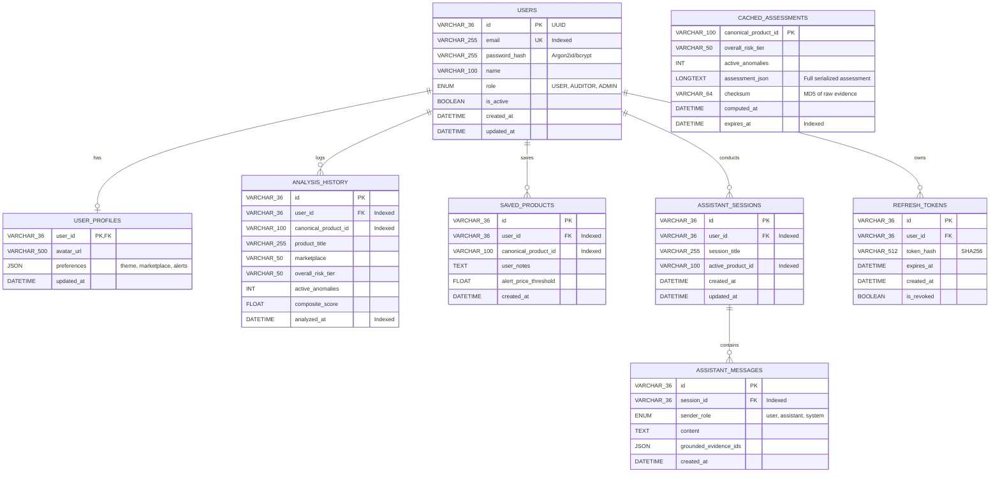

# Phase 2 — Stage 0: Existing Backend Technical Audit
## Deliverable 5: Database & Persistence Gap Analysis

**Project:** AI-Powered Indian Marketplace Trust Intelligence Platform  
**Audit Date:** November 11, 2026  
**Auditor:** Antigravity AI Engineering Team  

---

## 1. Current Storage State Inspection

### 1.1 Empirical Audit Findings
A comprehensive sweep of the codebase reveals:
1. **Zero SQL Files:** No `.sql` schema definitions, migration files, or seed scripts exist in the repository.
2. **Zero Relational Database Configuration:** No database connection pool, no ORM configuration (such as Prisma, TypeORM, Sequelize, or Knex.js), and no database environment variables exist.
3. **Current Storage Architecture:**  
   The platform operates exclusively on Apache Parquet files in `data/indian_marketplace_trust_dataset_v1_7/` and `v1_6/`. These tables are read-only, columnar, and loaded directly into RAM using pandas/pyarrow when the Python AI services initialize.
4. **Current Persistence Limitations:**  
   - Cannot persist registered users or login credentials.
   - Cannot record user analysis history across sessions.
   - Cannot maintain user saved product watchlists.
   - Cannot persist multi-turn conversational chat sessions for MarketMate.
   - Redundant AI trust evaluations must recalculate or re-read parquet tables on every server reboot.

---

## 2. Target Database Design: The Hybrid Storage Model

We implement a **Hybrid Data Architecture**:
- **Cold / Analytical Data (Apache Parquet):** 3,643 products, 3,643 listings, 3,659 reviews, 4,708 images, 41,372 graph edges, and derived ML features remain stored in certified, immutable Parquet files. This preserves the Phase 1 scientific baseline and eliminates unnecessary database ingestion overhead.
- **Hot / Operational Data (MySQL 8.0):** User accounts, authentication tokens, analysis history logs, user watchlists, MarketMate chat sessions, and transient trust assessment caches reside in a relational MySQL 8.0 database.

---

## 3. Relational Schema Proposal for MySQL 8.0

### 3.1 Entity Relationship Diagram



---

## 4. DDL Specification (SQL Schema)

```sql
-- 1. Users Table
CREATE TABLE users (
    id VARCHAR(36) PRIMARY KEY,
    email VARCHAR(255) NOT NULL UNIQUE,
    password_hash VARCHAR(255) NOT NULL,
    name VARCHAR(100) NOT NULL,
    role ENUM('USER', 'AUDITOR', 'ADMIN') NOT NULL DEFAULT 'USER',
    is_active BOOLEAN NOT NULL DEFAULT TRUE,
    created_at TIMESTAMP DEFAULT CURRENT_TIMESTAMP,
    updated_at TIMESTAMP DEFAULT CURRENT_TIMESTAMP ON UPDATE CURRENT_TIMESTAMP,
    INDEX idx_users_email (email)
) ENGINE=InnoDB DEFAULT CHARSET=utf8mb4 COLLATE=utf8mb4_unicode_ci;

-- 2. User Profiles Table
CREATE TABLE user_profiles (
    user_id VARCHAR(36) PRIMARY KEY,
    avatar_url VARCHAR(500) NULL,
    preferences JSON NULL,
    updated_at TIMESTAMP DEFAULT CURRENT_TIMESTAMP ON UPDATE CURRENT_TIMESTAMP,
    CONSTRAINT fk_profile_user FOREIGN KEY (user_id) REFERENCES users(id) ON DELETE CASCADE
) ENGINE=InnoDB DEFAULT CHARSET=utf8mb4 COLLATE=utf8mb4_unicode_ci;

-- 3. Refresh Tokens Table (Token Rotation)
CREATE TABLE refresh_tokens (
    id VARCHAR(36) PRIMARY KEY,
    user_id VARCHAR(36) NOT NULL,
    token_hash VARCHAR(512) NOT NULL,
    expires_at TIMESTAMP NOT NULL,
    is_revoked BOOLEAN NOT NULL DEFAULT FALSE,
    created_at TIMESTAMP DEFAULT CURRENT_TIMESTAMP,
    INDEX idx_tokens_user (user_id),
    INDEX idx_tokens_hash (token_hash),
    CONSTRAINT fk_tokens_user FOREIGN KEY (user_id) REFERENCES users(id) ON DELETE CASCADE
) ENGINE=InnoDB DEFAULT CHARSET=utf8mb4 COLLATE=utf8mb4_unicode_ci;

-- 4. User Analysis History Table
CREATE TABLE analysis_history (
    id VARCHAR(36) PRIMARY KEY,
    user_id VARCHAR(36) NOT NULL,
    canonical_product_id VARCHAR(100) NOT NULL,
    product_title VARCHAR(255) NOT NULL,
    marketplace VARCHAR(50) NOT NULL,
    overall_risk_tier VARCHAR(50) NOT NULL,
    active_anomalies INT NOT NULL DEFAULT 0,
    composite_score FLOAT NULL,
    analyzed_at TIMESTAMP DEFAULT CURRENT_TIMESTAMP,
    INDEX idx_history_user (user_id),
    INDEX idx_history_product (canonical_product_id),
    INDEX idx_history_timestamp (analyzed_at),
    CONSTRAINT fk_history_user FOREIGN KEY (user_id) REFERENCES users(id) ON DELETE CASCADE
) ENGINE=InnoDB DEFAULT CHARSET=utf8mb4 COLLATE=utf8mb4_unicode_ci;

-- 5. Saved Products / Watchlist Table
CREATE TABLE saved_products (
    id VARCHAR(36) PRIMARY KEY,
    user_id VARCHAR(36) NOT NULL,
    canonical_product_id VARCHAR(100) NOT NULL,
    user_notes TEXT NULL,
    alert_price_threshold DECIMAL(10,2) NULL,
    created_at TIMESTAMP DEFAULT CURRENT_TIMESTAMP,
    UNIQUE KEY uq_user_product (user_id, canonical_product_id),
    INDEX idx_saved_user (user_id),
    INDEX idx_saved_product (canonical_product_id),
    CONSTRAINT fk_saved_user FOREIGN KEY (user_id) REFERENCES users(id) ON DELETE CASCADE
) ENGINE=InnoDB DEFAULT CHARSET=utf8mb4 COLLATE=utf8mb4_unicode_ci;

-- 6. MarketMate Assistant Sessions
CREATE TABLE assistant_sessions (
    id VARCHAR(36) PRIMARY KEY,
    user_id VARCHAR(36) NOT NULL,
    session_title VARCHAR(255) NOT NULL DEFAULT 'New Conversation',
    active_product_id VARCHAR(100) NULL,
    created_at TIMESTAMP DEFAULT CURRENT_TIMESTAMP,
    updated_at TIMESTAMP DEFAULT CURRENT_TIMESTAMP ON UPDATE CURRENT_TIMESTAMP,
    INDEX idx_sessions_user (user_id),
    CONSTRAINT fk_sessions_user FOREIGN KEY (user_id) REFERENCES users(id) ON DELETE CASCADE
) ENGINE=InnoDB DEFAULT CHARSET=utf8mb4 COLLATE=utf8mb4_unicode_ci;

-- 7. MarketMate Assistant Messages
CREATE TABLE assistant_messages (
    id VARCHAR(36) PRIMARY KEY,
    session_id VARCHAR(36) NOT NULL,
    sender_role ENUM('user', 'assistant', 'system') NOT NULL,
    content TEXT NOT NULL,
    grounded_evidence_ids JSON NULL,
    created_at TIMESTAMP DEFAULT CURRENT_TIMESTAMP,
    INDEX idx_messages_session (session_id),
    CONSTRAINT fk_messages_session FOREIGN KEY (session_id) REFERENCES assistant_sessions(id) ON DELETE CASCADE
) ENGINE=InnoDB DEFAULT CHARSET=utf8mb4 COLLATE=utf8mb4_unicode_ci;

-- 8. Cached Trust Assessments Table (Inference Cache)
CREATE TABLE cached_assessments (
    canonical_product_id VARCHAR(100) PRIMARY KEY,
    overall_risk_tier VARCHAR(50) NOT NULL,
    active_anomalies INT NOT NULL DEFAULT 0,
    assessment_json LONGTEXT NOT NULL,
    checksum VARCHAR(64) NOT NULL,
    computed_at TIMESTAMP DEFAULT CURRENT_TIMESTAMP,
    expires_at TIMESTAMP NOT NULL,
    INDEX idx_cache_expires (expires_at)
) ENGINE=InnoDB DEFAULT CHARSET=utf8mb4 COLLATE=utf8mb4_unicode_ci;
```

---

## 5. Migration Strategy & Tooling

1. **Migration Tool:**  
   We select **Knex.js** or **Prisma** for migration management in the Node.js backend:
   - Declarative TypeScript migration files in `backend/src/database/migrations/`.
   - Forward (`up`) and backward (`down`) migrations for zero-downtime upgrades.
2. **Connection Pooling:**  
   Use `mysql2/promise` with configuration:
   - `connectionLimit: 20`
   - `waitForConnections: true`
   - `queueLimit: 0`
   - `idleTimeout: 30000`
3. **Execution Safety:**  
   Migrations must run automatically during container startup or backend initialization before accepting incoming traffic.
