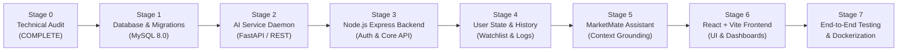

# Phase 2 — Stage 0: Existing Backend Technical Audit
## Deliverable 7: Phase 2 Implementation Roadmap

**Project:** AI-Powered Indian Marketplace Trust Intelligence Platform  
**Roadmap Version:** 2.0.0-PROPOSAL  
**Date:** November 11, 2026  
**Auditor / Architect:** Antigravity AI Engineering Team  

---

## 1. Roadmap Overview & Phased Progression

Phase 2 transitions the platform from a scientific research baseline into a complete, integrated, production-grade web application. To guarantee architectural stability and eliminate regressions, work is organized into 7 sequential stages:

---

## 2. Stage-by-Stage Implementation Plan

### Stage 1: Relational Persistence Layer (MySQL 8.0)
- **Goal:** Establish reliable, structured database storage for application data.
- **Tasks:**
  1. Set up local MySQL 8.0 database `marketplace_trust_db` and service credentials.
  2. Implement migration framework (Knex.js or Prisma) in `backend/src/database/`.
  3. Author and execute baseline migrations for:
     - `users`, `user_profiles`, `refresh_tokens`.
     - `analysis_history`, `saved_products`.
     - `assistant_sessions`, `assistant_messages`.
     - `cached_assessments`.
  4. Write automated migration unit tests verifying foreign keys, cascading deletions, and unique constraints.
- **Deliverables:** Working MySQL migration suite and automated database seeders.

### Stage 2: AI Trust Intelligence Runtime Modernization
- **Goal:** Expose stable, non-blocking HTTP endpoints for the existing Phase 1 trust engine.
- **Tasks:**
  1. Upgrade `src/api/service.py` or introduce a modern FastAPI wrapper in `src/api/fastapi_service.py` running with Uvicorn.
  2. Implement Pydantic request/response models directly referencing `src/trust_engine/contracts.py`.
  3. Ensure 100% preservation of all 523 existing tests.
  4. Add `/ready` readiness probe verifying parquet tables are mapped into memory.
  5. Validate sub-25ms response time on product trust assessment benchmarks.
- **Deliverables:** High-throughput, asynchronous Python AI daemon on port 8080.

### Stage 3: Node.js / Express Core Backend
- **Goal:** Build the primary application backend and API gateway.
- **Tasks:**
  1. Initialize Node.js TypeScript project in `backend/` with `package.json`, `tsconfig.json`, `src/`.
  2. Configure Express server, Helmet, CORS whitelist, Morgan logging, and global error middleware.
  3. Implement Authentication Module:
     - Argon2id / bcrypt password hashing.
     - JWT issuance, refresh token rotation, and auth middleware (`requireAuth`, `requireRole`).
     - Routes: `/auth/register`, `/auth/login`, `/auth/refresh`, `/auth/me`, `/auth/logout`.
  4. Implement Catalog & Search Proxy Module:
     - Proxies catalog queries to local cache or Python daemon.
     - Search with keyword, marketplace, category, and risk tier filters.
  5. Implement Trust Intelligence Proxy Gateway:
     - Exposes `/api/v1/products/:id/trust-assessment`, `/evidence`, `/report`, `/compare`.
- **Deliverables:** Tested, authenticated Node.js backend on port 5000.

### Stage 4: User State, History & Watchlist Services
- **Goal:** Provide persistent user state tracking.
- **Tasks:**
  1. Implement `AnalysisHistoryService`:
     - Automatically logs product assessment views for authenticated users.
     - Endpoints: `GET /api/v1/history`, `DELETE /api/v1/history/:id`.
  2. Implement `SavedProductsService`:
     - Allows users to bookmark listings, add notes, and track risk status.
     - Endpoints: `GET /api/v1/saved-products`, `POST /api/v1/saved-products`, `DELETE /api/v1/saved-products/:id`.
  3. Write integration tests for history recording and watchlist management.
- **Deliverables:** Fully functioning user activity and watchlist endpoints.

### Stage 5: MarketMate Conversational Assistant Integration
- **Goal:** Deploy the evidence-grounded conversational assistant.
- **Tasks:**
  1. Implement `MarketMateService` in Node.js backend.
  2. Integrate LLM provider (Google Gemini or OpenAI API) via secure backend client.
  3. Implement **Context-Grounding Injection**:
     - Fetches atomic evidence items and trust assessment from Python AI engine for the active product.
     - Injects evidence into system instructions: strictly forbids hallucinated claims or ungrounded assertions.
  4. Implement multi-turn chat session management and message persistence in MySQL.
  5. Endpoints: `POST /api/v1/assistant/chat`, `GET /api/v1/assistant/sessions`.
- **Deliverables:** Verified, grounded MarketMate conversational API.

### Stage 6: React + Vite + TypeScript Frontend Application
- **Goal:** Deliver a modern, accessible, high-performance user interface.
- **Tasks:**
  1. Initialize Vite React project in `frontend/` with Tailwind CSS and Lucide icons.
  2. Configure Axios client with JWT interceptor and TanStack Query caching.
  3. Build UI Component Library:
     - `RiskTierBadge`, `ModalityRadarCard`, `EvidenceTable`, `ComparisonMatrix`, `ConfidenceBar`.
  4. Develop Core Views:
     - **Dashboard:** Platform metrics, marketplace breakdown, anomaly highlights.
     - **Catalog Explorer:** Faceted search, filtering, and pagination.
     - **Product Trust Analysis:** Interactive modality tabs, atomic evidence inspection, limitations alert.
     - **Explainable Report Viewer:** 12-section printable/exportable trust report.
     - **Product Comparison:** Side-by-side evidence matrix and density-vs-risk ranking.
     - **Analysis History & Watchlist:** User activity tables.
     - **MarketMate Drawer:** Slide-out interactive chat panel with quick-prompt pills.
- **Deliverables:** Responsive, polished React application connected to backend on port 5173.

### Stage 7: End-to-End Testing, Security Hardening & Containerization
- **Goal:** Prepare the platform for turnkey deployment.
- **Tasks:**
  1. Author End-to-End (E2E) integration tests verifying the full stack: React -> Node.js -> MySQL -> Python AI.
  2. Author Dockerfile for Node.js backend, Dockerfile for Python AI daemon, Dockerfile for Frontend (Nginx).
  3. Author root `docker-compose.yml` linking all 4 services with persistent volumes.
  4. Conduct security vulnerability scan (`npm audit`, Bandit, OWASP ZAP).
- **Deliverables:** Complete production-ready containerized application.

---

## 3. Critical Risks & Mitigation Strategies

| Risk | Impact | Probability | Mitigation Strategy |
| :--- | :--- | :---: | :--- |
| **Python Daemon Latency Under Concurrency** | Slow page loads for trust assessments | Medium | Replace single-threaded `http.server` with ASGI Uvicorn workers. Implement MySQL assessment caching (`cached_assessments`). |
| **MarketMate Hallucination of Fraud** | False legal accusations or incorrect trust claims | High | Strict system prompt grounding requiring MarketMate to cite explicit `evidence_id` tokens. Enforce that uncorroborated anomalies are labeled as anomalies, not fraud. |
| **Port & Socket Conflicts on Windows** | EADDRINUSE on startup | Medium | Standardize ports (Node.js: 5000, Python: 8080, MySQL: 3306, Vite: 5173) and provide configurable `.env` parameters. |
| **Cross-Service Data Desynchronization** | Discrepancies between Node.js schemas and Python contracts | Low | Standardize all contracts on Phase 1 [`model_input_output_schemas.json`](file:///c:/Users/shruti/Desktop/project/ai-based-marketplace-analyzer/reports/phase_1_final/model_input_output_schemas.json). Run schema validation integration tests. |
| **Data Leakage into Frozen Datasets** | Invalidation of Phase 1 scientific baseline | High (if violated) | Mount `data/` directory as **READ-ONLY** (`:ro`) in Docker containers. All writes go strictly to MySQL or `/tmp`. |

---

## 4. Files to Be Created in the First Implementation Stage (Stage 1)

In Stage 1 (Relational Persistence Layer), the following files will be created in the `backend/` directory:

1. `backend/package.json`: Node.js dependencies (`mysql2`, `knex`, `dotenv`, `typescript`, `ts-node`, `jest`).
2. `backend/tsconfig.json`: TypeScript compiler options.
3. `backend/knexfile.ts`: Knex database connection and migration configuration for MySQL 8.0.
4. `backend/src/config/database.ts`: MySQL connection pool configuration.
5. `backend/src/database/migrations/20261111_01_create_users_and_profiles.ts`: DDL migration for `users`, `user_profiles`, `refresh_tokens`.
6. `backend/src/database/migrations/20261111_02_create_analysis_history_and_watchlist.ts`: DDL migration for `analysis_history` and `saved_products`.
7. `backend/src/database/migrations/20261111_03_create_assistant_and_cache.ts`: DDL migration for `assistant_sessions`, `assistant_messages`, and `cached_assessments`.
8. `backend/src/database/seeds/01_admin_seed.ts`: Initial development seed data.
9. `backend/tests/database.test.ts`: Automated migration and connection pool integration tests.
