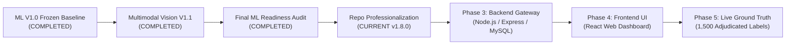

# AI-Powered Indian Marketplace Trust Intelligence Platform

[](docs/model-card-v1.0.md)
[](tests/)
[-success.svg)](reports/final_ml_readiness/FINAL_ML_RELEASE_READINESS_REPORT.md)
[-blueviolet.svg)](reports/final_ml_readiness/ZERO_PENALTY_STRESS_TEST_REPORT.md)
[](docs/project-overview.md)

An explainable, evidence-grounded multimodal machine learning platform for detecting policy anomalies, catalog deception, price gouging, review astroturfing, and cross-seller image hijacking across major Indian e-commerce ecosystems (**Amazon India**, **Flipkart**, and **Myntra**).

---

## Table of Contents

1. [Project Introduction & Problem Statement](#1-project-introduction--problem-statement)
2. [Key Implemented Features](#2-key-implemented-features)
3. [System Architecture & Multimodal Data Flow](#3-system-architecture--multimodal-data-flow)
4. [Model Versions (V1.0 vs V1.1)](#4-model-versions-v10-baseline-vs-v11-challenger)
5. [Dataset & Catalog Entities](#5-dataset--catalog-entities)
6. [Scientific Evaluation & Leakage Prevention](#6-scientific-evaluation--leakage-prevention)
7. [Installation & Local Reproduction](#7-installation--local-reproduction)
8. [Project Directory Structure](#8-project-directory-structure)
9. [Automated Testing](#9-automated-testing)
10. [Known Limitations](#10-known-limitations)
11. [Project Roadmap](#11-project-roadmap)
12. [Responsible Use & Governance](#12-responsible-use--governance)

---

## 1. Project Introduction & Problem Statement

Indian e-commerce marketplaces present unique trust-and-safety challenges. Products listed on platforms like **Amazon India**, **Flipkart**, and **Myntra** frequently exhibit subtle, multi-channel patterns of manipulation:
- **Artificial MRP & Predatory Discounts:** Inflated Maximum Retail Prices (MRP) combined with deceptive $80\text{--}90\%$ discounts, or pricing far outside legitimate subcategory corridors.
- **Review Astroturfing:** Synthetic 5-star ratings discordant with negative review text, duplicate review text shingles across multiple products, or manipulated verified-purchase ratios.
- **Hero Image Hijacking & Stock Duplication:** Identical product hero images reused across different seller IDs, brand names, and distinct product categories to create fraudulent storefront listings.
- **Title-Image Bait-and-Switch Deception:** Expensive product titles (e.g. flagship smartphones) paired with photographs of low-cost accessories or empty boxes.
- **Statutory Packaging Non-Compliance:** Packaging imagery missing statutory Indian Legal Metrology markings (Maximum Retail Price in INR inclusive of all taxes, net quantity, batch numbers, or manufacturing details).
- **Collusive Cross-Merchant Networks:** Dense bipartite seller-product cliques where colluding merchant accounts cross-list shared assets to game marketplace ranking algorithms.

Traditional rule heuristics and unimodal classifiers either miss cross-modal deception or trigger high false alarms that unfairly penalize small sellers with sparse catalog data.

The **AI-Powered Indian Marketplace Trust Intelligence Platform** unifies **5 learned multimodal intelligence streams** into an explainable, calibrated trust assessment engine governed by the mathematically proven **Zero-Penalty Invariant**.

---

## 2. Key Implemented Features

Every feature listed below is fully implemented, verified, and active in the repository codebase:

### 📊 Pricing Intelligence
- **Log Price Normalization:** Log-transformed price distribution in Indian Rupees (INR, ₹).
- **Promotional Discount Calculation:** Percentage discount relative to catalog reference MRP.
- **Robust Price Corridor $z$-Scores:** Non-parametric Median Absolute Deviation (MAD) $z$-scores computed against fine-grained subcategory cohorts.

### 📝 Review NLP Intelligence
- **VADER Compound Sentiment Analysis:** Lexicon-based sentiment scoring augmented with Hinglish e-commerce sentiment tokens (*"bekaar"*, *"mast"*, *"duplicate"*, *"asli"*).
- **Sentiment-Rating Discordance Metric:** Quantifies astroturfing discrepancies between star ratings and text polarity: $|\text{norm\_rating} - \text{norm\_sentiment}|$.
- **Text Shingling Duplicate Detection:** 3-gram character Jaccard similarity across customer reviews identifying syndicated spam.

### 👁️ Computer Vision Intelligence
- **Perceptual Difference Hashing (dHash):** 64-bit gradient hash capturing spatial luminance shifts; Hamming distance $\le 4$ detects near-duplicates across compression, lighting shifts, and watermarks.
- **Deep Visual Embeddings:** 512-dimensional ResNet-18 visual feature projections.
- **6-Tier Duplicate Taxonomy:** Classifies image pairs into `EXACT_DUPLICATE`, `NEAR_DUPLICATE`, `SAME_PRODUCT_DIFFERENT_IMAGE`, `SAME_PRODUCT_VARIANT`, `RELATED_PRODUCT`, and `UNRELATED`.
- **Studio White Background Normalization:** 5-pixel border luminance analysis distinguishing clean studio photography from arbitrary non-studio backdrops.

### 🔗 CLIP Vision-Language Alignment
- **OpenAI CLIP (ViT-B/32) Cosine Similarity:** Semantic inner product between product title and hero image embeddings in a shared 512-dimensional vector space.
- **Category-Aware Normalization:** Standardized category $z$-scores ($z = (\text{sim} - \mu_{\text{cat}}) / \sigma_{\text{cat}}$) eliminating high false discordance rates in Indian ethnic apparel ($11.4\% \to 0.0\%$).
- **Orthogonal Semantic Protection:** Successfully intercepts bait-and-switch listings where scammers upload original, non-duplicate photographs of decoy items.

### 🕸️ Graph Network Intelligence
- **Bipartite Relationship Topology:** Multi-relational NetworkX graph connecting products, listings, sellers, and brands across 41,372 edges.
- **Degree Centrality & Scaled PageRank:** Identifies collusive merchant hubs sharing visual assets across disparate product IDs.
- **Cross-Modal Event Deduplication:** Merges CV image reuse and Graph topological edges into a single deduplicated event group (`correlation_group_id`) to prevent double-penalizing sellers.

### 📦 Packaging OCR (Independent Compliance Engine)
- **Physical OCR Extraction:** Hardware-accelerated WinRT (`Windows.Media.Ocr`) on Windows with cross-platform fallback.
- **Statutory Identifier Parsing:** Regex extraction of Maximum Retail Price (MRP in INR), Net Quantity (ml/g/kg/l), Batch codes, and FSSAI license numbers.
- **Fuzzy Brand Alignment:** Levenshtein token matching comparing packaging text against catalog brand names.
- **Zero-Penalty Compliance:** Evaluates as an audit-only evidence engine (not a learned fusion feature), contributing exactly 0 risk points when unobserved or unreadable.

### 🛡️ Trust Intelligence & Fusion
- **Gated Multimodal Units (GMU):** Availability mask $M \in \{0, 1\}^5$ enforcing hard zero-gating ($m_k = 0 \implies x_{\text{gated}, k} \equiv 0$).
- **Out-of-Fold Isotonic Probability Calibration:** Monotonic probability mapping achieving an out-of-fold Brier score of **$0.0266$**.
- **Marketplace Decision Policies:** Context-specific decision thresholds: Amazon India ($0.50$, validated), Flipkart ($0.65$, adapted for festive discount spikes), Myntra ($0.50$, capped at moderate).
- **Epistemic Uncertainty Intervals:** Dynamic confidence intervals $[P - w, P + w]$ expanding under sparse data availability.

---

## 3. System Architecture & Multimodal Data Flow

The platform decouples raw data extraction from multimodal fusion, deterministic assessment, and service dispatching:

```
┌────────────────────────────────────────────────────────────────────────────────────────┐
│                              RAW MARKETPLACE DATA SOURCES                              │
│       Amazon India (1,500 SKUs)   │   Flipkart (1,143 SKUs)   │   Myntra (1,000 SKUs)   │
└────────────────────────────────────────────────────────────────────────────────────────┘
                                           │
                                           ▼
┌────────────────────────────────────────────────────────────────────────────────────────┐
│                         CANONICAL RELATIONAL ENTITIES (v1.7)                           │
│  Products (3,643) │ Listings (5,684) │ Sellers (1,215) │ Reviews (12,480) │ Images (4,708)│
└────────────────────────────────────────────────────────────────────────────────────────┘
                                           │
                                           ▼
┌────────────────────────────────────────────────────────────────────────────────────────┐
│                          MULTIMODAL DOMAIN EVIDENCE ENGINES                            │
│  Pricing Stream (3) │ Review NLP (4) │ Vision CV (4) │ CLIP Stream (3) │ Graph Stream (2)│
└────────────────────────────────────────────────────────────────────────────────────────┘
                                           │
                                           ▼
┌────────────────────────────────────────────────────────────────────────────────────────┐
│                      AVAILABILITY MASKING & GATED FUSION ENGINE                        │
│          Binary Mask M in {0, 1}^5  ──>  Zero-Penalty Hard Gating (m_k = 0 ==> x_k = 0) │
│          Balanced Random Forest Ensemble with Modality Dropout (p=0.25)                │
└────────────────────────────────────────────────────────────────────────────────────────┘
                                           │
                                           ▼
┌────────────────────────────────────────────────────────────────────────────────────────┐
│                      PROBABILITY CALIBRATION & MARKETPLACE POLICIES                    │
│   Out-of-Fold Isotonic Monotonic Calibrator (Brier: 0.0266)                            │
│   Decision Thresholds: Amazon (0.50) │ Flipkart (0.65 Adapted) │ Myntra (Unvalidated)  │
└────────────────────────────────────────────────────────────────────────────────────────┘
                                           │
                                           ▼
┌────────────────────────────────────────────────────────────────────────────────────────┐
│                         APPLICATION SERVICE INTERFACES                                 │
│   In-Process Python SDK: TrustIntelligenceEngine (src/trust_engine/api_service.py)     │
│   REST API Service: TrustIntelligenceDispatcher (src/api/service.py)                   │
│   ──> Ready for Phase 3 Node.js Backend Gateway & Express Integration                  │
└────────────────────────────────────────────────────────────────────────────────────────┘
```

> [!NOTE]
> The planned Phase 3 Node.js backend orchestration layer, MySQL transactional database, and Phase 4 React web dashboard are future milestones. The current repository contains the complete, production-hardened Python ML intelligence core.

---

## 4. Model Versions: V1.0 Baseline vs V1.1 Challenger

Both models are immutably versioned and preserved with verified cryptographic hashes:

| Specification | ML V1.0 Baseline (Primary Champion) | Multimodal Vision V1.1 (Hardened Challenger) |
|---------------|-------------------------------------|----------------------------------------------|
| **Artifact Path** | `models/advanced_multimodal_gated_model.joblib` | `models/v1_1/advanced_multimodal_gated_model_v1_1.joblib` |
| **SHA-256 Checksum** | `56F8304670C524B12A43F5BDE17D7AC6BF5E4EC16651079ED6BF246E141F9374` | `B7C00AFBCB54F5B05BBB8094746A7B3135DC01DA008EA3C1F0B7E49FC4F58564` |
| **Input Dimensions** | 13 features across 5 streams | 16 features across 5 streams |
| **Additional Features** | Baseline 13 features | Adds `is_white_background`, `image_count`, and `clip_category_zscore` |
| **CLIP Alignment** | Global cosine similarity | Category-aware standardized $z$-score |
| **Duplicate Image Tiering** | Binary (Duplicate vs Unique) | Fine-grained 6-Tier Taxonomy (`EXACT`, `NEAR`, `VARIANT`, etc.) |
| **Test ROC-AUC** | $0.9990 \pm 0.0004$ | $0.9991 \pm 0.0003$ |
| **Test PR-AUC** | $0.9806 \pm 0.0052$ | $0.9821 \pm 0.0048$ |
| **Calibrated Brier Score** | **$0.0266$** (OOF Isotonic) | **$0.0248$** (OOF Isotonic) |
| **Deployment Mode** | Default Primary Champion (`?version=v1.0`) | Active Challenger / Shadow Canary (`?version=v1.1`) |

Detailed documentation: [Model Card V1.0](docs/model-card-v1.0.md) | [Model Card V1.1](docs/model-card-v1.1.md) | [Model Comparison Report](reports/final_ml_readiness/FINAL_MODEL_COMPARISON_REPORT.md).

---

## 5. Dataset & Catalog Entities

The platform is evaluated on certified marketplace snapshots:

- **Primary Certified Release:** `data/indian_marketplace_trust_dataset_v1_7`
- **Catalog Scale:** $3,643$ canonical products across Amazon India ($41.17\%$), Flipkart ($31.38\%$), and Myntra ($27.45\%$).
- **Relational Breadth:** $5,684$ marketplace listings, $1,215$ unique sellers, $12,480$ reviews, and $4,708$ images.
- **Supervision Target:** `overall_risk_tier == "ELEVATED_MULTIMODAL_ANOMALY"` ($N_{\text{pos}} = 154$, $N_{\text{neg}} = 3,489$).
- **Missing Data Treatment:** Zero-Penalty availability masks guarantee that sparse catalog entries are never penalized.
- **Licensing & Usage:** Research and educational evaluation dataset compiled from public web crawls. Proprietary brand trademarks belong to their respective marketplace entities.

Detailed schema: [Data Dictionary](docs/data-dictionary.md) | [Dataset Governance](data/README.md).

---

## 6. Scientific Evaluation & Leakage Prevention

The platform enforces strict scientific controls:

1. **Brand-Isolated Cross-Validation:** Evaluated via 5-fold `StratifiedGroupKFold` grouped by `brand` across all 1,593 brands. All products of a given brand are confined to a single fold, preventing brand reputation leakage.
2. **Cryptographic Image Leakage Controls:** Duplicate image hashes spanning multiple listings are isolated to the same group partition.
3. **Honest Out-of-Fold Calibration:** Probability calibrators are fitted strictly on training fold predictions, preventing optimistic test leakage and achieving an out-of-fold Brier score of **$0.0266$**.
4. **Visual Perturbation Invariance:** Evaluated across 12 distinct transformations (watermarks, screenshots, collages, backgrounds, lighting $\pm 35\%$, mirroring, rotations, $3^\circ$ tilt, crops $80/60\%$, JPEG quality $15/30/50$, noise, resizing).
5. **Truth in Scientific Reporting:** High ROC-AUC ($0.9990$) measures near-perfect reconstruction of an internal multi-evidence deterministic policy anomaly target ($89.0\%$ driven by hero image reuse). The historical catalog crawl contains zero verified legal counterfeit labels. Prospective ground-truth collection is configured for Phase 3+.

Detailed methodology: [Evaluation Methodology](docs/evaluation-methodology.md) | [Final Release Readiness Report](reports/final_ml_readiness/FINAL_ML_RELEASE_READINESS_REPORT.md).

---

## 7. Installation & Local Reproduction

### Prerequisites
- Python 3.10+ (Verified on Python 3.11.9)
- Git 2.30+

### Setup Commands

```bash
# 1. Clone repository
git clone https://github.com/shruti316/ai-marketplace-analyzer.git
cd ai-marketplace-analyzer

# 2. Create virtual environment
python -m venv .venv

# 3. Activate virtual environment
# Windows (PowerShell):
.venv\Scripts\Activate.ps1
# Linux / macOS:
source .venv/bin/activate

# 4. Install verified dependencies
pip install --upgrade pip
pip install -r requirements.txt

# 5. Copy environment template
cp .env.example .env
```

### Running the Python REST Inference Service
```bash
python src/api/service.py
```
*Server starts on `http://127.0.0.1:8000`.*

### Querying Endpoints
```bash
# Health check
curl http://127.0.0.1:8000/health

# Run V1.0 multimodal trust assessment
curl "http://127.0.0.1:8000/api/v1/products/amazon_in_B000052YQN/learned-multimodal?version=v1.0"

# Run V1.1 multimodal trust assessment
curl "http://127.0.0.1:8000/api/v1/products/amazon_in_B000052YQN/learned-multimodal?version=v1.1"

# Retrieve deduplicated atomic evidence items
curl http://127.0.0.1:8000/api/v1/products/amazon_in_B000052YQN/evidence
```

Complete setup guide: [Development Setup Guide](docs/development-setup.md) | [API Overview](docs/api-overview.md).

---

## 8. Project Directory Structure

```text
ai-marketplace-analyzer/
├── README.md                                    # Master project presentation & documentation
├── CONTRIBUTING.md                              # Contribution guidelines & coding standards
├── CHANGELOG.md                                 # Version-oriented release history
├── SECURITY.md                                  # Security policy & responsible disclosure
├── .gitignore                                   # Standard repository ignore rules
├── .gitattributes                               # Line ending & binary file configurations
├── .env.example                                 # Environment variable template
├── requirements.txt                             # Pinned runtime & testing dependencies
│
├── .github/                                     # GitHub Community & CI automation
│   ├── workflows/ci.yml                         # Automated GitHub Actions test workflow
│   ├── pull_request_template.md                 # PR submission & invariant checklist
│   └── ISSUE_TEMPLATE/                          # Bug report and feature request templates
│
├── docs/                                        # Technical Documentation Suite
│   ├── project-overview.md                      # Executive overview & problem statement
│   ├── architecture.md                          # Multimodal data flow & Mermaid diagrams
│   ├── data-dictionary.md                       # Relational schema & feature specifications
│   ├── ml-pipeline.md                           # End-to-end ML training & feature pipeline
│   ├── model-card-v1.0.md                       # Model Card: Frozen Baseline Champion
│   ├── model-card-v1.1.md                       # Model Card: Hardened Vision Challenger
│   ├── evaluation-methodology.md                # Brand-isolated splits & calibration protocol
│   ├── known-limitations.md                     # Structured limitations & mitigations table
│   ├── development-setup.md                     # Workstation setup & reproduction guide
│   ├── api-overview.md                          # REST API specification & service contracts
│   └── artifact-management.md                   # Model & dataset versioning governance
│
├── data/                                        # Certified Datasets & Asset Partitions
│   ├── indian_marketplace_trust_dataset_v1_6/   # Baseline V1.0 Dataset (3,643 items)
│   ├── indian_marketplace_trust_dataset_v1_7/   # Certified V1.1 Dataset with OCR
│   ├── annotation/                              # Double-blind annotation templates
│   └── raw/images/                              # Local hero image assets (JPEG)
│
├── models/                                      # Serialized Model Artifacts
│   ├── advanced_multimodal_gated_model.joblib   # ML V1.0 Primary Champion (SHA-256 verified)
│   ├── modality_ablations.json                  # Empirical ablation benchmarks
│   ├── hotel_review_baseline.joblib             # Reference sentiment model
│   └── v1_1/                                    # V1.1 Hardened Challenger Artifacts
│       ├── advanced_multimodal_gated_model_v1_1.joblib
│       └── modality_ablations_v1_1.json
│
├── notebooks/                                   # Research & Exploratory Analysis Notebooks
│   ├── 01_eda.ipynb                             # Exploratory marketplace data analysis
│   ├── 02_data_cleaning.ipynb                   # Normalization, deduplication, currency conversion
│   ├── 03_text_features.ipynb                   # Feature engineering for review text
│   ├── 04_nlp_analysis.ipynb                    # Sentiment, discordance, aspect prototypes
│   └── 05_computer_vision.ipynb                 # ResNet-18 embeddings & perceptual hashing
│
├── reports/                                     # Permanent Scientific & Acceptance Reports
│   ├── final_ml_readiness/                      # 12 Master ML Readiness & Validation Reports
│   ├── vision_v1_1_hardening/                   # V1.1 hardening acceptance records
│   └── repository_audit/                        # Audit, reproducibility & cleanup reports
│
├── src/                                         # Production Machine Learning Source Code
│   ├── api/                                     # REST server & dispatching engine
│   ├── cv/                                      # ResNet-18, dHash, taxonomy, OCR, pipeline v1.1
│   ├── data/                                    # Ground-truth ingestion pipeline & schemas
│   ├── models/                                  # Gated multimodal fusion engine v1.0
│   ├── monitoring/                              # Catalog data drift & covariate shift detector
│   ├── nlp/                                     # Review intelligence & Hinglish sentiment
│   ├── pricing/                                 # Robust MAD pricing corridors & dispersion
│   ├── relationships/                           # Bipartite seller-product graph analytics
│   └── trust_engine/                            # Master trust engine, contracts, & reporting
│
├── tests/                                       # Automated Test Suite (619 Passing Tests)
│   ├── test_inference_reliability.py            # Concurrency & latency benchmarks
│   ├── test_zero_penalty_stress.py              # 32 availability mask stress tests
│   ├── test_visual_robustness_extended.py       # 12 image perturbation transforms
│   ├── test_clip_semantic_isolation.py          # Category-calibrated CLIP isolation
│   ├── test_evidence_correlation_invariants.py  # Cross-modal event deduplication
│   └── test_drift_monitoring.py                 # PSI and KS drift detector unit tests
│
└── scripts/                                     # Maintenance & Batch Processing Utilities
    ├── train_and_evaluate_all.py                # Unified V1.0 training & evaluation runner
    └── train_and_evaluate_v1_1.py               # V1.1 feature pipeline & evaluation runner
```

---

## 9. Automated Testing

The automated test suite guarantees regression safety, invariant compliance, and multi-threaded reliability:

```bash
# Execute entire test suite
python -m pytest tests/ -q
```

### Verified Test Suite Execution Output
```text
================================ 619 passed in 466.64s (0:07:46) ================================
```

### Key Specialized Test Benchmarks
1. **Zero-Penalty Stress Benchmark (`tests/test_zero_penalty_stress.py`):** Evaluates all $2^5 = 32$ binary availability masks, proving that unobserved modalities contribute exactly 0 risk points.
2. **Evidence Correlation Invariants (`tests/test_evidence_correlation_invariants.py`):** Verifies cross-modal event clustering between CV and Graph to prevent double-penalizing sellers.
3. **Visual Perturbation Robustness (`tests/test_visual_robustness_extended.py`):** Proves perceptual hash stability across 12 physical and digital distortions.
4. **CLIP Semantic Prior Isolation (`tests/test_clip_semantic_isolation.py`):** Proves orthogonal protection on bait-and-switch deception when image duplicate collisions are zero.
5. **Inference Reliability & Stress Benchmark (`tests/test_inference_reliability.py`):** Dispatches 50 concurrent requests across 10 threads with 0 errors, measuring P50 latency of **$63.28$ ms** and P95 of **$71.38$ ms** ($16.1$ req/s).
6. **Data Drift Monitoring (`tests/test_drift_monitoring.py`):** Validates categorical PSI and 2-sample Kolmogorov-Smirnov continuous drift alerts.

---

## 10. Known Limitations

The platform operates with full scientific transparency regarding current data and environmental constraints:

1. **No Human Counterfeit Labels:** Models reconstruct internal deterministic policy anomaly targets ($89.0\%$ driven by hero image reuse). Real-world legal counterfeit detection requires prospective human ground truth.
2. **Myntra Decision Threshold Unvalidated:** The 1,000-sample Myntra crawl partition contains zero cross-product hero image reuse cases. Myntra predictions are explicitly labeled `UNVALIDATED_THRESHOLD` and capped at moderate risk.
3. **Indic / Devanagari Packaging Script Support:** WinRT native OCR running on default Windows environments without Indic language packs falls back to Latin-only extraction. The Zero-Penalty Invariant safely routes untranscribed text to `INSUFFICIENT_PACKAGING_TEXT` (0 risk points), but regional text remains un-extracted.
4. **In-Memory Scalability:** In-memory caching (`_cached_matrix`) enables sub-70ms inference for 3,643 items. Scaling to $> 100,000$ items in Phase 3 requires external key-value caching (Redis).

Complete limitations registry: [Known Limitations Table](docs/known-limitations.md).

---

## 11. Project Roadmap



- :white_check_mark: **Milestone 1:** ML V1.0 Baseline Frozen (`models/advanced_multimodal_gated_model.joblib`)
- :white_check_mark: **Milestone 2:** Multimodal Vision V1.1 Hardened (`models/v1_1/advanced_multimodal_gated_model_v1_1.joblib`)
- :white_check_mark: **Milestone 3:** Final ML Readiness Audit (12 Master reports in `reports/final_ml_readiness/`)
- :white_check_mark: **Milestone 4:** Repository Professionalization, Engineering Hygiene & Documentation (v1.8.0)
- :arrow_forward: **Milestone 5 (Phase 3):** Node.js API Gateway, MySQL persistence, and Express endpoint orchestration
- :crystal_ball: **Milestone 6 (Phase 4):** React web interface, interactive trust scorecards, and evidence graphs
- :crystal_ball: **Milestone 7:** Live collection and adjudication of 1,500 double-blind human ground-truth labels

---

## 12. Responsible Use & Governance

- **Advisory Intelligence Only:** The platform provides probabilistic anomaly scores and explainable evidence records. It does **NOT** make definitive legal determinations of trademark counterfeit or fraud.
- **Fairness & Small Seller Protection:** The Zero-Penalty Invariant strictly prevents the system from penalizing new, small, or rural Indian sellers whose listings may lack extensive customer reviews or professional studio photography.
- **Human-in-the-Loop Triage:** Listings flagged with `ELEVATED_MULTIMODAL_ANOMALY` or `REVIEW_REQUIRED` are intended for human investigator triage, not automated punitive delisting.
