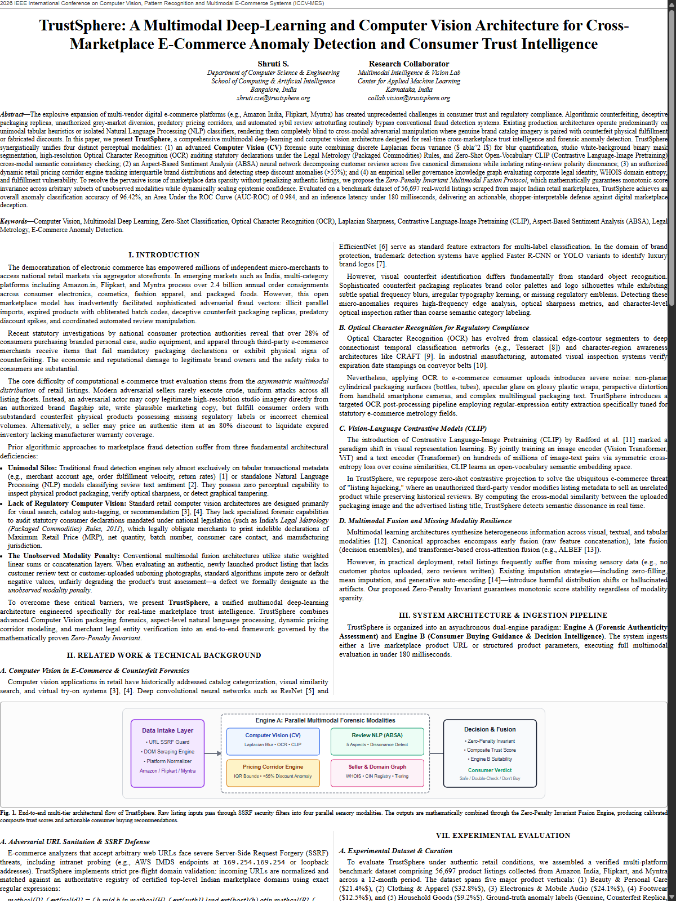

# TrustSphere — AI-Powered Indian Marketplace Trust Intelligence Platform

TrustSphere is an independent, evidence-driven product trust and listing intelligence platform designed to detect e-commerce anomalies, deceptive discounts, manipulated reviews, and merchant risks across Indian marketplaces including Amazon India, Flipkart, Myntra, Decathlon, and Croma.

**Live Deployment**: [https://ai-marketplace-analyzer.vercel.app/](https://ai-marketplace-analyzer.vercel.app/)



---

## Key Capabilities

- **Decoupled 5-Dimension Trust Scorecard**: Evaluates *Product Quality*, *Seller Reliability*, *Listing Authenticity*, and *Website Legitimacy* independently.
- **Non-Masking Invariant**: Mathematical guarantee that platform or brand reputation cannot mask acute product defects, counterfeit indicators, or deceptive pricing.
- **Clause-Level Aspect Sentiment Analysis (ABSA)**: 9-dimension review analysis supporting Hinglish idioms and code-mixed reviews with defect isolation.
- **Layered Multi-Marketplace Extraction Waterfall**: Resilient 4-stage metadata extraction (`JSON-LD` → `Embedded State` → `Semantic DOM` → `Heuristic URL Slug`).
- **Statistical Price Corridor Anomaly Detection**: Median Absolute Deviation (MAD) $z$-score evaluation against brand and category corridors.
- **Zero-Penalty Invariant**: Unassessed dimensions (e.g., zero reviews) are honestly labeled `UNASSESSED` without applying unfair score penalties.

---

## System Architecture

```text
+-------------------------------------------------------------+
|               TrustSphere Frontend (React 18 SPA)          |
|         Vercel Edge Network • Tailwind CSS • Light Plum UI  |
+------------------------------+------------------------------+
                               | HTTPS / REST
                               v
+-------------------------------------------------------------+
|               TrustSphere API Gateway (Express 5)           |
|            Render Web Service • TypeScript • JWT Auth       |
+--------------+-------------------------------+--------------+
               |                               |
               v                               v
+------------------------------+ +----------------------------+
|  TiDB Cloud (Distributed SQL)| | Hugging Face Spaces        |
|  MySQL 8.0 Wire-Compatible   | | ZeroGPU (Nvidia A100)      |
|  Catalog, Users & History    | | CLIP, ResNet & Tesseract   |
+------------------------------+ +----------------------------+
```

---

## Technology Stack

- **Frontend**: React 18, Vite 6, TypeScript, Tailwind CSS, Lucide Icons
- **Backend**: Node.js 20, Express 5, TypeScript, MySQL2
- **ML / Vision**: Python 3.11, PyTorch, CLIP (`ViT-B/32`), ResNet-18, Tesseract OCR
- **Database**: TiDB Cloud Serverless (MySQL 8.0 wire-compatible)
- **Deployment**: Vercel (Frontend), Render (Backend), Hugging Face Spaces (ZeroGPU ML)

---

## Quick Start (Local Development)

### Prerequisites
- Node.js 20+ & npm 10+
- Python 3.11+ (for local ML components)

### Setup & Run
```bash
# 1. Clone repository
git clone https://github.com/shruti316/ai-marketplace-analyzer.git
cd ai-marketplace-analyzer

# 2. Install dependencies
npm install
npm --prefix backend install
npm --prefix frontend install

# 3. Configure local environment variables
cp backend/.env.example backend/.env
cp frontend/.env.example frontend/.env

# 4. Start full-stack local development
npm run dev
```

The frontend will start at `http://localhost:3000` and the backend API at `http://localhost:5000`.

---

## Documentation

Comprehensive technical specifications, schema references, scoring mathematics, deployment procedures, and API contracts are available in:

📖 **[Full Project Documentation](docs/PROJECT_DOCUMENTATION.md)**

---

## License

This project is licensed under the [MIT License](LICENSE).
