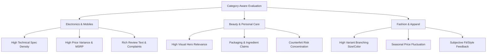

# Marketplace Trust Evidence Dataset v1.0 — Independent Evaluation Benchmarks & Assessment Strategy

**Project:** AI-Powered Marketplace Trust Intelligence Platform  
**Dataset Release:** `Marketplace Trust Evidence Dataset v1.0`  
**Execution Date:** 2026-11-03  
**Auditor:** Senior Data Quality Auditor & Multimodal ML Architect  

---

## 1. Executive Summary

This report establishes the evaluation architecture for the AI-Powered Marketplace Trust Intelligence Platform. Real-world e-commerce datasets inherently suffer from a lack of verified fraud ground truth. To prevent circular reasoning and overfitting, our architecture isolates independent ground-truth evaluation benchmarks in **Tier C** (`collections/isolated_benchmarks/`) while defining domain-specific assessment protocols for the primary marketplace dataset.

---

## 2. Independent Evaluation Benchmarks (Tier C)

| Benchmark Corpus | Domain | Records | Labels / Targets | Evaluation Role |
|---|---|---|---|---|
| **Ott et al. Deceptive Spam** (`deceptive_opinion_spam.parquet`) | Hotel Reviews (Turker crowdsourced) | 1,600 | Binary: 800 Deceptive, 800 Truthful | Calibrating NLP text deception classifiers |
| **E-Commerce Fake Reviews** (`ecommerce_fake_reviews.parquet`) | E-Commerce Reviews | 40,526 | Binary: `CG` (Computer Generated) vs `OR` (Original) | Evaluating LLM-generated fake review detection |
| **Synthetic Stress Test Suite** (`synthetic_stress_test_cases.parquet`) | Multimodal Marketplace | 5 | Edge cases: extreme lengths, nulls, corrupt images | Adversarial pipeline boundary verification |

### 2.1 Ott et al. Deceptive Opinion Spam Benchmark
- **Provenance:** Cornell University (Ott et al., ACL 2011).
- **Structure:** 1,600 balanced English reviews across 20 Chicago hotels (400 truthful positive, 400 deceptive positive, 400 truthful negative, 400 deceptive negative).
- **Benchmark Value:** Provides an unambiguous, verified ground-truth dataset where deceptive text was explicitly commissioned and truthful reviews originated from genuine TripAdvisor / Yelp guests.
- **Limitation:** Hotel review domain vocabulary differs from consumer electronics and beauty e-commerce. It must be used for calibration, not as an Indian e-commerce substitute.

### 2.2 E-Commerce Fake Reviews Benchmark
- **Structure:** 40,526 review texts balanced between organic consumer reviews and computer-generated synthetic text.
- **Benchmark Value:** Directly evaluates whether NLP models can distinguish synthetic text artifacts, repeated phrasing, and stylistic perplexity anomalies in e-commerce contexts.
- **Limitation:** Isolated from catalog entity relationships; does not incorporate price or image modalities.

### 2.3 Synthetic Adversarial Stress Test Cases
Five hand-crafted edge cases designed to test pipeline fault tolerance:
1. `STRESS_001`: Zero-byte image with extreme negative price (-₹99.00).
2. `STRESS_002`: 10,000-character review text with repeated Unicode emojis.
3. `STRESS_003`: 1x1 pixel image with luxury price (₹999,999.00).
4. `STRESS_004`: Complete null attribute payload.
5. `STRESS_005`: SQL / script injection payload in product title and description.

---

## 3. Category-Aware Evaluation Strategy

The dataset spans multiple distinct product verticals that cannot be evaluated with a monolithic model:

### Key Differences Across Verticals
1. **Electronics (Flipkart, BestBuy):**
   - Pricing models must account for technical specifications (RAM, storage, processor generation).
   - Review anomalies frequently center on refurbished / opened-box claims.
2. **Beauty & Personal Care (Amazon India, Amazon US):**
   - Visual consistency (packaging, batch numbers, seals) is paramount.
   - Text anomalies center on skin reactions, texture, and scent consistency.
3. **Fashion & Apparel (Myntra):**
   - Low review density; relies heavily on variant structure and brand identity.

---

## 4. Evaluation Metrics by Intelligence Module

| Intelligence Module | Primary Evaluation Metric | Secondary Metric | Evaluation Dataset |
|---|---|---|---|
| **NLP Review Intelligence** | Macro F1-Score & ROC-AUC | Perplexity & Semantic Coherence | Deceptive Spam + Fake Reviews Benchmark |
| **Vision Intelligence** | Perceptual Recall & Precision | L2 Embedding Distance Stability | Canonical Images + Duplicate Manifest |
| **Pricing Intelligence** | Outlier Precision @ K ($K=50$) | False Positive Rate on Normal Cohorts | Price Observations Table |
| **Graph Intelligence** | Edge Prediction AUC | Graph Modularity / Cluster Purity | Entity Relationships Graph |
| **Multimodal Fusion Engine** | Brier Score & Calibration Error | Spearman Rank Correlation with Evidence | Tier A Complete Multimodal Core |

---

## 5. Recommended Train / Validation / Test Partitioning

For future AI model development on Tier A and Tier B, the following leakage-free split protocol is mandated:
1. **Partition by Product ID (GroupKFold):**
   - Never split reviews or images of the same `canonical_product_id` across train and test sets.
2. **Standard Ratios:**
   - **Training Set (70%):** 4,230 products (2,550 Indian, 1,680 Supplementary).
   - **Validation Set (15%):** 906 products (546 Indian, 360 Supplementary).
   - **Test Set (15%):** 907 products (547 Indian, 360 Supplementary).
3. **Tier A Allocation:**
   - 70 products in Train, 15 in Validation, 15 in Test.

---

## 6. Summary Conclusion

The evaluation architecture combines independent ground-truth text benchmarks with category-specific evaluation splits, ensuring that future trust models are measured against rigorous, unbiased standards.
