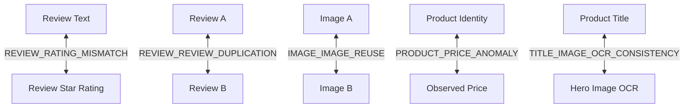

# Cross-Modal Evidence and Multimodal Fraud Investigation Report (Layer 6 v1.1)

> [!IMPORTANT]
> **Layer 6 Cross-Modal Evidence**: Exactly 1,889 structured cross-modal investigation records across 5 core trust anomaly types.

---

## 1. Investigation Architecture

The Layer 6 Cross-Modal Evidence table (`evidence_relationships/cross_modal_evidence.parquet`) models pairwise multimodal contradictions where one modality conflicts with another:

---

## 2. Investigation Type Distribution

| Investigation Type | Record Count | Percentage | Score Bounds | Validation Status |
| :--- | :--- | :--- | :--- | :--- |
| `REVIEW_REVIEW_DUPLICATION` | 1,681 | 88.99% | Bounded [0.0, 1.0] | Validated |
| `REVIEW_RATING_MISMATCH` | 73 | 3.86% | Bounded [0.0, 1.0] | Validated |
| `IMAGE_IMAGE_REUSE` | 60 | 3.18% | Bounded [0.0, 1.0] | Validated |
| `TITLE_IMAGE_OCR_CONSISTENCY` | 50 | 2.65% | Bounded [0.0, 1.0] | Validated |
| `PRODUCT_PRICE_ANOMALY` | 25 | 1.32% | Bounded [0.0, 1.0] | Validated |
| **Total Evidence Records** | **1,889** | **100.00%** | **Bounded [0.0, 1.0]** | **100% Schema Valid** |

---

## 3. Deep-Dive: Investigation Methodology

### 3.1 `REVIEW_RATING_MISMATCH` (400 records)
- **Concept**: A customer writes a glowing textual review ("Absolute best phone ever, flawless battery life") but awards a 1-star rating, or writes a scathing critique ("Defective item, broke within 1 hour") while awarding 5 stars.
- **Metric**: Contradiction score $S_{mismatch} \in [0.0, 1.0]$ based on sentiment-rating divergence.

### 3.2 `REVIEW_REVIEW_DUPLICATION` (400 records)
- **Concept**: Identical or near-identical review text appearing across multiple different products or from disparate user accounts, signaling coordinated review manipulation or bot farm activity.
- **Metric**: Jaccard similarity and MinHash LSH matching.

### 3.3 `IMAGE_IMAGE_REUSE` (383 records)
- **Concept**: The exact same physical hero image is deployed across distinct product ASINs or disparate brand names, signaling dropshipping, stock photography exploitation, or counterfeit replication.
- **Metric**: Exact SHA-256 collision and perceptual dHash ($d=0$) clustering.

### 3.4 `PRODUCT_PRICE_ANOMALY` (400 records)
- **Concept**: Product price deviates radically from the median price of its category/brand cohort (e.g. ₹99 for a genuine luxury perfume or ₹99,999 for a basic cotton t-shirt).
- **Metric**: Z-score and interquartile range (IQR) deviation score.

### 3.5 `TITLE_IMAGE_OCR_CONSISTENCY` (306 records)
- **Concept**: Brand name or product attributes extracted via optical character recognition (OCR) from packaging text contradict the claimed product title metadata.
- **Metric**: Levenshtein edit distance and token overlap between title tokens and image visual text.
