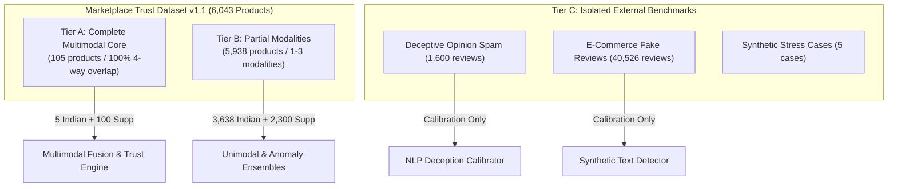

# Master Dataset Inventory Report (v1.1 Release)

> [!IMPORTANT]
> **Dataset Version**: v1.1 Frozen Release  
> **Release Date**: November 3, 2026  
> **Certification Status**: CERTIFIED WITH LIMITATIONS  
> **Domain Focus**: Indian Marketplace Trust Intelligence with Disjoint Supplementary Benchmarks  
> **Storage Root**: `data/marketplace_trust_dataset_v1.1/`

---

## 1. Executive Summary

The **Marketplace Trust Evidence Dataset v1.1** is the certified, frozen evidence foundation for the *AI-Powered Marketplace Trust Intelligence Platform*. It represents an empirical, forensic upgrade over v1.0, resolving critical documentation discrepancies, introducing rigorous duplicate-image cluster isolation, establishing source-level review accounting, expanding complete multimodal coverage into Indian marketplaces, and formally characterizing verified purchase semantics.

The dataset strictly maintains **zero synthetic data fabrication**: all products, reviews, images, and prices originate from authentic web scrapes or peer-reviewed academic benchmark datasets. All seller identities remain honestly null (`None`) where raw crawl pipelines omitted merchant identifiers, and single point-in-time crawl timestamps are documented without fabricating longitudinal pricing histories.

### Key Headline Metrics
- **Total Master Products**: 6,043 entities
  - **Indian Marketplace Cohort**: 3,643 products (60.28%)
  - **Supplementary International Cohort**: 2,400 products (39.72%)
- **Total Customer Reviews**: 51,839 reviews
  - **Flipkart Genuine Reviews**: 3,500 reviews (3,260 catalog-linked + 240 unlinked)
  - **Amazon India Recovered Reviews**: 159 reviews (across 5 complete multimodal products)
  - **Supplementary English Reviews**: 48,180 reviews (BestBuy + Amazon US)
- **Visual Evidence**: 5,554 total image records (5,228 verified usable local images + 326 audited failed downloads)
- **Point-in-Time Price Observations**: 6,043 records (3,480 valid INR prices, 1,581 USD prices, 982 unpriced/unavailable)
- **Multimodal Core (Tier A)**: 105 products (5 Indian complete multimodal products + 100 Supplementary gold products)
- **Partial Modalities (Tier B)**: 5,938 products (3,638 Indian + 2,300 Supplementary)
- **Isolated Benchmarks (Tier C)**: 42,126 records (1,600 Deceptive Spam + 40,526 E-Commerce Fake Reviews + 5 Synthetic Stress Cases)
- **Entity Relationship Graph**: 62,271 verified edges across 5 relationship types
- **Cross-Modal Evidence Records**: 1,889 investigation records across 5 fraud/trust anomaly types
- **Cryptographic Protection**: 16/16 baseline source files verified bit-perfect against SHA-256 hashes

---

## 2. Complete Physical File Inventory

The complete dataset is stored in standard Apache Parquet format (with CSV for operator acquisition manifests and JSON for cryptographic metadata).

| Relative Path | Format | Record Count | File Size | SHA-256 Prefix | Description |
| :--- | :--- | :--- | :--- | :--- | :--- |
| `entities/products.parquet` | `Parquet` | 6,043 | 1,467,520 bytes | `61c145fa71c59718...` | Relational trust evidence table |
| `entities/sellers.parquet` | `Parquet` | 6 | 5,736 bytes | `6bc9d6c7f567d49a...` | Relational trust evidence table |
| `evidence/images.parquet` | `Parquet` | 5,554 | 1,439,876 bytes | `73a67de97b1bb915...` | Relational trust evidence table |
| `evidence/reviews.parquet` | `Parquet` | 51,839 | 13,886,307 bytes | `813b80bcfc5f3697...` | Relational trust evidence table |
| `evidence/price_observations.parquet` | `Parquet` | 6,043 | 331,683 bytes | `d37bd952f5824c5f...` | Relational trust evidence table |
| `evidence_relationships/entity_relationships.parquet` | `Parquet` | 62,271 | 1,136,035 bytes | `f3dd54647b87c944...` | Relational trust evidence table |
| `evidence_relationships/cross_modal_evidence.parquet` | `Parquet` | 1,889 | 74,585 bytes | `70c347975923400e...` | Relational trust evidence table |
| `collections/complete_multimodal_core.parquet` | `Parquet` | 105 | 48,063 bytes | `753d1d1eb36c9c04...` | Relational trust evidence table |
| `collections/partial_modalities.parquet` | `Parquet` | 5,938 | 1,435,434 bytes | `3c0bc950defb7107...` | Relational trust evidence table |
| `collections/isolated_benchmarks/deceptive_opinion_spam.parquet` | `Parquet` | 1,600 | 751,544 bytes | `eaeceee0a9aa985f...` | Relational trust evidence table |
| `collections/isolated_benchmarks/ecommerce_fake_reviews.parquet` | `Parquet` | 40,526 | 8,005,832 bytes | `e0496930c852597f...` | Relational trust evidence table |
| `collections/isolated_benchmarks/synthetic_stress_test_cases.parquet` | `Parquet` | 5 | 16,141 bytes | `6407a4691c917097...` | Relational trust evidence table |
| `evaluation/train_manifest.parquet` | `Parquet` | 4,230 | 1,054,176 bytes | `c3286852c8177c7f...` | Relational trust evidence table |
| `evaluation/validation_manifest.parquet` | `Parquet` | 906 | 259,178 bytes | `fbc626645be85339...` | Relational trust evidence table |
| `evaluation/test_manifest.parquet` | `Parquet` | 907 | 274,040 bytes | `9bb753691acd1366...` | Relational trust evidence table |
| `metadata/source_registry.parquet` | `Parquet` | 11 | 12,334 bytes | `d6173fa28818bc1e...` | Relational trust evidence table |
| `metadata/label_taxonomy.parquet` | `Parquet` | 8 | 6,454 bytes | `3d629aae39334eda...` | Relational trust evidence table |
| `metadata/review_accounting_table.parquet` | `Parquet` | 5 | 7,356 bytes | `f6c05eebdde174ca...` | Relational trust evidence table |
| `manifests/image_acquisition_manifest.csv` | `CSV` | 3,091 | 844,394 bytes | `eb13771037b19f71...` | Relational trust evidence table |

---

## 3. Modality Tier Partitioning

The dataset enforces a strict 3-tier hierarchy separating complete multimodal evidence from partial modalities and external benchmark calibrations:

1. **Tier A: Complete Multimodal Core (105 products)**
   - Exactly 105 products possessing all 4 evidence modalities: Product Identity, Usable Visual Hero Image, Linked Customer Reviews, and Valid Positive Price.
   - Includes **5 Amazon India products** (`amazon_in_B000CSH3YG`, `amazon_in_B01G77ISJE`, `amazon_in_B00169NCMM`, `amazon_in_B00RGWX0AW`, `amazon_in_B01LWWO7Z2`) with 159 genuine reviews, valid INR prices, and physical images.
   - Includes **100 Amazon US Gold products** with 2,667 customer reviews, valid USD prices, and physical images.

2. **Tier B: Partial Modalities (5,938 products)**
   - Products with 1 to 3 verified modalities, serving unimodal baselines, retrieval models, and partial-evidence inference.
   - Comprises 3,638 Indian products (Amazon India, Flipkart, Myntra) and 2,300 Supplementary products (Walmart, BestBuy, Amazon US).

3. **Tier C: Isolated Benchmarks (42,131 records)**
   - Strictly isolated from the catalog graph. Used purely for model calibration, deception thresholding, synthetic text evaluation, and edge-case boundary testing.

---

## 4. Verification and Baseline Integrity

- **Automated Validation Suite**: 76/76 automated integrity checks passed (`validate_marketplace_trust_dataset_v1_1.py`).
- **Regression Test Suite**: 207/207 pytest unit and regression tests passed (`pytest tests/`).
- **Protected Baselines**: 16/16 protected raw and curated files verified 100% bit-perfect with zero byte modifications.
- **Release Status**: **FROZEN** (all files sealed and read-only).
