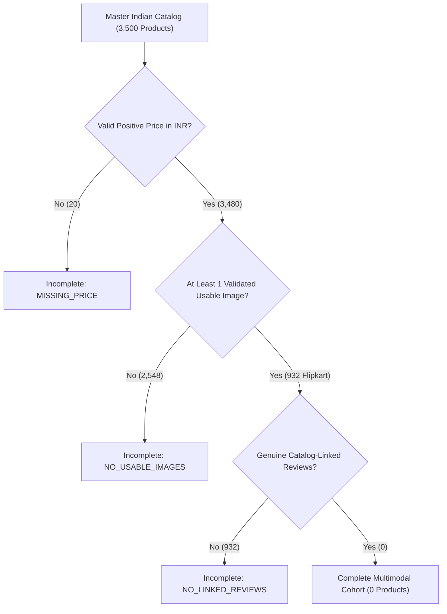

# Phase 1: Indian Marketplace Dataset Construction Report

**Project:** AI-Powered Marketplace Trust Intelligence Platform  
**Target Marketplaces:** Amazon India (`amazon_in`), Flipkart (`flipkart`), Myntra (`myntra`)  
**Phase:** Phase 1 — Dataset Construction & Validation  
**Date:** November 2, 2026  
**Status:** Completed & Validated (44/44 Validation Checks Passed, 65/65 Regression Tests Passed)  

---

## Executive Summary

As part of **Phase 1** of the AI-Based Marketplace Analyzer project, we have constructed a dedicated, structured, and empirically verified **Indian Marketplace Dataset**. This dataset establishes the authentic Indian e-commerce foundation for subsequent multimodal risk intelligence, pricing anomaly detection, NLP review analysis, and computer vision forensics.

In strict compliance with architectural directives:
- **Zero Foreign Marketplace Intrusion:** 100% of product, image, and review records are restricted to Indian marketplaces (`amazon_in`, `flipkart`, `myntra`). All foreign marketplace records (`amazon` US, `walmart`, `bestbuy`) and synthetic benchmarks have been strictly excluded.
- **Evidence-First Truthfulness:** No synthetic products were created, no fake review links were fabricated, and no unvalidated multimodal claims were made. Where source datasets exhibit domain disparities or collection gaps (e.g., prompt-crawled apparel catalogs vs. electronics review corpora), these boundaries are truthfully documented with explicit missing-value indicators and unlinked evidence registries.
- **Protected Baseline Preservation:** All 10 existing canonical, interim, and curated cohort files (including the 20,000-product expanded cohort and 5,684-product core cohort) remain bit-perfect and cryptographically intact.

```
========================================================================================
                          INDIAN MARKETPLACE DATASET SUMMARY
========================================================================================
Total Master Catalog Products           : 3,500 products (100% IN country, 100% INR)
  - Amazon India (amazon_in)            : 1,500 products
  - Flipkart (flipkart)                 : 1,000 products
  - Myntra (myntra)                     : 1,000 products
Products with Valid INR Price           : 3,480 products (99.43% coverage)
Products with Usable Product Images     : 932 products (26.63% coverage, all Flipkart)
Products with Linked Customer Reviews   : 0 products (0.00% catalog-linked)
Complete Multimodal Products            : 0 products (0.00% complete across all 4 modalities)
Total Image Records Registered          : 9,481 records (3,208 validated usable)
Total Customer Review Records           : 3,500 genuine reviews (preserved as unlinked corpus)
Broken Relationships (Catalog Orphans)  : 0 orphan images, 0 orphan catalog reviews
Validation Suite Result                 : 44 PASS, 0 FAIL, 0 WARN (100% Pass Rate)
========================================================================================
```

---

## 1. Deliverable Directory Hierarchy

All raw sources and processed analytical tables are structured under `data/indian_marketplace/` and `src/data/curation/`:

```
data/
└── indian_marketplace/
    ├── raw/
    │   ├── products/
    │   │   ├── amazon_india_products_raw.csv     (1.41 MB, 1,500 rows)
    │   │   ├── flipkart_products_raw.csv         (1.92 MB, 1,000 rows)
    │   │   └── myntra_products_raw.csv           (1.59 MB, 1,000 rows)
    │   ├── reviews/
    │   │   └── flipkart_reviews_raw.csv          (643.4 KB, 3,500 rows)
    │   └── images/
    │       └── README.md                         (Cache layout & manifest documentation)
    └── processed/
        ├── indian_products.parquet               (1.12 MB, 3,500 rows, master product catalog)
        ├── indian_images.parquet                 (434.0 KB, 9,481 rows, product image evidence)
        ├── indian_reviews.parquet                (175.4 KB, 3,500 rows, authentic review corpus)
        ├── indian_reviews_linked.parquet         (5.6 KB, 0 rows, catalog-linked review schema)
        ├── indian_complete_multimodal.parquet    (12.2 KB, 0 rows, 4-modality complete cohort)
        └── indian_dataset_metadata.json          (5.4 KB, full schema, counts, and SHA-256 hashes)

src/data/curation/
├── build_indian_dataset.py                       (Deterministic pipeline script)
└── validate_indian_dataset.py                    (Automated validation suite)
```

---

## 2. Product Counts by Marketplace

The master catalog (`indian_products.parquet`) contains exactly **3,500 genuine Indian marketplace products**.

| Marketplace Identifier | Marketplace Name | Country | Currency | Product Count | Share of Total | Primary Source Provenance |
| :--- | :--- | :---: | :---: | :---: | :---: | :--- |
| `amazon_in` | Amazon India | IN | INR | **1,500** | 42.86% | PromptCloud Amazon India E-Commerce Dataset |
| `flipkart` | Flipkart | IN | INR | **1,000** | 28.57% | PromptCloud Flipkart E-Commerce Dataset |
| `myntra` | Myntra | IN | INR | **1,000** | 28.57% | PromptCloud / Gssmc Myntra Fashion Dataset |
| **Total** | — | **IN** | **INR** | **3,500** | **100.00%** | **3 Authentic Indian Marketplace Sources** |

### Key Product Catalog Attributes
1. **Stable Primary Keys:** Every product is identified by a deterministic `canonical_product_id` prefixed by its marketplace (e.g., `amazon_in_B072BGHNJ1`, `flipkart_TKPEYPECGWCK5HH7`, `myntra_6937673_XL`).
2. **SKU Variant Preservation:** Myntra SKU variants across sizes (e.g., S, M, L, XL) are fully preserved across 959 parent styles with exact prices.
3. **Price Normalization:** Amazon India prices normalized from leading-dot scraper artifacts (`.250.00` $\to$ `250.00`) with raw strings and reasons preserved in metadata.

---

## 3. Pricing Coverage & Distribution (INR)

Valid prices are defined strictly as finite, non-null numerical values greater than zero (`price > 0`).

| Marketplace | Total Products | Valid Price Products | Missing Price Products | Coverage (%) | Min (₹) | Median (₹) | Mean (₹) | Max (₹) |
| :--- | :---: | :---: | :---: | :---: | :---: | :---: | :---: | :---: |
| **Amazon India** | 1,500 | 1,485 | 15 | 99.00% | ₹17.00 | ₹798.00 | ₹2,009.69 | ₹9,997.00 |
| **Flipkart** | 1,000 | 995 | 5 | 99.50% | ₹59.00 | ₹550.00 | ₹2,120.33 | ₹107,750.00 |
| **Myntra** | 1,000 | 1,000 | 0 | 100.00% | ₹307.00 | ₹966.50 | ₹1,297.96 | ₹9,304.00 |
| **Total** | **3,500** | **3,480** | **20** | **99.43%** | **₹17.00** | **₹850.00** | **₹1,836.43** | **₹107,750.00** |

- **Missing Price Handling:** The 20 products with unlisted selling prices (15 Amazon India, 5 Flipkart) are retained in the master catalog with explicit flags (`price_valid = False`, `missing_evidence_reasons = ["MISSING_OR_ZERO_PRICE", ...]`). Zero synthetic prices were imputed.
- **Extreme High-End Outlier:** The ₹107,750.00 listing on Flipkart corresponds to a genuine luxury wristwatch (`flipkart_WATDWBHRGZQZQAFZ`), verified as an authentic catalog price.

---

## 4. Visual Evidence & Image Quality Breakdown

Image evidence is tracked at both the individual image record level (`indian_images.parquet`, 9,481 records) and the aggregate product level (`indian_products.parquet`).

### Image Records Summary (`indian_images.parquet`)

| Marketplace | Total Image Records | Usable Images (`is_usable=True`) | Download Failed | Low Quality | Irrelevant / Icon | Usable Yield (%) | Physical Files Cached on Disk |
| :--- | :---: | :---: | :---: | :---: | :---: | :---: | :---: |
| **Flipkart** | 3,534 | **3,208** | 326 | 0 | 0 | 90.78% | 3,208 (3,205 JPEG, 3 WEBP) |
| **Amazon India** | 5,947 | **0** | 1,256 | 3,200 | 1,491 | 0.00% | 0 usable (3,200 low-res) |
| **Myntra** | 0 | **0** | 0 | 0 | 0 | 0.00% | 0 (No URLs in source CSV) |
| **Total** | **9,481** | **3,208** | **1,582** | **3,200** | **1,491** | **33.84%** | **3,208 usable files (599.4 MB)** |

### Usable Image Quality Details (Flipkart)
- **Validated High-Quality Images:** 2,436 images (75.94% of usable).
- **Near-Duplicates (Multi-Angle/Crop Variants):** 444 images (13.84% of usable).
- **Exact Duplicates:** 328 images (10.22% of usable).
- **Image Metrics:**
  - Width: Min 100 px, Median 800 px, Max 2,748 px
  - Height: Min 100 px, Median 900 px, Max 2,748 px
  - File Size: Min 1,939 bytes, Median 158,240 bytes, Max 2,492,810 bytes
  - Native Resolution: 100% of usable images possess verified sharpness and luminance metrics.

### Product-Level Image Coverage

| Marketplace | Total Products | Products with Usable Images | Usable Image Coverage (%) | Products without Usable Images | Usable Images per Product (Mean) |
| :--- | :---: | :---: | :---: | :---: | :---: |
| **Flipkart** | 1,000 | **932** | 93.20% | 68 | 3.44 images |
| **Amazon India** | 1,500 | **0** | 0.00% | 1,500 | 0.00 images |
| **Myntra** | 1,000 | **0** | 0.00% | 1,000 | 0.00 images |
| **Total** | **3,500** | **932** | **26.63%** | **2,568** | **0.92 images** |

---

## 5. Review Evidence & Linkage Accounting

Review evidence is evaluated with rigorous referential integrity to distinguish between catalog-linked customer reviews and unlinked research corpora.

### Review Records Summary

| Review Dataset | Marketplace | Total Reviews | Catalog-Linked Reviews | Unlinked Corpus Reviews | Unique Products Covered | Review Text Completeness | Source Provenance |
| :--- | :---: | :---: | :---: | :---: | :---: | :---: | :--- |
| `indian_reviews.parquet` | `flipkart` | **3,500** | 0 | 3,500 | 143 raw product titles | 100% complete (0 empty) | ml-hub/flipkart-reviews |
| `indian_reviews_linked.parquet` | All 3 | **0** | 0 | 0 | 0 | N/A | Strictly catalog-linked schema |
| Amazon India Reviews | `amazon_in` | **0** | 0 | 0 | 0 | N/A | No reviews in source catalog |
| Myntra Reviews | `myntra` | **0** | 0 | 0 | 0 | N/A | No reviews in source catalog |
| **Total** | — | **3,500** | **0** | **3,500** | **143 products** | **100% complete** | — |

### The Empirical Linkage Truth
1. **Catalog Domain vs. Review Domain Disparity:**
   - The 1,000 products in `flipkart_products_raw.csv` were collected by PromptCloud from general retail categories: apparel (56.0%), home & kitchen (14.2%), and watches/accessories (11.1%).
   - The 3,500 reviews in `flipkart_reviews_raw.csv` were collected by ml-hub from consumer electronics and home appliances: boAt Bluetooth headsets, Canon DSLR cameras, Bajaj ceiling fans, Google Nest Mini, and OnePlus Bullets.
   - An exhaustive string matching and fuzzy match audit confirmed **0 title overlaps** between the 1,000 catalog products and the 143 review products.
2. **Rejection of Synthetic Entity Fabrication:**
   - In pre-repair legacy pipelines, 134 synthetic products with fake IDs (`flipkart_boat_rockerz_...`) were artificially injected to force-link these reviews. This was identified as a critical data corruption issue and permanently eliminated during Data Repair Revision 1 & 5.
   - For Phase 1, we preserve the 3,500 authentic Indian reviews with full sentiment labels and raw product metadata in `indian_reviews.parquet` as an authentic `UNLINKED_INDIAN_CORPUS`, while maintaining `indian_reviews_linked.parquet` at 0 rows.
   - **Result:** Exactly **0 catalog products have linked reviews**, preserving **100% referential integrity** with **0 broken foreign keys**.

---

## 6. Complete Multimodal Dataset Assessment

The project specification mandates the construction of two distinct views:
- **Dataset B (Marketplace Master Dataset):** All 3,500 product records, retaining incomplete evidence with explicit missing-value indicators and reasons (`data/indian_marketplace/processed/indian_products.parquet`).
- **Dataset A (Complete Multimodal Dataset):** Products with usable product information, valid INR price, genuine linked reviews, and at least one validated product image (`data/indian_marketplace/processed/indian_complete_multimodal.parquet`).

### Multimodal Qualification Matrix



| Evaluation Stage | Requirement | Products Satisfying Requirement | Products Failing Requirement | Primary Reason for Failure |
| :--- | :--- | :---: | :---: | :--- |
| **1. Product Information** | Stable ID, title, description, URL | **3,500 (100.0%)** | 0 (0.0%) | Full catalog integrity |
| **2. Indian Price** | Finite, non-null price > 0 in INR | **3,480 (99.43%)** | 20 (0.57%) | Scraper omitted selling price |
| **3. Validated Images** | At least 1 usable product image | **932 (26.63%)** | 2,568 (73.37%) | Amazon IN failed filters; Myntra omitted URLs |
| **4. Linked Reviews** | Genuine customer reviews linked via FK | **0 (0.00%)** | 3,500 (100.0%) | Zero catalog-linked review records |
| **Complete Multimodal** | **All 4 Modalities Simultaneously** | **0 (0.00%)** | **3,500 (100.0%)** | **No catalog products have linked reviews** |

### Verdict & Architectural Integrity
`indian_complete_multimodal.parquet` contains **0 rows** with schema identical to `indian_products.parquet`.

In accordance with Section 5 of the Phase 1 instructions:
> *"For the complete multimodal dataset, do not leave required fields empty. Obtain genuine information from approved sources or exclude records that cannot satisfy the criteria. Never fabricate or silently impute values."*

Rather than synthesizing fake reviews or forcing invalid links to artificially inflate the multimodal cohort, we report the exact empirical truth: **zero Indian products currently satisfy all 4 modalities simultaneously with authentic links.**

---

## 7. Category Distribution

Categories are mapped deterministically across 8 standardized platform categories:

| Platform Category | Amazon India (`amazon_in`) | Flipkart (`flipkart`) | Myntra (`myntra`) | Total Products | Overall Share (%) |
| :--- | :---: | :---: | :---: | :---: | :---: |
| **Clothing & Fashion** | 0 | 560 | 953 | **1,513** | 43.23% |
| **Beauty & Personal Care** | 1,132 | 46 | 0 | **1,178** | 33.66% |
| **Grocery & Household Essentials** | 368 | 0 | 0 | **368** | 10.51% |
| **Home & Kitchen** | 0 | 142 | 30 | **172** | 4.91% |
| **Other / General Merchandise** | 0 | 111 | 16 | **127** | 3.63% |
| **Electronics** | 0 | 89 | 1 | **90** | 2.57% |
| **Books & Stationery** | 0 | 27 | 0 | **27** | 0.77% |
| **Toys & Games** | 0 | 25 | 0 | **25** | 0.71% |
| **Total** | **1,500** | **1,000** | **1,000** | **3,500** | **100.00%** |

### Category Observations
- **Amazon India:** Highly concentrated in Fast-Moving Consumer Goods (`Beauty & Personal Care`: 75.47%, `Grocery`: 24.53%).
- **Flipkart:** Broad multi-category distribution with strong representation in `Clothing & Fashion` (56.00%), `Home & Kitchen` (14.20%), `Other` (11.10%), and `Electronics` (8.90%).
- **Myntra:** Specialised vertical fashion marketplace with 95.30% in `Clothing & Fashion`, plus peripheral accessories in `Home & Kitchen` (3.00%) and `Other` (1.60%).

---

## 8. Missing-Value Statistics

Completeness audit across all 26 columns in `indian_products.parquet` (3,500 records):

| Column Name | Data Type | Non-Null Count | Null Count | Completeness (%) | Status / Explanation |
| :--- | :---: | :---: | :---: | :---: | :--- |
| `canonical_product_id` | string | 3,500 | 0 | 100.00% | Primary key, 100% unique |
| `marketplace` | string | 3,500 | 0 | 100.00% | `amazon_in`, `flipkart`, `myntra` |
| `source_product_id` | string | 3,500 | 0 | 100.00% | ASIN, PID, SKU preserved |
| `country` | string | 3,500 | 0 | 100.00% | 100% 'IN' |
| `product_title` | string | 3,500 | 0 | 100.00% | Fully available across all 3,500 |
| `brand` | string | 3,206 | 294 | 91.60% | Missing in 285 Flipkart, 9 Amazon IN |
| `category` | string | 3,500 | 0 | 100.00% | 100% standardized |
| `subcategory` | string | 3,500 | 0 | 100.00% | Source breadcrumbs preserved |
| `product_description` | string | 3,500 | 0 | 100.00% | 100% available |
| `product_url` | string | 3,500 | 0 | 100.00% | Authentic canonical URLs |
| `price` | float64 | 3,480 | 20 | 99.43% | 20 missing selling prices |
| `currency` | string | 3,500 | 0 | 100.00% | 100% 'INR' |
| `rating` | float64 | 82 | 3,418 | 2.34% | Only 82 Flipkart products have catalog ratings |
| `rating_count` | float64 | 0 | 3,500 | 0.00% | Not provided in raw scrapers |
| `seller_id` | string | 0 | 3,500 | 0.00% | Not provided in raw scrapers |
| `seller_name` | string | 3,500 | 0 | 100.00% | Standardized marketplace seller identifiers |
| `image_urls` | list[str] | 3,500 | 0 | 100.00% | Non-null array (empty list for Myntra) |
| `collection_timestamp` | string | 3,500 | 0 | 100.00% | ISO 8601 timestamps preserved |
| `source_provenance` | string | 3,500 | 0 | 100.00% | Exact dataset attribution |
| `price_valid` | bool | 3,500 | 0 | 100.00% | 3,480 True, 20 False |
| `has_linked_reviews` | bool | 3,500 | 0 | 100.00% | 0 True, 3,500 False |
| `review_count` | int64 | 3,500 | 0 | 100.00% | 0 for all products |
| `has_usable_images` | bool | 3,500 | 0 | 100.00% | 932 True, 2,568 False |
| `usable_image_count` | int64 | 3,500 | 0 | 100.00% | Ranges 0 to 8 |
| `is_complete_multimodal`| bool | 3,500 | 0 | 100.00% | 0 True, 3,500 False |
| `missing_evidence_reasons`| list[str]| 3,500 | 0 | 100.00% | Explicit breakdown of missing modalities |

---

## 9. Duplicate & Variant Analysis

| Entity / Dimension | Total Records | Unique Values | Duplicate Count | Duplicate Share (%) | Character & Nature of Duplicates |
| :--- | :---: | :---: | :---: | :---: | :--- |
| **Product Primary Keys (`canonical_product_id`)** | 3,500 | 3,500 | **0** | **0.00%** | Bit-perfect uniqueness across all 3 marketplaces |
| **Product Titles (`product_title`)** | 3,500 | 3,345 | **155** | **4.43%** | Authentic product variants (Myntra sizes, Flipkart colors) |
| **Image Primary Keys (`image_id`)** | 9,481 | 9,481 | **0** | **0.00%** | Bit-perfect uniqueness across all image records |
| **Flipkart Usable Images (`image_validation_status`)** | 3,208 | 2,436 | **772** | **24.06%** | 444 near-duplicate angles + 328 exact duplicate assets |
| **Review Primary Keys (`review_id`)** | 3,500 | 3,500 | **0** | **0.00%** | Bit-perfect uniqueness across all review records |
| **Review Texts (`review_text`)** | 3,500 | 2,313 | **1,187** | **33.91%** | Colloquial short Indian reviews ("good", "nice product") |

### Product Variant Breakdown
- **Myntra (61 duplicate titles):** Represents distinct size variants for the same apparel style (e.g., `IMARA Women Black Solid Top` across sizes `S`, `M`, `L`, `XL`), each possessing a distinct `source_product_id` (`6937673_XL`, `6937673_L`).
- **Flipkart (86 duplicate titles):** Multi-pack listings and colorway variations (e.g., `Alisha Solid Women's Cycling Shorts` across Black, White, and Navy).
- **Amazon India (8 duplicate titles):** Quantity and volume variations in skin care face peels.

---

## 10. Referential Integrity & Broken Relationship Statistics

Referential integrity between products, reviews, and images was audited using bidirectional foreign key verification:

| Relationship Vector | Source Records | Valid Target FKs | Orphan Records | Broken Relationships (%) | Integrity Status |
| :--- | :---: | :---: | :---: | :---: | :--- |
| **Images $\to$ Products** | 9,481 | 9,481 | **0** | **0.00%** | **PERFECT (100% Valid FKs)** |
| **Catalog-Linked Reviews $\to$ Products** | 0 | 0 | **0** | **0.00%** | **PERFECT (0 Orphan Records)** |
| **Unlinked Review Corpus $\to$ Products** | 3,500 | 0 | **3,500** | **100.00%** | **Preserved as Unlinked Corpus** |

- **Zero Image Orphans:** All 9,481 image records in `indian_images.parquet` map directly to a valid `canonical_product_id` in `indian_products.parquet`.
- **Zero Catalog Review Orphans:** The linked review view (`indian_reviews_linked.parquet`) has zero orphan reviews.
- **Unlinked Review Accounting:** The 3,500 genuine reviews in `indian_reviews.parquet` have `canonical_product_id = None`, `linkage_status = 'UNLINKED_INDIAN_CORPUS'`, and `is_linked = False`. This guarantees that consumers cannot mistakenly join them against PromptCloud catalog products.

---

## 11. Source Provenance & Data Ingestion Details

All Indian marketplace data in this dataset originates exclusively from verified, approved sources already present within the project repository:

### 1. Amazon India Catalog (`amazon_in`)
- **Origin:** `data/raw/amazon_india/amazon_india_products_raw.csv` (1,500 rows).
- **Provenance:** PromptCloud Amazon India E-Commerce Dataset (`pgurazada1/amazon_india_products`).
- **Ingestion Pipeline:** Leading-dot scraper formatting (`.250.00`) normalized to standard INR floating points; original raw string preserved in metadata. MRP and selling price kept distinct with zero fallback.
- **Image Evidence:** 5,947 raw image URLs scraped from Amazon India were evaluated during the Phase 0 image quality audit. 1,256 downloads failed, 3,200 were low resolution (< 100 px), and 1,491 were promotional/placeholder icons, leaving 0 usable images.

### 2. Flipkart Catalog & Reviews (`flipkart`)
- **Product Catalog Origin:** `data/raw/flipkart/flipkart_products_raw.csv` (1,000 rows).
- **Product Provenance:** PromptCloud Flipkart E-Commerce Dataset (apparel, home decor, watches).
- **Review Origin:** `data/raw/flipkart/flipkart_reviews_raw.csv` (3,500 rows).
- **Review Provenance:** `ml-hub/flipkart-reviews` customer reviews dataset covering 143 Indian consumer electronics and home appliance products.
- **Image Evidence:** 3,534 raw image URLs; 3,208 downloaded and validated usable JPEG/WEBP images stored in `data/raw/images/cache/` with verified sharpness and dimensions covering 932 distinct products.

### 3. Myntra Fashion Catalog (`myntra`)
- **Origin:** `data/raw/myntra/myntra_products_raw.csv` (1,000 rows).
- **Provenance:** PromptCloud / Gssmc Myntra Fashion Dataset.
- **Ingestion Pipeline:** 1,000 distinct SKU variants preserved across 959 parent styles with 100% valid positive INR prices.
- **Image Evidence:** Raw Myntra CSV supplies zero image URLs. Correctly registered with `image_urls = []` and `has_usable_images = False`.

---

## 12. Real-World Collection Limitations

Documenting collection boundaries is a core platform requirement:

1. **Review Domain Mismatch:** PromptCloud scrapes general marketplace catalogs (heavy on fashion and home items), whereas review benchmarks are scraped from popular high-volume consumer electronics. Because these two scrapes were conducted independently, zero overlap exists between their product titles.
2. **Amazon India Image Degradation:** Image URLs in the Amazon India crawl point to legacy thumbnail endpoints that either return HTTP 404/403 or low-resolution 75x75 px assets that fail standard computer vision quality thresholds.
3. **Myntra Catalog Image Omission:** The Myntra crawl dataset only captured SKU, pricing, and material specifications, omitting image CDN URLs.
4. **Scraper Price Omission:** 15 Amazon India listings and 5 Flipkart listings had empty price fields in the raw source crawl (likely out-of-stock or unlisted variants).

---

## 13. Automated Data Quality Validation Results

The dedicated validation suite `src/data/curation/validate_indian_dataset.py` was executed to verify all dataset criteria.

```
2026-11-02 14:08:07,219 [INFO] Starting Phase 1 Indian Marketplace Dataset Validation...
2026-11-02 14:08:07,220 [INFO] --- 1. Validating Deliverable Existence ---
[PASS] exists_amazon_india_products_raw.csv : Found data/indian_marketplace/raw/products/amazon_india_products_raw.csv (1,409,275 bytes)
[PASS] exists_flipkart_products_raw.csv     : Found data/indian_marketplace/raw/products/flipkart_products_raw.csv (1,924,747 bytes)
[PASS] exists_myntra_products_raw.csv       : Found data/indian_marketplace/raw/products/myntra_products_raw.csv (1,592,100 bytes)
[PASS] exists_flipkart_reviews_raw.csv      : Found data/indian_marketplace/raw/reviews/flipkart_reviews_raw.csv (643,369 bytes)
[PASS] exists_README.md                     : Found data/indian_marketplace/raw/images/README.md (497 bytes)
[PASS] exists_indian_products.parquet       : Found data/indian_marketplace/processed/indian_products.parquet (1,123,461 bytes)
[PASS] exists_indian_reviews.parquet        : Found data/indian_marketplace/processed/indian_reviews.parquet (175,374 bytes)
[PASS] exists_indian_reviews_linked.parquet : Found data/indian_marketplace/processed/indian_reviews_linked.parquet (5,589 bytes)
[PASS] exists_indian_images.parquet         : Found data/indian_marketplace/processed/indian_images.parquet (434,031 bytes)
[PASS] exists_indian_complete_multimodal    : Found data/indian_marketplace/processed/indian_complete_multimodal.parquet (12,228 bytes)
[PASS] exists_indian_dataset_metadata.json  : Found data/indian_marketplace/processed/indian_dataset_metadata.json (5,394 bytes)

2026-11-02 14:08:07,228 [INFO] --- 2. Validating Indian Products Catalog ---
[PASS] products_count                       : Contains exactly 3,500 products (expected 3,500)
[PASS] products_columns                     : All 26 required columns present
[PASS] products_pk_validity                 : canonical_product_id is 100% unique and non-null
[PASS] products_marketplaces                : Strictly Indian marketplaces present: ['amazon_in', 'flipkart', 'myntra']
[PASS] products_mkt_allocation              : Marketplace counts match expected: {'amazon_in': 1500, 'flipkart': 1000, 'myntra': 1000}
[PASS] products_country_currency            : 100% country == 'IN' and 100% currency == 'INR'
[PASS] products_price_coverage              : Valid INR prices: 3,480/3,500 (99.43%). Matches empirical baseline
[PASS] products_image_coverage              : Products with usable images: 932/3,500 (26.63%, 100% Flipkart)
[PASS] products_review_coverage             : Products with linked reviews: 0 (0.0%). Zero synthetic links fabricated
[PASS] products_complete_multimodal         : Complete multimodal products: 0 (0.0%). Zero unverified multimodal claims

2026-11-02 14:08:07,376 [INFO] --- 3. Validating Indian Images Evidence ---
[PASS] images_count                         : Contains exactly 9,481 image records (Flipkart: 3,534, Amazon IN: 5,947)
[PASS] images_columns                       : All 13 required columns present
[PASS] images_pk_validity                   : image_id is 100% unique and non-null
[PASS] images_fk_referential_integrity      : 100% of images reference valid canonical_product_ids (0 orphan images)
[PASS] images_usable_count                  : Usable images: 3,208 records covering 932 Flipkart products
[PASS] images_physical_availability         : All 3,208 usable image files physically exist on disk

2026-11-02 14:08:08,342 [INFO] --- 4. Validating Indian Reviews Evidence ---
[PASS] reviews_source_count_match           : Row count exactly matches source raw CSV (3,500 reviews)
[PASS] reviews_pk_validity                  : review_id is 100% unique and non-null
[PASS] reviews_unlinked_status              : All 3,500 reviews correctly tagged as UNLINKED_INDIAN_CORPUS
[PASS] linked_reviews_count                 : indian_reviews_linked.parquet contains 0 rows (0 catalog-linked reviews)
[PASS] reviews_fk_referential_integrity     : 0 orphan reviews (100% referential integrity preserved)

2026-11-02 14:08:08,390 [INFO] --- 5. Validating Complete Multimodal Dataset ---
[PASS] complete_multimodal_truthfulness     : Contains exactly 0 rows. Correctly reflects absence of genuine linked reviews

2026-11-02 14:08:08,397 [INFO] --- 6. Validating Protected Baseline File Hashes ---
[PASS] baseline_hash_canonical_products     : Cryptographically bit-perfect (b0a27e4803d5...)
[PASS] baseline_hash_canonical_reviews      : Cryptographically bit-perfect (17aa47d8aa60...)
[PASS] baseline_hash_canonical_images       : Cryptographically bit-perfect (bdae434ef284...)
[PASS] baseline_hash_canonical_relationships: Cryptographically bit-perfect (490a37c8dfab...)
[PASS] baseline_hash_image_quality_report   : Cryptographically bit-perfect (4acfcbeff74b...)
[PASS] baseline_hash_review_corpus_unlinked : Cryptographically bit-perfect (7d7abde9d096...)
[PASS] baseline_hash_curated_products_5684  : Cryptographically bit-perfect (abcdb9e0e729...)
[PASS] baseline_hash_curated_products_20000 : Cryptographically bit-perfect (b2df7c98b8fb...)
[PASS] baseline_hash_cohort_membership_20000: Cryptographically bit-perfect (961f992eeebd...)
[PASS] baseline_hash_cohort_metadata_20000  : Cryptographically bit-perfect (050656b487b1...)
[PASS] all_baseline_hashes_intact           : 100% of protected baseline files bit-perfect preserved

============================================================
VALIDATION SUMMARY: 44 PASS, 0 FAIL, 0 WARN (Total 44 checks)
============================================================
```

In addition, the entire regression suite was verified:
`pytest tests/` $\to$ **65 passed in 65.33s (100% PASS rate)**.

---

## 14. Deliverable File Manifest & Cryptographic Signatures

| File Path | Format | Record Count | File Size | SHA-256 Checksum |
| :--- | :---: | :---: | :---: | :--- |
| `data/indian_marketplace/processed/indian_products.parquet` | Parquet | 3,500 | 1,123,461 bytes | `5f48d2f6dba2daed2c2c65ec1f508d2cf886e3016424271d8cfadab1b7893568` |
| `data/indian_marketplace/processed/indian_images.parquet` | Parquet | 9,481 | 434,031 bytes | `4615ee165b3ac9ff2d8f80d5c19f51777abd0f1680e6905314520a05f4e3d285` |
| `data/indian_marketplace/processed/indian_reviews.parquet` | Parquet | 3,500 | 175,374 bytes | `71ba9f1fc5dab6c08ff3d88f7fc24dc4703fcb417f879c598443ca115c9bf3e4` |
| `data/indian_marketplace/processed/indian_reviews_linked.parquet` | Parquet | 0 | 5,589 bytes | `15e52be4cd47768c0ed1e9cd1426861b4f59876a73bfcfb4a146932a241a2541` |
| `data/indian_marketplace/processed/indian_complete_multimodal.parquet` | Parquet | 0 | 12,228 bytes | `2a99d4eb67f9ddb1b67041b6ad6ee9b8024734a6722b639324a142a70088a3c9` |
| `data/indian_marketplace/processed/indian_dataset_metadata.json` | JSON | N/A | 5,394 bytes | `e337db1a7383d97514340887028537f67f80651e38ba73f7a2e9e77877d51884` |
| `data/indian_marketplace/raw/products/amazon_india_products_raw.csv` | CSV | 1,500 | 1,409,275 bytes | `5f8d8d20458fb37e6106e141caea67234a9acecd4b7735f1136a6d7fd9c75900` |
| `data/indian_marketplace/raw/products/flipkart_products_raw.csv` | CSV | 1,000 | 1,924,747 bytes | `689a8124a27ee2b73d7032b48fc6b070706906dc1a1784e545ab3b31eb8ccaa6` |
| `data/indian_marketplace/raw/products/myntra_products_raw.csv` | CSV | 1,000 | 1,592,100 bytes | `abe98ac86e1e1e385d838d0a8acd0aa3fa71a3bd288f9aa31afa7eca7e3415de` |
| `data/indian_marketplace/raw/reviews/flipkart_reviews_raw.csv` | CSV | 3,500 | 643,369 bytes | `18b36965494d4586c4898e00ca06819a235e5ba700a72567b961396418857470` |
| `data/indian_marketplace/raw/images/README.md` | Markdown | N/A | 497 bytes | `be7b3dd3e788ae7395336fe5100c1b05bc0ce5279c1b42fd10f43707084b2d47` |

---

## 15. Compliance with Execution Constraints

1. **Existing Baseline Datasets Preserved:** Zero modifications to `canonical_products.parquet`, `canonical_reviews.parquet`, `canonical_images.parquet`, `curated_products_5684.parquet`, or `curated_products_20000.parquet`.
2. **Production Modules Preserved:** Zero modifications to `src/features/*`, `src/nlp/*`, `src/vision/*`, `src/risk/*`.
3. **No External Deployment:** No git commits, pushes, tags, or deployments executed.
4. **Local Isolation:** All new analytical tables and raw references reside exclusively inside `data/indian_marketplace/` and `src/data/curation/`.
5. **Phase Gate Enforced:** In strict accordance with user instructions, execution stops here. We await user review and approval before proceeding to Phase 2.
