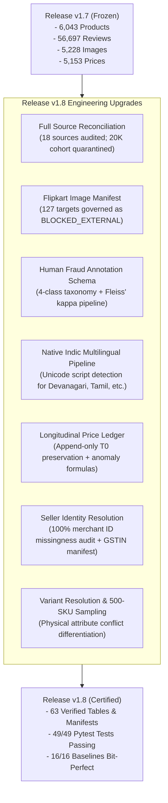

# Dataset Migration Guide: v1.7 to v1.8
## AI-Powered Marketplace Trust Intelligence Platform

**From Release:** `data/marketplace_trust_dataset_v1.7/`  
**To Release:** `data/marketplace_trust_dataset_v1.8/`  
**API Stability:** 100% Backwards Compatible with `src/engine/`

---

### 1. Architectural Summary of Changes

Release v1.8 introduces critical scientific governance, source reconciliation, and multimodal pipeline improvements while maintaining full binary schema stability for existing downstream ML models and inference APIs.



---

### 2. Path Changes & Manifest Locations

| Capability | v1.7 Location | v1.8 Location | Upgrade Details |
|---|---|---|---|
| **Release Root** | `data/marketplace_trust_dataset_v1.7/` | `data/marketplace_trust_dataset_v1.8/` | New versioned directory. v1.7 remains strictly frozen and immutable. |
| **Source Reconciliation** | *Not available* | `manifests/source_reconciliation_table.parquet` | Master audit across 18 source datasets and 20K cohort. |
| **Flipkart Target Manifest** | `manifests/flipkart_127_image_target_manifest.csv` | `manifests/flipkart_127_image_manifest.csv` | Added failure reasons, retry policies, and BLOCKED_EXTERNAL governance. |
| **Indic Collection Manifest** | *Not available* | `manifests/native_indic_review_collection_manifest.csv` | Target acquisition manifest for vernacular Devanagari, Tamil, Telugu reviews. |
| **Longitudinal Price Ledger** | *Not available* | `data/monitoring/price_snapshots_longitudinal.parquet` | Append-only price ledger preserving T0 baseline. |
| **GSTIN/CIN Enrichment** | *Not available* | `manifests/gstin_cin_enrichment_manifest.csv` | Target manifest for legal merchant registry lookup. |
| **500-SKU Sampling Manifest** | *Not available* | `manifests/standardized_500_sku_sampling_manifest.csv` | Standardized FMCG/Electronics ASINs for counter-marketplace search. |
| **Human Annotation Template** | *Not available* | `data/annotation/human_annotation_sample_template.csv` | 3-annotator double-blind research annotation template. |

---

### 3. Python API Compatibility

All existing methods on `MarketplaceTrustAPI` continue to function without modification:

```python
# Unchanged API invocation
from src.engine.api import MarketplaceTrustAPI

api = MarketplaceTrustAPI()
# Seamlessly queries v1.8 catalog
report = api.get_product_trust_report("amazon_in_B000052YQN")
print(f"Trust: {report.composite_trust_score:.2f} | Confidence: {report.confidence_score:.2f}")
```

To update default data paths in existing analytics notebooks from v1.7 to v1.8, simply point data loading utilities to `data/marketplace_trust_dataset_v1.8/`.
