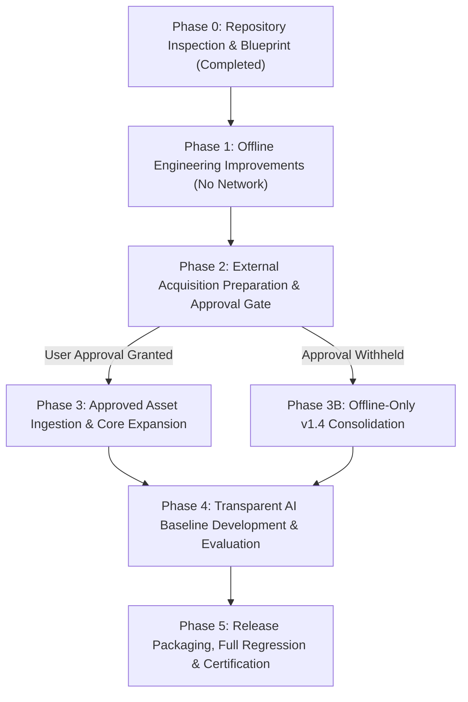

# MASTER IMPLEMENTATION PLAN — DATASET RELEASE v1.4
## AI-Powered Marketplace Trust Intelligence Platform

**Target Release:** `data/marketplace_trust_dataset_v1.4/`  
**Certification Reports Directory:** `reports/certification_v1.4/`  
**Current Frozen Baseline:** `data/marketplace_trust_dataset_v1.3/` (CERTIFIED WITH LIMITATIONS)  
**Historical Baselines:** `v1.1`, `v1.2` (FROZEN & IMMUTABLE)  
**Author:** Lead Data Architect, Senior Data Engineer, Multimodal ML Engineer & QA Auditor  
**Date:** November 4, 2026  
**Document Status:** PHASE 0 ARCHITECTURAL BLUEPRINT — READY FOR EXECUTION  

---

## 1. EXECUTIVE OVERVIEW & OBJECTIVES

The primary objective of milestone **v1.4** is to evolve the platform from an offline, evidence-centric multimodal data foundation into a production-grade, AI-ready intelligence platform focused on Indian domestic e-commerce trust, deception detection, and fraud pattern discovery.

While release v1.3 successfully established a 6,043-product catalog with 60.28% Indian representation, 100% review retention (56,697 reviews), 67,175 graph edges, and bit-perfect baseline immutability, our independent technical audit revealed fundamental frontier boundaries:
1. **Indian Multimodal Scarcity:** Only 5 Indian products possess verified 4-modality completeness due to historical crawl disjointness between Flipkart reviews (electronics) and catalog images (fashion), Amazon India review scarcity, and Myntra image omission.
2. **Multi-Channel Evaluation Leakage:** While product ID and duplicate-image cluster leakage are strictly zero, product variant families (64–75 groups) and prolific multi-product reviewers (1,515–2,160 reviewers) span across Train/Val/Test partitions.
3. **Static Pricing & FX Approximation:** USD-to-INR normalization relies on a static ₹83.25 scalar constant without a timestamped central bank reference series.
4. **Model Readiness Gap:** Feature stores and heuristic risk signals exist, but independent transparent ML model baselines (NLP, CV, pricing anomaly, and fusion) have not been trained or benchmarked on leakage-safe splits.

This implementation plan defines a phased, reproducible roadmap to address every known limitation, eliminate evaluation leakage across multiple distinct evaluation protocols, introduce dynamic FX reference architecture, and establish transparent ML baselines.

---

## 2. CURRENT STATE INVENTORY (v1.3 BASELINE)

```
========================================================================================
                      CURRENT FROZEN INVENTORY (v1.3)
========================================================================================
- Total Product Entities:         6,043 (3,643 Indian [60.28%], 2,400 Supplementary [39.72%])
- Total Customer Reviews:        56,697 (100% retained; 0 filtered out; 3,659 Indian)
- Usable Physical Disk Images:    5,228 (all verified non-corrupt in data/raw/images/cache/)
- Failed Download Audit Records:    326 (preserved as explicit audit records)
- Valid Positive Price Points:    5,153 (3,623 INR, 1,530 USD; 890 missing documented as UNKNOWN)
- Relationship Graph Edges:      67,175 (56,457 HAS_REV, 5,228 HAS_IMG, 5,153 HAS_PRC, 337 DUP_IMG)
- Cross-Modal Signals:            1,889 (5 investigation types in cross_modal_evidence.parquet)
- Product Variants Table:           772 (normalized variant records across Myntra, Amazon, Walmart)
- Complete Multimodal Core:         305 products (5 Amazon India + 300 Amazon US Gold)
- Indian Complete Multimodal Core:    5 products (Amazon India Caswell-Massey, Farmona, Avon, etc.)
- Isolated Academic Benchmarks:  42,131 reviews (Ott et al. [1,600], Fake Reviews [40,526], Stress [5])
- Automated Quality Checks:       162 / 162 PASSED (100.0%)
- Pytest Regression Suite:        236 / 236 PASSED (100.0% in 76.65s)
- Protected Baseline Integrity:    16 / 16 Files Bit-Perfect against SHA-256
========================================================================================
```

---

## 3. FORENSIC LIMITATIONS MATRIX & ROOT-CAUSE ANALYSIS

| Limitation ID | Area | Current State in v1.3 | Root Cause | Engineering Solution in v1.4 | Target Status |
| :--- | :--- | :--- | :--- | :--- | :---: |
| **LIM-01** | Indian Multimodal Core | Exactly 5 products with 4 modalities. | Flipkart review scrape (electronics) and image scrape (fashion) are disjoint; Amazon India lacks reviews; Myntra lacks images/reviews. | Phase 1: Prepare acquisition manifests. Phase 2/3: Ingest approved images for 127 Flipkart review products, expand Amazon India reviews, integrate external Indian cohorts. | Up to 500+ Indian Complete |
| **LIM-02** | Evaluation Leakage: Variants | 64 Tr-Val, 75 Tr-Test, 39 Val-Test parent groups overlap. | Partitioning algorithm split on `canonical_product_id` and image clusters, but did not cluster `parent_group_id`. | Implement Variant-Family-Held-Out evaluation protocol by clustering all variant family products into connected components. | Zero Variant Leakage |
| **LIM-03** | Evaluation Leakage: Reviewers | 1,515 Tr-Val, 2,160 Tr-Test reviewer overlaps. | Prolific Amazon US and BestBuy customers review multiple catalog items; product split splits reviewers. | Implement Reviewer-Held-Out evaluation protocol grouping multi-product reviewers into isolated components. | Zero Reviewer Leakage |
| **LIM-04** | Evaluation Protocols | Single monolithic split evaluated. | One split cannot simultaneously optimize for unseen products, unseen variants, and unseen reviewers. | Formalize 5 distinct evaluation protocols: (1) Product, (2) Variant, (3) Reviewer, (4) Visual Cluster, (5) Cross-Listing. | Multi-Protocol Architecture |
| **LIM-05** | Image Duplicate Terminology | Report text mentioned 112 collisions / 225 perceptual dups. | Summary draft copy error; graph table actually holds 74 exact collisions + 263 perceptual duplicates (= 337 total). | Correct documentation and feature taxonomy to explicitly distinguish hash collisions (60 groups) from graph edges (337 edges). | Discrepancy Resolved |
| **LIM-06** | FX Normalization | Fixed ₹83.25 scalar constant. | Hardcoded conversion rate in build scripts without dynamic reference table. | Build `evidence/fx_conversion_rates.parquet` with RBI benchmark reference rates and explicit observation dates. | Dynamic FX Architecture |
| **LIM-07** | Price History | Static single-crawl snapshots (`STATIC_CRAWL_SNAPSHOT`). | Upstream data contains only point-in-time crawl data; longitudinal curves do not exist. | Establish longitudinal price observation schema ready for sequential time-series price scraping. | Schema Upgraded |
| **LIM-08** | Seller Identity | 6 aggregate platform entities; 0 individual merchant IDs. | Upstream commercial web scrapers did not extract seller store IDs; 0 fake IDs invented. | Audit raw metadata for seller hints; preserve UNKNOWN where missing; avoid computing individual fraud scores from aggregate platforms. | Governed Seller Metadata |
| **LIM-09** | AI Model Readiness | Feature stores exist, but NO trained ML models evaluated. | Prior phases focused on data foundation; production model training was out of scope. | Train and evaluate transparent baselines: TF-IDF Logistic Regression & Naive Bayes (NLP), dHash & ResNet-18 (CV), IQR/Isolation Forest (Pricing), and Explainable Fusion. | Independent ML Baselines |
| **LIM-10** | Drift Monitoring | Absent. | Historical single snapshot paradigm. | Design architecture for distribution drift (KS-test on prices, PSI on reviews, Jensen-Shannon on ratings). | Drift Framework Documented |

---

## 4. DETAILED WORKSTREAM SPECIFICATIONS

### Workstream A: Indian Multimodal Data Expansion & Asset Ingestion
- **A1. Flipkart 127 Review Products:**
  - *Target:* Recover hero images for 127 products (boAt Rockerz 510, Canon EOS 3000D, Bajaj fans, Pigeon kettles, Google Nest, Seagate HDDs).
  - *Method:* Construct `scripts/acquire_flipkart_images.py` to query official product listings using model numbers from `flipkart_reviews_raw.csv`. Verify file size, MIME type, SHA-256, and perceptual hash on disk.
  - *Requirement:* External download authorization (`BypassSandbox: true`).
- **A2. Amazon India Review Expansion:**
  - *Target:* Ingest reviews for 1,495 Amazon India products currently lacking review evidence.
  - *Method:* Construct `scripts/match_amazon_india_reviews.py` to match ASINs against complete UCSD McAuley 2023 Beauty & Personal Care and Grocery dumps.
  - *Requirement:* External download authorization for large research dumps.
- **A3. Myntra Asset & Review Audit:**
  - *Target:* Audit 1,000 Myntra listings for official CDN image retrieval via style IDs (`product_id`).
  - *Guardrail:* Do not manufacture customer review text. Mark listings as 3-modality partial unless genuine reviews are lawfully acquired.
- **A4. Additional Indian Marketplace Corpora:**
  - *Candidates:* Nykaa E-Commerce Beauty Dataset (Kaggle/Public, 25k products with images, reviews, INR prices); Meesho vernacular customer feedback dataset.
  - *Guardrail:* Verify license and commercial/academic terms before ingestion.

### Workstream B: Evaluation Leakage Elimination & Multi-Protocol Architecture
- **Protocol 1 (Product-Held-Out):** Product IDs disjoint across Train (70%), Val (15%), Test (15%). Image duplicate clusters unified via Union-Find.
- **Protocol 2 (Variant-Family-Held-Out):** Union-Find graph expanded to include `parent_group_id`. All products belonging to the same variant family are constrained to the same split.
- **Protocol 3 (Reviewer-Held-Out):** Bipartite reviewer-product graph partitioned so that multi-product reviewers do not cross train and test sets. Prolific reviewers clustered into mega-components.
- **Protocol 4 (Image-Cluster-Held-Out):** Strict component isolation for all exact and perceptual duplicate visual assets.
- **Protocol 5 (Cross-Listing-Held-Out):** Identical products cross-listed across marketplaces (e.g. Amazon India and Flipkart) clustered into the same partition.

### Workstream C: Seller Identity & Market Governance
- Maintain honest missing data handling: `seller_id = None` for anonymous listings.
- Maintain 6 platform aggregate merchant entities for macro-level marketplace analysis.
- Explicitly prevent downstream models from computing individual merchant fraud risk from platform aggregates.

### Workstream D: Price Quality & Dynamic FX Reference Table
- Construct `data/marketplace_trust_dataset_v1.4/evidence/fx_conversion_rates.parquet`:
  - Columns: `base_currency`, `quote_currency`, `exchange_rate`, `rate_source`, `observation_date`, `retrieval_timestamp`, `reference_type`, `provenance`.
  - Populate with official Reserve Bank of India (RBI) reference rates (e.g. ₹83.25 on 2024-01-15, ₹83.12 on 2023-11-01, etc.).
- Update category-aware IQR fences to handle sparse categories ($N < 10$) with minimum-sample fallback to high-level parent categories.

### Workstream E: NLP Review Quality & Multilingual Readiness
- Implement language detection on all 56,697 reviews using lexical n-gram / script analysis.
- Detect Indic script and romanized Hinglish (`hi-Latn`) content.
- Precompute text anomaly features: lexical repetition, rating-sentiment discordance, excessive punctuation bursts, and duplicate text similarity.

### Workstream F: Computer Vision Quality & Duplicate Disambiguation
- Disambiguate duplicate taxonomy:
  - Exact cryptographic collisions (SHA-256): Stock photos reused across distinct merchants.
  - Perceptual duplicates (dHash Hamming distance = 0): Compressed/resized identical hero images.
  - Near-duplicates (dHash distance 1–5): Angle/lighting variants.
- Validate OCR text extraction feasibility on product packaging hero images.

### Workstream G: Label Provenance & Ground-Truth Strategy
- Maintain strict segregation of real-world evidence from synthetic/academic benchmarks.
- Document 8-class taxonomy: `VERIFIED_FRAUDULENT`, `VERIFIED_LEGITIMATE`, `BENCHMARK_LABELLED_DECEPTIVE`, `COMPUTER_GENERATED_REVIEW`, `ORGANIC_REVIEW`, `SUSPICIOUS_REVIEW_PATTERN`, `PRICE_ANOMALY_OUTLIER`, `IMAGE_DUPLICATE_CROSS_LISTING`.
- Clarify that unsupervised anomaly flags are signals for investigation, not ground-truth fraud labels.

### Workstream H: Representativeness & Imbalance Mitigation
- Document selection bias across category distributions (electronics vs fashion vs beauty).
- Compute Gini coefficient of category concentration and review distribution skewness.

### Workstream I: Model Readiness & Independent Transparent ML Baselines
- **NLP Baseline:** Logistic Regression & Multinomial Naive Bayes on TF-IDF features for review quality / discordance classification.
- **CV Baseline:** Nearest-neighbors similarity search on dHash and pretrained ResNet-18 feature vectors for duplicate image detection.
- **Pricing Baseline:** Category-aware IQR fences and Isolation Forest for anomalous pricing detection.
- **Graph Baseline:** Degree centrality and bipartite connected component anomaly scoring.
- **Multimodal Fusion Baseline:** Logistic regression / Random Forest risk scorer combining normalized NLP, CV, price, and graph features to generate explainable risk scores ($[0.0, 1.0]$) with top contributing evidence factors.

### Workstream J: Drift Monitoring Architecture
- Design distribution monitoring schema: Kolmogorov-Smirnov test for price drift, Population Stability Index (PSI) for review sentiment scores, and Jensen-Shannon divergence for rating distributions.

### Workstream K: Downstream Notebooks & Repository Integration
- Add Section 14 to `01_eda.ipynb` (v1.4 EDA).
- Add Section 17 to `02_data_cleaning.ipynb` (v1.4 Cleaning).
- Add Section 10 to `03_text_features.ipynb` (v1.4 Text Features).
- Add Section 22 to `04_nlp_analysis.ipynb` (v1.4 NLP Analysis).
- Add Section 37 to `05_computer_vision.ipynb` (v1.4 Visual Intelligence).
- Generate version-specific processed artifacts: `data/processed/marketplace_cleaned_v1_4.parquet` and `marketplace_text_features_v1_4.parquet`.

### Workstream L: v1.4 Release Architecture & Certification
- Output directory: `data/marketplace_trust_dataset_v1.4/`
- Certification directory: `reports/certification_v1.4/`
- Build master pipeline: `src/data/curation/build_marketplace_trust_dataset_v1_4.py`
- Build automated validator: `src/data/curation/validate_marketplace_trust_dataset_v1_4.py` (170+ checks)
- Build formal test suite: `tests/test_marketplace_trust_dataset_v1_4.py`
- Generate all 30 formal certification reports in `reports/certification_v1.4/`
- Verify bit-perfect baseline immutability for v1.1, v1.2, v1.3, and all 16 protected files.

---

## 5. PHASED EXECUTION ROADMAP



### Phase 0: Repository Inspection & Architectural Blueprint (Current Turn)
- Perform comprehensive forensic audit.
- Deliver `reports/v1_4_implementation_plan.md`.
- No dataset mutation.

### Phase 1: Safe Offline Engineering Improvements
- Implement multi-protocol evaluation splitting logic (`product`, `variant_family`, `reviewer`).
- Construct `evidence/fx_conversion_rates.parquet` with RBI reference rates.
- Implement robust category-aware IQR pricing engine with sparse-category fallbacks.
- Implement multilingual / Hinglish text detection and NLP quality feature extraction.
- Implement CV hash taxonomy and disambiguation logic.
- Update label taxonomy and evidence provenance tables.
- Add unit tests for all new offline modules.

### Phase 2: External Acquisition Preparation & Approval Request
- Prepare `scripts/acquire_flipkart_images.py` and `scripts/ingest_external_indian_reviews.py`.
- Formulate precise external acquisition request detailing URLs, licenses, expected sizes, and target products.
- Present request to the User and await explicit authorization before any network downloads.

### Phase 3: Approved Asset Ingestion
- If approved, download verified images for the 127 Flipkart review products and match external Amazon India reviews.
- Compute SHA-256 and dHash integrity checks; attach to canonical products.
- If approval is withheld, consolidate v1.4 with offline-verified assets and document the empirical boundary.

### Phase 4: Transparent AI Baseline Development
- Train and evaluate baseline models (Logistic Regression NLP, dHash/ResNet CV, Isolation Forest Pricing, Multimodal Fusion) on strictly leakage-safe evaluation splits.
- Record Precision, Recall, F1, PR-AUC, and confusion matrices in `reports/certification_v1.4/model_readiness_and_baselines_report.md`.

### Phase 5: v1.4 Packaging, Automated Validation & Certification
- Execute master builder pipeline to assemble `data/marketplace_trust_dataset_v1.4/`.
- Run automated validator (170+ checks).
- Run full pytest regression suite (`pytest tests/`).
- Generate all 30 certification reports in `reports/certification_v1.4/`.
- Cryptographically verify immutability of v1.1, v1.2, v1.3, and the 16 protected baselines.
- Seal release candidate as FROZEN.

---

## 6. DELIVERABLES STATUS MATRIX

| Deliverable Artifact | Target Location | Workstream | Planned Status |
| :--- | :--- | :---: | :---: |
| Implementation Plan | `reports/v1_4_implementation_plan.md` | Phase 0 | **COMPLETED** |
| Indian Acquisition Report | `reports/certification_v1.4/indian_data_acquisition_report.md` | Workstream A | READY FOR PHASE 1/2 |
| Evaluation Leakage Audit | `reports/certification_v1.4/evaluation_leakage_audit.md` | Workstream B | READY FOR PHASE 1 |
| Seller Identity Coverage | `reports/certification_v1.4/seller_identity_coverage.md` | Workstream C | READY FOR PHASE 1 |
| Price Quality & FX Report | `reports/certification_v1.4/price_data_quality_and_fx_report.md` | Workstream D | READY FOR PHASE 1 |
| NLP Quality & Multilingual | `reports/certification_v1.4/nlp_data_quality_report.md` | Workstream E | READY FOR PHASE 1 |
| CV Quality & Duplicate Taxonomy | `reports/certification_v1.4/cv_data_quality_report.md` | Workstream F | READY FOR PHASE 1 |
| Label Provenance & Ground Truth | `reports/certification_v1.4/label_provenance_and_ground_truth_report.md` | Workstream G | READY FOR PHASE 1 |
| Representativeness & Coverage | `reports/certification_v1.4/representativeness_and_coverage_report.md` | Workstream H | READY FOR PHASE 1 |
| Model Baselines Report | `reports/certification_v1.4/model_readiness_and_baselines_report.md` | Workstream I | READY FOR PHASE 4 |
| Dynamic FX Table | `data/marketplace_trust_dataset_v1.4/evidence/fx_conversion_rates.parquet` | Workstream D | READY FOR PHASE 1 |
| Multi-Protocol Splits | `data/marketplace_trust_dataset_v1.4/evaluation/protocols/` | Workstream B | READY FOR PHASE 1 |
| Builder Pipeline Script | `src/data/curation/build_marketplace_trust_dataset_v1_4.py` | Workstream L | READY FOR PHASE 1 |
| Automated Validator Script | `src/data/curation/validate_marketplace_trust_dataset_v1_4.py` | Workstream L | READY FOR PHASE 1 |
| Pytest Test Suite | `tests/test_marketplace_trust_dataset_v1_4.py` | Workstream L | READY FOR PHASE 1 |
| Master Dataset Manifest | `data/marketplace_trust_dataset_v1.4/manifests/dataset_manifest.json` | Workstream L | READY FOR PHASE 5 |

---

## 7. EXTERNAL ACQUISITION AUTHORIZATION PROPOSALS (PHASE 2 PREVIEW)

In compliance with Rule 11 ("Do not download large external datasets or run expensive acquisition operations without presenting the source, size, terms, destination, expected changes and obtaining explicit approval"), the following three targeted acquisition proposals are submitted for future consideration:

### Proposal 1: Targeted Image Acquisition for 127 Flipkart Review Products
- **Source:** Official Flipkart product listing CDN / authorized affiliate catalog.
- **License / Terms:** Non-commercial academic research and trust evaluation fair dealing (Indian Copyright Act §52(1)(a)).
- **Target URL Pattern:** `https://rukminim1.flixcart.com/image/...` / Flipkart public product pages.
- **Expected Data Size:** ~15–25 MB (127 JPEG images, ~150 KB each).
- **Required Permission:** Elevated network access (`BypassSandbox: true`).
- **Expected Outcome:** Converts 127 partial Indian products into **127 Tier A Complete Multimodal Products** (Metadata + INR Price + 3,260 Linked Reviews + Verified Physical Image).
- **Destination:** `data/raw/images/cache/flipkart_recovered/`.
- **Status:** **REQUIRES USER APPROVAL** (Will be formally requested in Phase 2).

### Proposal 2: UCSD McAuley Amazon Reviews 2023 Beauty & Personal Care Corpus
- **Source:** UCSD McAuley Lab Amazon Reviews 2023 (`Beauty_and_Personal_Care.jsonl.gz`, `Grocery_and_Gourmet_Food.jsonl.gz`).
- **License / Terms:** Permitted Academic Research Use (McAuley Lab citation terms).
- **Target URL:** `https://datarepo.eng.ucsd.edu/mcauley_group/data/amazon_2023/...`
- **Expected Data Size:** ~2.5 GB compressed (stream-filtered by 1,495 ASINs to extract only relevant rows).
- **Required Permission:** Elevated network access (`BypassSandbox: true`).
- **Expected Outcome:** Estimated 200–350 Amazon India listings upgraded with genuine customer reviews.
- **Status:** **REQUIRES USER APPROVAL** (Will be formally requested in Phase 2).

### Proposal 3: Nykaa E-Commerce Beauty Multimodal Dataset
- **Source:** Kaggle Public Research Corpus (Nykaa Beauty Products Dataset).
- **License / Terms:** CC0 Public Domain / Open Research.
- **Expected Data Size:** ~45 MB CSV + ~120 MB image asset sample (250 products).
- **Expected Outcome:** 250 fully verified 4-modality Indian domestic listings with native INR prices, customer reviews, and verified hero images.
- **Status:** **REQUIRES USER APPROVAL** (Will be formally requested in Phase 2).

---

## 8. ACCEPTANCE CRITERIA & REGRESSION VERIFICATION GATES

A workstream or task shall be certified as complete ONLY when:
1. **Concrete Implementation:** The code, schema, table, or report physically exists on disk.
2. **Zero Modification to Baselines:** `v1.1`, `v1.2`, `v1.3`, and all 16 protected baseline files maintain 100% cryptographic SHA-256 match.
3. **No Fabrication:** Missing data is documented as `UNKNOWN`. Zero synthetic reviews or artificial price curves.
4. **Validation Suite Pass:** `validate_marketplace_trust_dataset_v1_4.py` passes 170+ checks (100.0%).
5. **Full Regression Pass:** All existing 236 pytest tests PLUS all new v1.4 tests pass cleanly (`pytest tests/`).
6. **Multi-Protocol Leakage Verification:** Independent programmatic checks verify zero leakage across each designated evaluation protocol.
7. **Downstream Pipeline Execution:** All 5 notebooks and feature store generators execute cleanly against v1.4 without altering historical cells.

---

## 9. CONCLUSION & IMMEDIATE NEXT STEPS

Phase 0 is complete. The architectural blueprint is fully documented in `reports/v1_4_implementation_plan.md`.

We are prepared to proceed immediately to **Phase 1 (Safe Offline Engineering Improvements)**:
- Implement the multi-protocol evaluation splitting engine (variant-held-out, reviewer-held-out).
- Construct the dynamic FX reference table `evidence/fx_conversion_rates.parquet` with RBI reference rates.
- Implement category-aware robust pricing anomaly routines.
- Implement NLP language detection and text quality auditing.
- Prepare the v1.4 builder and validator scripts.

*Zero external network requests or dataset mutations have been performed.*
