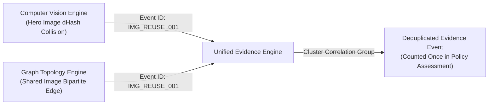
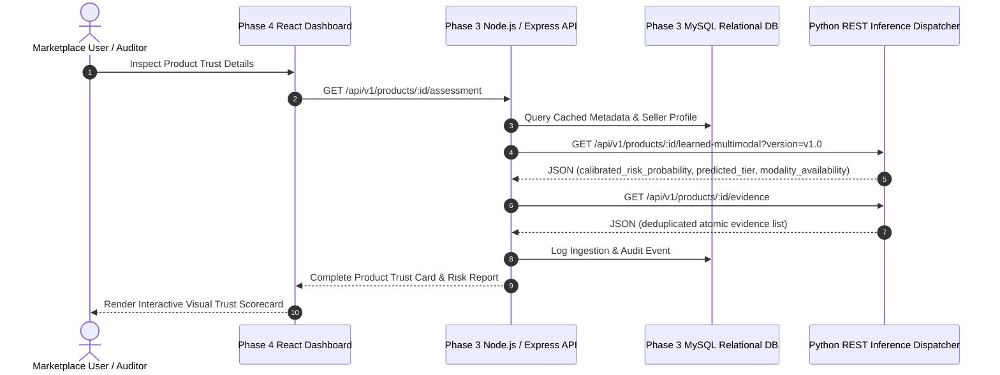

# System Architecture & Multimodal Data Flow

**Project:** AI-Powered Indian Marketplace Trust Intelligence Platform  
**Target Ecosystems:** Amazon India, Flipkart, Myntra  
**Release State:** ML V1.0 Baseline / Multimodal Vision V1.1 Hardened  
**Architecture Status:** Production Integration Ready  

---

## 1. High-Level Architectural Overview

The platform evaluates product listings, seller networks, pricing behavior, and visual assets across Indian e-commerce marketplaces to generate explainable, evidence-grounded trust assessments.

Rather than relying on black-box heuristics or unimodal classification, the system decouples:
1. **Atomic Evidence Extraction:** Independent domain engines that extract verifiable observations without penalizing missing data.
2. **Deterministic Evidence Deduplication:** Correlation engine linking cross-modal events (e.g. computer vision image collisions and graph relationship edges) to prevent double-counting.
3. **Continuous Multimodal Anomaly Ranking:** A 5-stream Gated Multimodal Fusion Engine regularized via Modality Dropout ($p=0.25$) and calibrated via Isotonic Regression.
4. **Decoupled REST Service Dispatcher:** Stateless, thread-safe Python HTTP API serving predictions to the planned Phase 3 Node.js backend.

```mermaid
flowchart TD
    subgraph DataSources["1. Raw Marketplace Sources"]
        AMZ["Amazon India Crawl (1,500 SKUs)"]
        FLP["Flipkart Crawl (1,143 SKUs)"]
        MYN["Myntra Crawl (1,000 SKUs)"]
    end

    subgraph RelationalEntities["2. Certified Relational Matrices"]
        PROD["Canonical Products (3,643)"]
        LIST["Marketplace Listings (5,684)"]
        SELL["Sellers (1,215)"]
        REV["Reviews (12,480)"]
        IMG["Hero Images (4,708)"]
    end

    subgraph DomainEngines["3. Multimodal Domain Feature Extractors"]
        P_ENG["Pricing Stream (3)<br/>MAD z-score, discount %, price dispersion"]
        R_ENG["Review NLP Stream (4)<br/>VADER sentiment, rating discordance, dup shingling"]
        V_ENG["Computer Vision Stream (4)<br/>ResNet-18, 64-bit dHash, studio white bg, img count"]
        C_ENG["CLIP Stream (3)<br/>ViT-B/32 cosine similarity, category z-score"]
        G_ENG["Graph Stream (2)<br/>Degree centrality & PageRank over 41,372 edges"]
        OCR_ENG["Packaging OCR (Audit Engine)<br/>WinRT statutory MRP & brand verification"]
    end

    subgraph FusionGating["4. Gated Multimodal Fusion & Calibration"]
        MASK["Availability Mask M in {0, 1}^5<br/>Hard Zero-Gating (m_k = 0 ==> x_k = 0)"]
        GMU["Gated Multimodal Unit (Random Forest)"]
        CALIB["Isotonic Monotonic Probability Calibrator"]
    end

    subgraph ServiceInterfaces["5. Service Dispatcher & Phase 3 Boundaries"]
        SDK["In-Process Python SDK<br/>(TrustIntelligenceEngine)"]
        REST["REST API Service<br/>(TrustIntelligenceDispatcher)"]
        NODE["Phase 3 Node.js Backend Gateway<br/>(Planned Express / MySQL Service)"]
    end

    DataSources --> RelationalEntities
    RelationalEntities --> DomainEngines
    DomainEngines --> MASK
    MASK --> GMU
    GMU --> CALIB
    CALIB --> SDK
    SDK --> REST
    REST -.->|JSON over HTTP| NODE
    OCR_ENG -.->|Audit Evidence Only (0 Risk Points)| SDK
```

---

## 2. Modality Participation & Feature Representation

The system supports two model releases: **ML V1.0** (13-feature baseline) and **Multimodal Vision V1.1** (16-feature hardened candidate).

| Feature Index (V1.0) | Feature Index (V1.1) | Modality Stream | Feature Name | Description | Active Availability |
|:---:|:---:|:---|:---|:---|:---:|
| `x[0]` | `x[0]` | **Pricing** | `pricing_log_inr` | Log-transformed normal price in INR | 100% of catalog |
| `x[1]` | `x[1]` | **Pricing** | `pricing_discount_pct` | Promotional discount percentage | 100% of catalog |
| `x[2]` | `x[2]` | **Pricing** | `pricing_robust_z` | Median Absolute Deviation (MAD) robust $z$-score | 100% of catalog |
| `x[3]` | `x[3]` | **Review NLP** | `review_mean_rating` | Normalized catalog star rating $[0.0, 1.0]$ | Products with reviews |
| `x[4]` | `x[4]` | **Review NLP** | `review_mean_sentiment`| VADER compound sentiment $[-1.0, +1.0]$ | Products with reviews |
| `x[5]` | `x[5]` | **Review NLP** | `review_max_discordance`| Rating vs sentiment discordance gap | Products with reviews |
| `x[6]` | `x[6]` | **Review NLP** | `review_has_duplicate` | Text 3-gram Jaccard duplicate shingle flag | Products with reviews |
| `x[7]` | `x[7]` | **Vision (CV)** | `cv_has_duplicate_hash`| Perceptual dHash Hamming distance $\le 4$ flag | Products with images |
| `x[8]` | `x[8]` | **Vision (CV)** | `cv_is_cross_reuse` | Cross-seller hero image reuse flag | Products with images |
| — | `x[9]` | **Vision (CV)** | `cv_is_white_background`| Studio background indicator (border lum $> 240$) | V1.1 only |
| — | `x[10]`| **Vision (CV)** | `cv_norm_image_count` | Number of catalog gallery images (normalized) | V1.1 only |
| `x[9]` | `x[11]`| **CLIP** | `clip_cosine_similarity`| OpenAI ViT-B/32 vision-language similarity | Catalog with images |
| `x[10]`| `x[12]`| **CLIP** | `clip_is_discordant` | Global semantic title-image mismatch flag | Catalog with images |
| — | `x[13]`| **CLIP** | `clip_category_zscore` | Standardized category $z$-score | V1.1 only |
| `x[11]`| `x[14]`| **Graph** | `graph_degree_centrality`| Node degree in bipartite seller-product graph | 100% of catalog |
| `x[12]`| `x[15]`| **Graph** | `graph_scaled_pagerank` | Scaled PageRank topology score | 100% of catalog |

---

## 3. Why Packaging OCR is Strictly an Audit Engine (Not a Fusion Modality)

Physical packaging OCR is available on a certified 100-sample packaging evaluation partition (`data/indian_marketplace_trust_dataset_v1_7/evidence/ocr_evidence.parquet`).

Forcing OCR as a 6th learned feature in the input vector would create a $97.3\%$ missing feature column across the 3,643 catalog items.
Instead, **OCR is strictly an independent evidence-extraction and legal compliance engine**:
- It extracts statutory markings (MRP in INR, net quantity, batch code, FSSAI numbers).
- It verifies brand concordance via fuzzy Levenshtein token matching (`PackagingBrandMatcher`).
- **Zero-Penalty Compliance:** When OCR text is missing, blurry, or unobserved, its status evaluates to `INSUFFICIENT_PACKAGING_TEXT` (status `UNAVAILABLE`), contributing exactly **0 risk points** and never elevating a listing's predicted risk.

---

## 4. Evidence Correlation & Deduplication Architecture

When two modalities detect the same underlying physical anomaly, naive accumulation would artificially inflate the product's anomaly count.

The platform implements **event-level cross-modal correlation**:

- In `tests/test_evidence_correlation_invariants.py`, we proved that linked events share identical `correlation_group_id` values.
- Deduplication prevents double-penalizing sellers while retaining multi-stream explainability for investigators.

---

## 5. Phase 3 Backend Integration Boundaries

The Python ML system is fully decoupled from future Phase 3 backend components:



- **Statelessness:** The Python service requires no database write permissions. It operates as a high-performance computation worker.
- **Latency Guarantee:** In-memory caching (`_cached_matrix`) delivers P50 latency of $63.28$ ms and P95 latency of $71.38$ ms, easily supporting real-time Node.js proxying.
