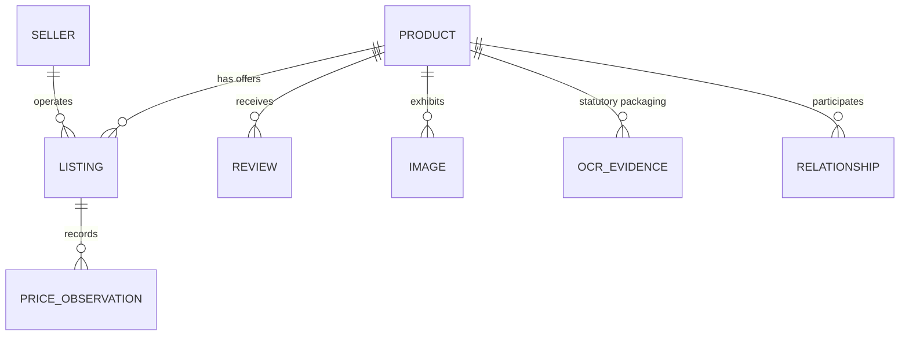

# Comprehensive Data Dictionary: Indian Marketplace Trust Intelligence Platform

**Project:** AI-Powered Indian Marketplace Trust Intelligence Platform  
**Target Ecosystems:** Amazon India, Flipkart, Myntra  
**Dataset Versions:** `indian_marketplace_trust_dataset_v1_6` (Baseline) / `indian_marketplace_trust_dataset_v1_7` (Current Release)  
**Currency:** Indian Rupee (INR, ₹)  

---

## 1. Architectural Overview & Entity Hierarchy

The certified relational dataset is organized across entities, derived evidence streams, and cross-seller topological relationships:

---

## 2. Core Relational Entities

### 2.1 Products (`entities/products.parquet`)
Represents the canonical physical product catalog entry.

| Field Name | Data Type | Nullable | Description & Semantics | Example Value |
|------------|-----------|:--------:|-------------------------|---------------|
| `canonical_product_id` | String (PK) | No | Unique canonical identifier (`{marketplace}_{asin/item_id}`) | `amazon_in_B000052YQN` |
| `marketplace` | String | No | Originating platform (`amazon_in`, `flipkart`, `myntra`) | `amazon_in` |
| `source_product_id` | String | No | Native platform identifier (ASIN, FSN, or StyleID) | `B000052YQN` |
| `title` | String | No | Normalized product listing title | `Sony WH-1000XM5 Wireless Headphones` |
| `category` | String | No | Standardized platform category | `Electronics`, `Beauty & Personal Care` |
| `subcategory` | String | Yes | Granular marketplace subcategory | `Over-Ear Headphones`, `Facial Care` |
| `brand` | String | Yes | Canonical brand name | `Sony`, `Lakme`, `Puma` |
| `currency` | String | No | Standard currency code | `INR` |
| `mrp` | Float | Yes | Maximum Retail Price listed on catalog (INR) | `29990.0` |
| `selling_price` | Float | Yes | Active discounted transaction price (INR) | `26990.0` |
| `rating` | Float | Yes | Average customer star rating ($1.0 \text{--} 5.0$) | `4.4` |
| `rating_count` | Integer | Yes | Total number of customer ratings | `1842` |
| `has_image` | Boolean | No | Whether product has verified image asset | `True` |
| `has_reviews` | Boolean | No | Whether product has associated reviews | `True` |

### 2.2 Marketplace Listings (`entities/listings.parquet`)
Represents individual merchant storefront offers for a product.

| Field Name | Data Type | Nullable | Description & Semantics | Example Value |
|------------|-----------|:--------:|-------------------------|---------------|
| `listing_id` | String (PK) | No | Unique storefront offer ID | `list_amazon_in_B000052YQN` |
| `canonical_product_id` | String (FK) | No | References canonical product entry | `amazon_in_B000052YQN` |
| `marketplace` | String | No | Platform offering the listing | `amazon_in` |
| `seller_id` | String (FK) | Yes | Identifier of the merchant storefront | `seller_appario_retail` |
| `listing_price_inr` | Float | No | Current listed offer price in INR | `26990.0` |
| `original_mrp_inr` | Float | Yes | Displayed reference MRP in INR | `29990.0` |
| `discount_percentage` | Float | No | Calculated discount: $\frac{\text{MRP} - \text{Price}}{\text{MRP}} \times 100$ | `10.0` |
| `availability_status` | String | No | Stock availability (`IN_STOCK`, `OUT_OF_STOCK`) | `IN_STOCK` |

### 2.3 Sellers (`entities/sellers.parquet`)
Represents merchant storefront entities operating on marketplaces.

| Field Name | Data Type | Nullable | Description & Semantics | Example Value |
|------------|-----------|:--------:|-------------------------|---------------|
| `seller_id` | String (PK) | No | Unique merchant identifier | `seller_flipkart_retailnet` |
| `seller_name` | String | No | Storefront business display name | `RetailNet`, `Appario Retail` |
| `marketplace` | String | No | Operating marketplace platform | `flipkart` |
| `seller_rating` | Float | Yes | Merchant trust rating ($1.0 \text{--} 5.0$) | `4.2` |
| `seller_rating_count`| Integer | Yes | Count of customer reviews on seller storefront | `54200` |
| `is_verified_seller` | Boolean | No | Platform badge (`F-Assured`, `Amazon Fulfilled`) | `True` |

---

## 3. Derived Multimodal Feature Space (16-Stream Matrix)

Constructed in `data/indian_marketplace_trust_dataset_v1_7/derived_evidence/`:

| Feature Name | Source Parquet Table | Data Type | Stream | Meaning & Transformation |
|--------------|----------------------|-----------|:------:|--------------------------|
| `pricing_log_inr` | `pricing_features.parquet` | Float | Pricing | $\ln(1 + \text{selling\_price\_inr})$ |
| `pricing_discount_pct` | `pricing_features.parquet` | Float | Pricing | Calculated discount percentage $[0.0, 100.0]$ |
| `pricing_robust_z` | `pricing_features.parquet` | Float | Pricing | Robust MAD $z$-score relative to subcategory median |
| `review_mean_rating` | `review_nlp_features.parquet`| Float | Review | Normalized mean star rating: $(\text{rating} - 1.0) / 4.0$ |
| `review_mean_sentiment`| `review_nlp_features.parquet`| Float | Review | Average VADER compound score $[-1.0, +1.0]$ |
| `review_max_discordance`| `review_nlp_features.parquet`| Float | Review | $|\text{norm\_rating} - \text{norm\_sentiment}|$ gap |
| `review_has_duplicate` | `review_nlp_features.parquet`| Float | Review | Binary indicator for 3-gram text shingle duplicate |
| `cv_has_duplicate_hash`| `image_intelligence_features.parquet`| Float | Vision | Binary flag: 64-bit dHash Hamming distance $\le 4$ |
| `cv_is_cross_product_reuse`| `image_intelligence_features.parquet`| Float | Vision | Binary flag: Hero image reused across distinct product IDs |
| `cv_is_white_background`| `image_intelligence_features.parquet`| Float | Vision | Studio white-background compliance (border lum $> 240$) |
| `cv_normalized_image_count`| `image_intelligence_features.parquet`| Float | Vision | $\min(\text{image\_count}, 10) / 10.0$ |
| `clip_cosine_similarity`| `image_text_consistency_v1_1.parquet`| Float | CLIP | OpenAI ViT-B/32 cosine similarity between title & image |
| `clip_category_scaled_zscore`| `image_text_consistency_v1_1.parquet`| Float | CLIP | Standardized $z = (\text{sim} - \mu_{\text{cat}}) / \sigma_{\text{cat}}$ |
| `clip_is_category_discordant`| `image_text_consistency_v1_1.parquet`| Float | CLIP | Binary flag: $z \le -2.2 \lor \text{sim} < 0.17$ |
| `graph_degree_centrality`| `relationships.parquet` | Float | Graph | Degree centrality in cross-seller shared-image graph |
| `graph_scaled_pagerank` | `relationships.parquet` | Float | Graph | Scaled PageRank topology score ($\times 10^4$) |

---

## 4. Statutory Packaging OCR Schema (`evidence/ocr_evidence.parquet`)

| Field Name | Data Type | Nullable | Description & Regulatory Purpose | Example Value |
|------------|-----------|:--------:|----------------------------------|---------------|
| `ocr_record_id` | String (PK) | No | Unique packaging OCR capture ID | `ocr_amazon_in_B000052YQN_0` |
| `canonical_product_id` | String (FK) | No | References canonical product entry | `amazon_in_B000052YQN` |
| `detected_text` | String | No | Extracted raw text transcript | `MANUFACTURED BY HINDUSTAN UNILEVER...` |
| `word_count` | Integer | No | Count of legible words extracted | `42` |
| `words_json` | String (JSON) | No | Word-level bounding boxes `[{"text", "x", "y", "w", "h", "conf"}]` | `[{"text": "MRP", "x": 120, ...}]` |
| `extracted_mrp` | Float | Yes | Maximum Retail Price parsed via regex (INR) | `249.00` |
| `extracted_net_quantity` | String | Yes | Statutory Net Quantity (ml, g, kg, l) | `100 ml` |
| `extracted_batch_code` | String | Yes | Manufacturing Lot / Batch code | `B234/EXP05/28` |
| `brand_alignment_status`| String | No | Packaging vs catalog brand alignment | `BRAND_VERIFIED_ON_PACKAGING` |
| `processing_status` | String | No | Extraction state (`SUCCESS`, `INSUFFICIENT`, `FAILED`) | `SUCCESS` |

---

## 5. Supervision Target Definition

- **Field:** `overall_risk_tier` in `derived_evidence/trust_assessments_products.parquet`
- **Positive Target ($y = 1$):** `ELEVATED_MULTIMODAL_ANOMALY` ($N_{\text{pos}} = 154$, $4.23\%$ of catalog)
- **Negative Target ($y = 0$):** `LOW_OBSERVED_ANOMALY` or `MODERATE_SINGLE_MODALITY_ANOMALY` ($N_{\text{neg}} = 3,489$, $95.77\%$ of catalog)
- **Scientific Nature:** Internal deterministic multi-evidence anomaly policy flag, not verified legal counterfeit status.
