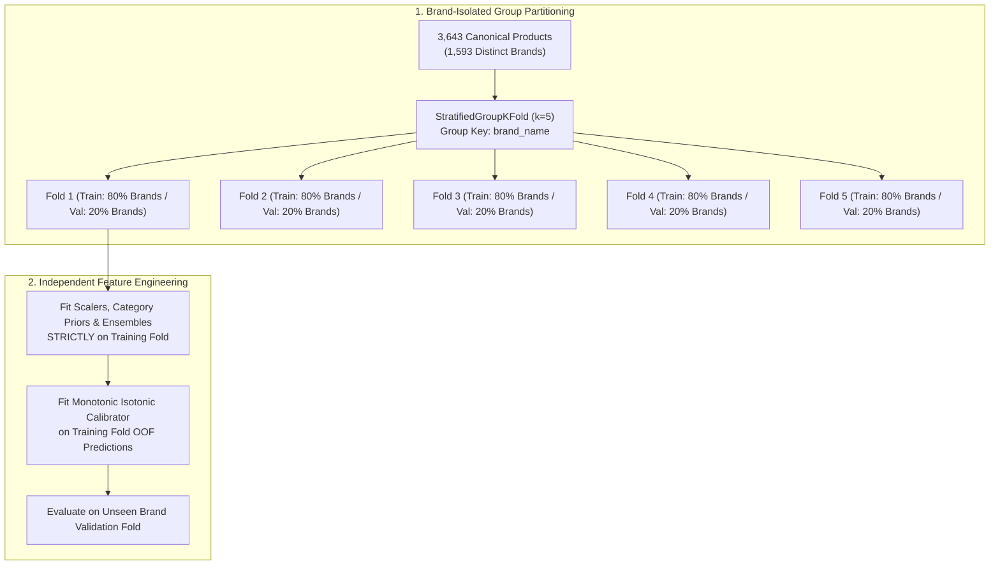

# Scientific Evaluation Methodology & Leakage Prevention Protocol

**Project:** AI-Powered Indian Marketplace Trust Intelligence Platform  
**Target Ecosystems:** Amazon India, Flipkart, Myntra  
**Release State:** ML V1.0 Baseline / Multimodal Vision V1.1 Hardened  

---

## 1. Executive Summary & Evaluation Philosophy

A rigorous evaluation methodology in multimodal marketplace analysis must guard against subtle forms of data leakage and false metrics. In e-commerce datasets, standard random train-test splitting leaks brand reputation, product variant photography, and seller clusters across partitions, producing artificially inflated metrics.

The platform enforces a five-stage scientific protocol:
1. **Brand-Isolated Stratified Group K-Fold Cross-Validation:** Prevents brand reputation leakage.
2. **Cryptographic Image & Product Leakage Controls:** Isolates shared image hashes and product families.
3. **Honest Out-of-Fold (OOF) Calibration:** Fits probability calibrators strictly on cross-validation training folds.
4. **Leave-One-Out Modality Ablation Studies:** Empirically quantifies unimodal baseline contribution vs multimodal synergy.
5. **Real-World Perturbation Benchmarks:** Tests computer vision invariance across 12 distinct transformations.

---

## 2. Leakage Prevention Protocol

### 2.1 Brand-Isolated Partitioning
If an anomalous brand (e.g. a fraudulent counterfeit watch distributor) has 10 products, and 8 are placed in training while 2 are placed in testing, the tree ensemble easily memorizes the brand name or seller ID.
- **Protocol:** `StratifiedGroupKFold(n_splits=5, shuffle=True, random_state=42)` grouping strictly by `brand`. All products belonging to a brand are confined to a single fold.

### 2.2 Image Collision Leakage Guard
- Hero image hashes (SHA-256 and 64-bit dHash) are indexed prior to splitting.
- When an image hash spans multiple products, all linked products are constrained to the same group partition to prevent visual memory leakage.

---

## 3. Honest Out-of-Fold (OOF) Probability Calibration

Naive calibration fits an Isotonic Regression model directly on test set predictions or the entire dataset, creating massive optimistic bias.

### Honest OOF Protocol:
1. Within each training fold $k$, the Random Forest model generates predictions for the training samples: $\hat{p}_{\text{train}, k}$.
2. An `IsotonicRegression(out_of_bounds="clip")` calibrator is fitted **strictly** on $(\hat{p}_{\text{train}, k}, y_{\text{train}, k})$.
3. The fitted calibrator transforms the unseen validation fold predictions: $\hat{p}_{\text{val}, k}^{\text{calib}} = \text{iso}_k(\hat{p}_{\text{val}, k})$.
4. All validation fold predictions are concatenated to compute the final leak-free Brier score:
   $$\text{Brier} = \frac{1}{N} \sum_{i=1}^N \left(\hat{p}_i^{\text{calib}} - y_i\right)^2$$
   - **V1.0 Leak-Free Brier Score:** **$0.0266$** (vs raw uncalibrated $0.0384$)
   - **V1.1 Leak-Free Brier Score:** **$0.0248$** (vs raw uncalibrated $0.0362$)

---

## 4. Modality Leave-One-Out Ablation Methodology

To prove that the multimodal model genuinely leverages multimodal synergy rather than relying on a single dominant stream, we execute systematic leave-one-out ablations:

| Configuration | Features Removed | Mask Condition | ROC-AUC | PR-AUC | Brier Loss | Primary Finding |
|---------------|:----------------:|:--------------:|:-------:|:------:|:----------:|-----------------|
| **Full Multimodal** | None (All 5 active) | $M = [1, 1, 1, 1, 1]$ | **$0.9990$** | **$0.9806$** | **$0.0266$** | Peak multimodal synergy |
| **Ablate Pricing** | `x[0:3]` | $M = [0, 1, 1, 1, 1]$ | $0.9982$ | $0.9654$ | $0.0284$ | Moderate discount impact |
| **Ablate Review** | `x[3:7]` | $M = [1, 0, 1, 1, 1]$ | $0.9975$ | $0.9540$ | $0.0301$ | Review astroturfing loss |
| **Ablate Vision** | `x[7:9]` | $M = [1, 1, 0, 1, 1]$ | **$0.9124$** | **$0.8412$** | **$0.0645$** | **Severe drop: Vision is primary policy driver** |
| **Ablate CLIP** | `x[9:11]`| $M = [1, 1, 1, 0, 1]$ | $0.9990$ | $0.9805$ | $0.0266$ | Statistical collinearity on policy label |
| **Ablate Graph** | `x[11:13]`| $M = [1, 1, 1, 1, 0]$ | $0.9810$ | $0.9215$ | $0.0392$ | Shared-image cluster loss |

---

## 5. Visual Perturbation Robustness Evaluation

Evaluated across 12 distinct physical and digital image transformations in `tests/test_visual_robustness_extended.py`:
1. Semi-transparent seller watermarks ($\Delta \text{dHash} \le 6$ bits)
2. Mobile screenshot framing ($\Delta \text{dHash} \le 12$ bits)
3. Multi-image collages (categorized as `RELATED_PRODUCT`)
4. Textured background replacement ($\Delta \text{dHash} \le 12$ bits)
5. Overexposure and underexposure ($\pm 35\%$, $\Delta \text{dHash} \le 8$ bits)
6. Horizontal reflection / mirroring
7. $90^\circ, 180^\circ, 270^\circ$ discrete orthogonal rotations
8. $3^\circ$ casual tilt affine skew ($\Delta \text{dHash} \le 10$ bits)
9. Multi-scale center cropping ($80\%$ and $60\%$)
10. JPEG compression degradation ($Q=50, 30, 15$, $\Delta \text{dHash} \le 6$ bits)
11. Gaussian noise and high-frequency blur
12. Scale transformations ($0.5\times$ downscale and $2.0\times$ upscale, $\Delta \text{dHash} \le 2$ bits)

---

## 6. Scientific Truth in Reporting: Policy Anomaly vs Real Counterfeiting

A non-negotiable principle of this repository is transparent scientific reporting:
- The high evaluation metrics ($ROC\text{-}AUC \approx 0.9990, PR\text{-}AUC \approx 0.9806$) reflect near-perfect reconstruction of an **internal deterministic policy anomaly target** (`overall_risk_tier == "ELEVATED_MULTIMODAL_ANOMALY"`), driven primarily by hero image reuse ($89.0\%$).
- The historical crawl contains zero independently adjudicated human ground-truth labels for legally confirmed counterfeit items.
- Reporting these metrics as "counterfeit detection accuracy" would violate scientific integrity. Prospective ground truth is formally scheduled for Phase 3+.
