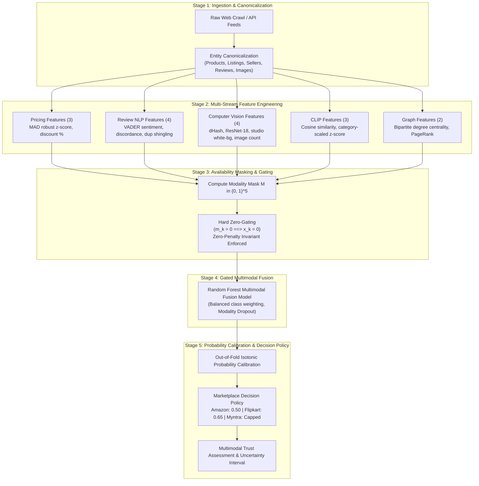

# Multimodal Machine Learning Pipeline Specification

**Project:** AI-Powered Indian Marketplace Trust Intelligence Platform  
**Target Ecosystems:** Amazon India, Flipkart, Myntra  
**Release State:** ML V1.0 Baseline / Multimodal Vision V1.1 Hardened  

---

## 1. End-to-End Pipeline Overview

The trust intelligence pipeline transforms raw, heterogeneous marketplace product offerings into calibrated risk probabilities and explainable evidence reports through five discrete stages:

---

## 2. Multi-Stream Feature Extraction Details

### 2.1 Pricing Stream (3 Features)
- **Log Price INR:** $\ln(1 + \text{price\_inr})$ eliminates long-tail skewness across electronics and FMCG.
- **Discount Percentage:** Direct commercial promotional indicator: $\frac{\text{MRP} - \text{Price}}{\text{MRP}} \times 100$.
- **Robust Price $z$-score:** Computed using Median Absolute Deviation (MAD) within subcategory cohorts:
  $$z_{\text{MAD}} = 0.6745 \times \frac{\text{Price} - \text{Median}(\text{Price})}{\text{MAD}}$$
  Robust to extreme outliers and festive sales spikes.

### 2.2 Review NLP Stream (4 Features)
- **Mean Star Rating:** Normalized star score $(\text{rating} - 1.0) / 4.0$.
- **Compound Sentiment:** VADER lexicon compound score $[-1.0, +1.0]$, augmented with Hinglish e-commerce sentiment tokens (*"bekaar"*, *"mast"*, *"duplicate"*, *"asli"*).
- **Sentiment-Rating Discordance:** Quantifies astroturfing gap: $|\text{norm\_rating} - \text{norm\_sentiment}|$.
- **Duplicate Review Shingling:** 3-gram character Jaccard similarity across customer reviews. If pairwise Jaccard $> 0.80$, `review_has_duplicate = 1.0`.

### 2.3 Computer Vision Stream (4 Features)
- **64-bit Difference Hash (dHash):** Gradient-based perceptual hash computed on $9 \times 8$ grayscale thumbnails. Hamming distance $\le 4$ indicates near-duplicate imagery.
- **Cross-Product Image Reuse:** Bipartite graph flag indicating that the same hero image dHash or ResNet-18 embedding is linked to multiple distinct canonical product IDs.
- **Studio White Background Indicator (V1.1):** Evaluates mean luminance of 5-pixel image border. If border luminance $> 240$, `is_white_background = 1.0`. Prevents false positive clustering from identical white studio backdrops.
- **Normalized Image Count (V1.1):** Catalog gallery completeness score: $\min(\text{image\_count}, 10) / 10.0$.

### 2.4 CLIP Vision-Language Stream (3 Features)
- **Raw Cosine Similarity:** Inner product between 512-dim normalized image embedding and title text embedding via OpenAI CLIP ViT-B/32.
- **Category-Aware Standardized $z$-Score (V1.1):**
  $$z_{\text{cat}} = \frac{\text{Sim}_{\text{CLIP}} - \mu_{\text{cat}}}{\sigma_{\text{cat}}}$$
  Accounts for category-level vocabulary baselines (e.g. Beauty $\mu=0.364$ vs Indian Ethnic Wear $\mu=0.278$).
- **Category Discordance Flag:** $z_{\text{cat}} \le -2.2 \lor \text{Sim}_{\text{CLIP}} < 0.17$. Catches severe bait-and-switch deception without false alarms in fashion apparel.

### 2.5 Relationship Graph Stream (2 Features)
- **Bipartite Degree Centrality:** Connects seller nodes to product nodes via shared image hash edges. Degree centrality flags suspicious seller hubs sharing assets.
- **Scaled PageRank:** Topology score identifying influential nodes within cross-merchant image-sharing cliques.

---

## 3. The Zero-Penalty Invariant & Gating Formula

Let $x \in \mathbb{R}^D$ be the concatenated multi-stream feature vector, and let $M \in \{0, 1\}^5$ be the binary availability mask:
$$M = [m_{\text{pricing}}, m_{\text{review}}, m_{\text{vision}}, m_{\text{clip}}, m_{\text{graph}}]$$

The gated feature representation $x_{\text{gated}}$ is computed via Hadamard product:
$$x_{\text{gated}, k} = x_k \cdot m_{\text{stream}(k)}$$

### Mathematical Guarantee
$$\forall k \text{ such that } m_{\text{stream}(k)} = 0 \implies x_{\text{gated}, k} \equiv 0$$
$$\frac{\partial P(\text{Anomaly})}{\partial (\text{Missing Modality})} \le 0$$

If a listing has no reviews ($m_{\text{review}} = 0$) or no images ($m_{\text{vision}} = 0$), all corresponding feature entries are strictly zeroed out. Missing data **never** acts as negative evidence.

---

## 4. Probability Calibration & Marketplace Policy Thresholds

Raw tree ensemble output probabilities are calibrated using monotonic **Isotonic Regression** fitted on out-of-fold predictions:

1. **Amazon India:**
   - Decision Threshold: **$0.50$**
   - High precision on standardized studio catalog.
2. **Flipkart:**
   - Decision Threshold: **$0.65$**
   - Adapted threshold accommodates promotional festive discount variance ($39.28\%$ catalog baseline) to eliminate false alarms.
3. **Myntra:**
   - Decision Threshold: **$0.50$** (Capped at moderate risk, labeled `UNVALIDATED_THRESHOLD` due to zero positive historical training cases).
