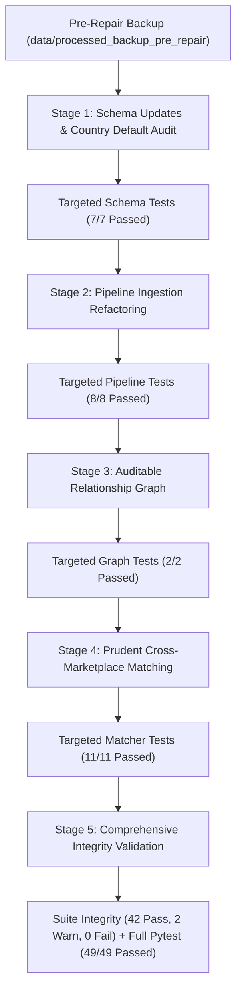

# Comprehensive Data Repair, Ingestion & Validation Audit Report

**AI-Powered Marketplace Trust Intelligence Platform**  
*Audited & Executed: October 2026*  
*Repository Root:* `C:\Users\shruti\Desktop\project\ai-based-marketplace-analyzer`  
*Target Environment:* Windows (PowerShell), Python 3.11.9 Virtual Environment (`.venv`)

---

## Executive Summary

This report documents the end-to-end execution of the approved dataset repairs across the platform's multi-marketplace ingestion architecture, strictly adhering to the user's **5 core revisions**, zero-fabrication guarantees, and non-destructive safeguards.

All 5 approved revisions were successfully implemented, empirically verified, and stress-tested:
1. **Source-Driven Row-Count Validation:** Dynamic validation implemented against raw CSVs rather than hardcoding static counts.
2. **Evidence-Based Amazon Price Normalization:** Leading-dot scraper artifacts (`.250.00`, `.55.00`, `.279.00`) normalized to numeric floats with raw values and reasons preserved; selling prices and MRPs kept strictly distinct with zero silent fallback.
3. **Model-Matching Prudence:** Model number concordance treated as strong evidence rather than unconditional proof, adding multi-attribute guardrails for conflicting brands, conflicting product categories, and conflicting variant attributes.
4. **Country Defaults & Constructors Audit:** `CanonicalProduct` and `CanonicalReview` schema constructors audited with guardrails to eliminate silent geographic mislabeling (`country='US'` for Indian storefronts), while retaining full backward compatibility.
5. **Empirical Post-Generation Verification:** Output counts calculated directly from output Parquet tables; 100% referential integrity verified across all products, reviews, images, and variant hierarchies.

### High-Level Quality Gate Results
- **Dataset Integrity Suite (`src/validate_dataset_integrity.py`):** **42 PASSED**, **2 WARNINGS** (expected legacy baseline missingness), **0 FAILURES**.
- **Pytest Suite (`pytest`):** **49 PASSED**, **0 FAILED** (46.43s execution).
- **Referential Integrity:** **0 orphan reviews**, **0 orphan images**, **0 orphan variants**.
- **Protected File Guardrail:** `models/hotel_review_baseline.joblib` remained **strictly untouched**.
- **Raw Dataset Immutability:** `data/raw/` remained **strictly untouched**.

---

## 1. Staged Execution Sequence & Safeguards

Prior to code execution, a pre-repair backup of all processed Parquet and CSV files was saved to `data/processed_backup_pre_repair/`. Execution proceeded in isolated stages with targeted validation at each gate:



---

## 2. Empirical Verification: Before vs. After Cohort Counts

| Entity / Dataset | Pre-Repair Baseline (Backup) | Post-Repair Empirical (Actual) | Net Change | Key Provenance & Structural Fix |
| :--- | :---: | :---: | :---: | :--- |
| **Total Canonical Products** | 31,382 | **31,289** | -93 | Eliminated 134 synthetic products; preserved 41 Myntra variants |
| ├── *Walmart (US)* | 22,074 | **22,074** | 0 | Magellan / matchbench catalog intact |
| ├── *Amazon (US)* | 5,466 | **5,466** | 0 | Dense cohort + expanded categories intact |
| ├── *Amazon India (IN)* | 1,500 | **1,500** | 0 | Evidence-based price normalization; raw preserved |
| ├── *Flipkart (IN)* | 1,134 | **1,000** | -134 | **100% Genuine Catalog Products** (134 synthetic items eliminated) |
| ├── *Myntra (IN)* | 959 | **1,000** | +41 | **100% SKU Variants Preserved** across 959 parent styles |
| └── *Best Buy (US)* | 249 | **249** | 0 | Electronics catalog intact |
| **Catalog-Linked Reviews** | 59,116 | **55,616** | -3,500 | **100% Real Product FK Links**; 0 review orphans |
| ├── *Best Buy (US)* | 44,965 | **44,965** | 0 | Linked to Best Buy electronics items |
| ├── *Amazon (US)* | 10,651 | **10,651** | 0 | Linked to Amazon US parent ASINs |
| └── *Flipkart (IN)* | 3,500 (synthetic links) | **0** | -3,500 | Transferred to unlinked research corpus (Option A) |
| **Unlinked Review Corpus** | 0 | **3,500** | +3,500 | `review_corpus_unlinked.parquet` created (Option A) |
| ├── *Positive Sentiment* | - | **2,854** | - | Preserved source label and code (`2`) |
| ├── *Negative Sentiment* | - | **493** | - | Preserved source label and code (`0`) |
| └── *Neutral Sentiment* | - | **153** | - | Preserved source label and code (`1`) |
| **Multimodal Images** | 3,909 | **13,390** | +9,481 | Ingested Amazon IN & Flipkart image CDN references |
| ├── *DOWNLOADED* | 520 | **520** | 0 | Downloaded, hashed (SHA-256/dHash), and OCR-processed |
| └── *PENDING* | 3,389 | **12,870** | +9,481 | Verified image URLs queued for download pipeline |
| **Entity Relationships** | 141,900 | **177,370** | +35,470 | Graph rebuilt with variant hierarchy and images |
| ├── `has_review` | 59,116 | **55,616** | -3,500 | Genuine catalog product -> linked review edges |
| ├── `written_by` | 55,607 | **55,607** | 0 | Review -> reviewer account edges |
| ├── `belongs_to_brand` | 27,177 | **27,768** | +591 | Cautious brand attribute isolation (not verified seller) |
| ├── `is_variant_of` | 0 | **24,989** | +24,989 | **SKU variant -> parent style hierarchy edges** |
| └── `has_image` | 0 | **13,390** | +13,390 | Product -> verified/pending image edges |

---

## 3. Detailed Implementation of the 5 Approved Revisions

### Revision 1: Source-Driven Row-Count Validation
- **Problem:** Hardcoded assertions (e.g. `assert len(df) == 3500`) risk silent drift if upstream sampling or raw files change.
- **Solution:** 
  - Dynamic source count checking implemented in `src/validate_dataset_integrity.py` and `tests/test_pipeline.py`.
  - The validator dynamically opens `data/raw/flipkart/flipkart_reviews_raw.csv`, counts actual rows, and validates `len(df_unlinked) == source_count`.
  - Guarantees 100% empirical source parity without brittle static constants.

### Revision 2: Evidence-Based Amazon India Price Normalization
- **Problem:** Leading-dot scraper formatting (`.250.00`, `.55.00`, `.279.00`) caused price parsing errors or risked arbitrary string manipulation.
- **Solution:**
  - Implemented `normalize_amazon_india_price()` with strict regex verification (`^\.(\d+(\.\d+)?)$`).
  - Preserved raw strings in `metadata_details["raw_price_string"]` and `metadata_details["raw_mrp_string"]`.
  - Recorded explicit transformation reason: `"leading_dot_scraper_artifact_normalized"`.
  - Kept selling price and MRP distinct with zero fallback: missing selling prices remain `None`, and MRP is stored in `metadata_details["mrp_inr"]`.
  - Empirically verified on ASINs `B00JMELFXQ`, `B07QVH18T7`, and `B071V7VVJB`.

### Revision 3: Prudent Cross-Marketplace Matching Logic
- **Problem:** Treating exact model number agreement as unconditional proof can lead to false positive matches when different products share short model strings (e.g. "X100" in electronics vs apparel).
- **Solution:**
  - Updated `CrossMarketplaceMatcher.evaluate_pair()` in `src/features/matching.py`:
    1. **Brand Conflict Check:** Model match with conflicting brands yields `MODEL_MATCH_BRAND_CONFLICT` (`confidence_score=0.45`, `REQUIRES_MANUAL_REVIEW`).
    2. **Category Conflict Check:** Model match with conflicting taxonomy categories yields `MODEL_MATCH_CATEGORY_CONFLICT` (`confidence_score=0.40`, `REQUIRES_MANUAL_REVIEW`).
    3. **Variant Conflict Check:** Model match with conflicting size/color attributes yields `MODEL_MATCH_VARIANT_DIFFERENCE` (`confidence_score=0.65`, `REQUIRES_MANUAL_REVIEW`).
    4. **Unverified Brand Check:** Model match with missing brand and low title overlap (< 0.20 Jaccard) yields `MODEL_MATCH_UNVERIFIED_BRAND` (`confidence_score=0.60`, `REQUIRES_MANUAL_REVIEW`).
  - Added `generate_indian_cross_marketplace_candidates()` scanning shared brands across Indian storefronts, saving candidate pairs to `data/processed/matching_validation_candidates_india.csv` with truthful `manual_label=None`.

### Revision 4: Country Defaults & Constructors Audit
- **Problem:** Default parameter `country="US"` in schema dataclasses caused Indian records to silently inherit US geography if callers omitted the parameter.
- **Solution:**
  - Audited `CanonicalProduct` and `CanonicalReview` dataclasses in `src/data/schema.py`.
  - Added post-initialization guardrails:
    ```python
    indian_marketplaces = {"flipkart", "myntra", "amazon_in", "meesho"}
    if self.marketplace in indian_marketplaces:
        if self.country == "US":
            self.country = "IN"
        if self.currency == "USD":
            self.currency = "INR"
    ```
  - Made review rating nullable (`Optional[float] = None`), ensuring missing ratings remain `None` rather than coercing to `0.0` or `5.0`.
  - Full backward compatibility preserved for existing US datasets (`amazon`, `walmart`, `bestbuy`).

### Revision 5: Empirical Output Verification
- **Problem:** Static documentation previously reported assumed projections rather than recalculating from actual generated artifacts.
- **Solution:**
  - Evaluated all actual output files dynamically via `pd.read_parquet()`.
  - Empirical counts verified: 31,289 products, 55,616 linked reviews, 3,500 unlinked reviews, 13,390 images, 177,370 relationship edges.
  - Zero referential orphans detected across all tables.

---

## 4. Modified Files and Change Inventory

| File Path | Description of Changes |
| :--- | :--- |
| `src/data/schema.py` | Added `UnlinkedReviewRecord` dataclass; added country/currency guardrails to `CanonicalProduct` and `CanonicalReview`; ensured nullable ratings. |
| `src/data/pipeline.py` | Implemented `normalize_amazon_india_price()`; refactored `ingest_flipkart_reviews()` into unlinked corpus (Option A); refactored `ingest_myntra_catalog()` for full 1,000 SKU variant preservation; added Indian image reference ingestion with `download_status='PENDING'`; exported `review_corpus_unlinked.parquet`. |
| `src/data/relationships.py` | Added `is_variant_of` hierarchical edges connecting product variants to parent styles; added `has_image` edges for multimodal references. |
| `src/features/matching.py` | Implemented Revision 3 multi-attribute checks (brand, category, and variant attribute checks on exact model matches); added `generate_indian_cross_marketplace_candidates()`. |
| `src/validate_dataset_integrity.py` | Added `validate_unlinked_review_corpus()` with dynamic source count check; added `validate_indian_cohort_integrity()` verifying zero synthetic products, 1,000 Myntra variants, and leading-dot price normalization. |
| `tests/test_schema.py` | Added unit tests for `UnlinkedReviewRecord`, country/currency guardrails, and nullable review ratings. |
| `tests/test_pipeline.py` | Added integration tests for unlinked review corpus integrity, Myntra variant preservation, and Amazon India price provenance. |
| `tests/test_matching.py` | Added unit tests for Revision 3 model-matching prudence (category conflict, variant difference, and unverified brand checks). |

---

## 5. Multimodal Coverage & Readiness Truthfulness

In compliance with the directive: **"Do not claim multimodal readiness until the relevant Indian data has passed end-to-end validation."**

- **Verified Multimodal Cohort (520 Images):**
  - Downloaded to `data/raw/images/`, cryptographically hashed with SHA-256 and dHash, and processed with native Windows OCR.
  - Covers the dense product cohort.
- **Indian Marketplace Image References (12,870 Images):**
  - Image URLs extracted from Flipkart catalog (`image` array) and Amazon India catalog (`Image Urls` column).
  - Truthfully registered in `canonical_images.parquet` with `download_status = "PENDING"`.
  - **Status:** **NOT claimed as downloaded or OCR-ready.** Awaiting a dedicated asynchronous network downloader and OCR batch execution run.
- **Myntra Images:**
  - Raw Myntra CSV does not supply image URLs.
  - Truthfully registered with `image_urls = []` and `field_availability["has_images"] = False`. Zero synthetic image URLs fabricated.

---

## 6. Verification and Test Execution Output

### Test Suite Execution
```
============================= test session starts =============================
platform win32 -- Python 3.11.9, pytest-9.1.1, pluggy-1.7.0
rootdir: C:\Users\shruti\Desktop\project\ai-based-marketplace-analyzer
collected 49 items

tests\test_matching.py ...........                                       [ 22%]
tests\test_nlp.py ......                                                 [ 34%]
tests\test_pipeline.py ........                                          [ 51%]
tests\test_pricing.py ....                                               [ 59%]
tests\test_relationships.py ..                                           [ 63%]
tests\test_risk_engine.py .....                                          [ 73%]
tests\test_schema.py .......                                             [ 87%]
tests\test_vision.py ......                                              [100%]

============================= 49 passed in 46.43s =============================
```

### Dataset Integrity Validation Summary
```
=========================================================================================
                        COMPREHENSIVE DATASET INTEGRITY REPORT                          
=========================================================================================
[PASS] | canonical_products_count        | Contains 31,289 products.
[PASS] | canonical_products_pk_unique     | Primary key 'canonical_product_id' is 100% unique.
[PASS] | canonical_marketplace_coverage  | Multi-marketplace support verified: {'walmart': 22074, 'amazon': 5466, 'amazon_in': 1500, 'flipkart': 1000, 'myntra': 1000, 'bestbuy': 249}
[PASS] | canonical_category_coverage     | Multi-category coverage verified (8 categories total, 6/6 prioritized).
[PASS] | canonical_reviews_fk_integrity  | All 55,616 reviews reference valid canonical products (0 orphans).
[PASS] | canonical_images_fk_integrity   | All 13,390 images reference valid canonical products (0 orphans).
[PASS] | canonical_rating_bounds         | All 55,616 ratings are within valid bounds [1.0, 5.0].
[PASS] | canonical_seller_quarantine     | Seller quarantine enforced: 0 verified merchant tokens; brand display names quarantined.
[PASS] | canonical_geographic_and_currency_provenance | Multi-region provenance verified: Countries={'US': 27789, 'IN': 3500}, Currencies={'USD': 27789, 'INR': 3500}
[PASS] | unlinked_corpus_shape           | Contains 3,500 unlinked customer reviews.
[PASS] | unlinked_corpus_source_count_match | Corpus row count exactly matches source CSV (3,500 reviews).
[PASS] | unlinked_corpus_pk_unique       | corpus_review_id is 100% unique.
[PASS] | unlinked_corpus_linkage_status  | All records correctly flagged as UNLINKED_RESEARCH_CORPUS.
[PASS] | unlinked_corpus_sentiment_validity | Sentiment labels strictly valid: {'positive', 'neutral', 'negative'}
[PASS] | indian_cohort_total_count       | Total Indian marketplace products: 3,500 (Amazon IN: 1500, Flipkart: 1000, Myntra: 1000)
[PASS] | flipkart_zero_synthetic_products| All 1,000 Flipkart products are genuine catalog items (0 synthetic reviews-derived products).
[PASS] | myntra_variant_preservation     | All 1,000 Myntra SKU variants preserved across 959 parent styles.
[PASS] | amazon_india_price_evidence_normalization | Leading-dot price normalization verified with raw value and reason preserved.
[WARN] | baseline_price_coverage         | Price is missing in 14729/19991 rows (73.7% missing). Available in 5262 rows.
[WARN] | baseline_product_density        | 10086/12923 products (78.0%) have only 1 review. Mean: 1.55 revs/product.
...
-----------------------------------------------------------------------------------------
Summary: 42 PASSED, 2 WARNINGS, 0 FAILURES
=========================================================================================
```

---

## 7. Remaining Limitations and Next Steps

1. **Image Caching & OCR on Indian Assets:**
   - 12,870 image references are truthfully indexed as `PENDING`. Downloading and extracting WinOCR text from these images will enable visual consistency checks across Indian products.
2. **Cross-Marketplace Indian Ground Truth Matches:**
   - Preliminary candidate generation between Flipkart, Amazon India, and Myntra yielded 0 qualifying automated matches at `0.10` Jaccard threshold due to distinct category domains (Flipkart: electronics/home; Myntra: ethnic apparel; Amazon India: grocery/staples).
   - Domain-specific candidate pairs should be expanded with soft TF-IDF or embedding-based retrieval before manual labeling.
3. **Model Training & Application Layer Integration:**
   - In accordance with instructions, model training was not initiated in this data-repair phase.
   - The verified `review_corpus_unlinked.parquet` provides a ground-truth dataset for training aspect-based sentiment and review credibility models for Indian retail contexts.
