# Dataset Provenance, Architecture & Quality Audit Report
## AI-Powered Marketplace Trust Intelligence Platform

**Date:** October 2026  
**Auditor & Lead System Architect:** Senior Data Engineer, ML Engineer & Repository Maintainer  
**Repository Working Directory:** `c:\Users\shruti\Desktop\project\ai-based-marketplace-analyzer`  
**GitHub Repository:** `https://github.com/shruti316/ai-marketplace-analyzer`  
**Status:** Validated Baseline & Empirical Audit Complete  

---

## 1. Executive Summary

This comprehensive audit evaluates the data foundation, physical file assets, schema architecture, provenance, data quality, referential constraints, and downstream pipeline dependencies of the **AI-Powered Marketplace Trust Intelligence Platform**.

### Key Baseline Findings:
1. **Automated Test Baseline:**
   - `python run_tests.py`: **33 / 33 unit and integration tests passing** (0 failures).
   - `python -m src.validate_dataset_integrity`: **32 passes, 2 documented warnings, 0 failures**.
   - The 2 warnings reflect documented real-world long-tail properties of the historical baseline sample (`marketplace_text_features.parquet`): 73.7% missing prices and 78.0% single-review listings.
2. **Current Catalog Representation:**
   - **Canonical Products (`canonical_products.parquet`):** 27,789 total products across Walmart (22,074; 79.4%), Amazon (5,466; 19.7%), and BestBuy (249; 0.9%).
   - **Canonical Reviews (`canonical_reviews.parquet`):** 55,616 total reviews across BestBuy (44,965; 80.8%) and Amazon (10,651; 19.2%).
   - **Canonical Images (`canonical_images.parquet`):** 3,909 image records (100% Amazon; 520 downloaded and verified in `image_manifest.parquet`).
   - **Canonical Relational Graph (`canonical_relationships.parquet`):** 139,708 entity edges linking products, reviews, images, brands, and reviewers.
   - **Listing-Level Review Features (`product_review_features.parquet`):** 27,789 rows with aggregated NLP sentiment, verified-purchase ratios, and intra-listing similarity features.
3. **Geographic and Currency Provenance:**
   - **100% of current catalog products and reviews originate from US/North American storefronts** (`walmart.com`, `amazon.com`, `bestbuy.com`).
   - **100% of current prices are denominated in USD.**
   - There is currently **zero native representation of Indian consumer commerce** (no Amazon India `.in`, no Flipkart, no Myntra, no Meesho, and no INR currency).
4. **Protected File Quarantine:**
   - `models/hotel_review_baseline.joblib` is modified in the working tree and is **strictly quarantined**. It is not overwritten, restored, retrained, or committed.
   - The Ott et al. (ACL 2011/2013) Chicago Hotel Deception benchmark is isolated in `data/raw/benchmarks/deceptive_opinion_spam.parquet` and is completely decoupled from e-commerce fraud scoring.

---

## 2. Complete Physical Dataset Inventory

Every dataset in the platform has been audited, fingerprinted, and measured. Raw source data remains strictly immutable in `data/raw/`.

| Dataset Role | File Path | Format | Rows × Cols | Size (MB) | SHA-256 Checksum | Provenance & Source |
| :--- | :--- | :--- | :--- | :--- | :--- | :--- |
| **Canonical Products** | `data/processed/canonical_products.parquet` | Parquet | 27,789 × 21 | 3.40 MB | `73794c3d53285234c83fe60760a17fa4267fa66100b215d194c83a27d5d86bf6` | Amazon Reviews '23 (UCSD), Magellan Walmart (Univ. of Wisconsin), BestBuy (ValerianFourel) |
| **Canonical Reviews** | `data/processed/canonical_reviews.parquet` | Parquet | 55,616 × 15 | 8.71 MB | `2201fdd8cd346c76b7c043c7b3c96d068c2295769471a767df7d2f65a17e42e6` | BestBuy customer reviews, Amazon Reviews '23 (All Beauty, Electronics, Fashion, Home, Toys, Books) |
| **Canonical Images** | `data/processed/canonical_images.parquet` | Parquet | 3,909 × 15 | 0.16 MB | `0bf02773dc432d613822140efc95bc1421ec82ae3e131e3247cfc6145d7a3789` | Amazon CloudFront CDN image URLs extracted from Amazon Reviews '23 metadata |
| **Canonical Relationships** | `data/processed/canonical_relationships.parquet` | Parquet | 139,708 × 10 | 3.52 MB | `75926f0eec5a92e966933913e22e2c06974c7b0009c5fb16cd184207901928d6` | Deterministic entity graph edges linking products, reviews, images, brands, and reviewers |
| **Product Review Features** | `data/processed/product_review_features.parquet` | Parquet | 27,789 × 21 | 1.42 MB | `53bfe8d88446c241f41c4006d241da305a894106727f37c31eac6ebc20aff244` | Aggregated listing-level NLP metrics: VADER sentiment discordance, verified ratio, TF-IDF cosine similarity |
| **Cross-Marketplace Matches** | `data/processed/matched_cross_marketplace_pairs.parquet` | Parquet | 1 × 16 | 0.01 MB | `84ae81db0a4d7d5a7e0b7e33d70528fa7dd9b8d4135dbadc9b248038cf13a401` | Candidate pair comparison between Walmart and Amazon (exact model match Sony headphones) |
| **Cleaned Baseline (Week 2)** | `data/processed/marketplace_cleaned.parquet` | Parquet | 19,991 × 22 | 6.37 MB | `41dd24c69887811e0bcf1e87427b8a52ae27773101cc240618e6613824772078` | Preserved Week 2 data-cleaning working sample (Amazon All_Beauty) |
| **Text Features (Week 2)** | `data/processed/marketplace_text_features.parquet` | Parquet | 19,991 × 30 | 8.86 MB | `9ebcbe58c9d337a3e543687822b29c9c2a1e4cad2df4fc685d821c93c95cead8` | Preserved Week 2 feature-engineering output with review stylometry & timestamps |
| **Dense Products Cohort** | `data/interim/dense_products.parquet` | Parquet | 300 × 11 | 0.18 MB | `3d045841876f9ffffa781600f479e2b323bca2274e32a183718cae5d412f2b6b` | 300 Amazon Beauty products with 100% positive price and $\ge 10$ customer reviews |
| **Dense Reviews Cohort** | `data/interim/dense_reviews.parquet` | Parquet | 7,595 × 11 | 2.16 MB | `43efa0d2d4f6756dafb8cb3a5145bbb70e9f0d52e2a3474a9a84464ff5a3a354` | 7,595 customer reviews linked to dense products (mean 25.3 reviews/product) |
| **Dense Product Images** | `data/interim/dense_product_images.parquet` | Parquet | 3,489 × 5 | 0.08 MB | `70fedaeba32fab8085222793c7a358739579269ff274b7f26a8da80d782de2d4` | Structured image dictionary parsed from Amazon raw metadata (hi_res, large, thumb) |
| **Product Pricing Cohort** | `data/interim/product_pricing_cohort.parquet` | Parquet | 17,704 × 12 | 1.47 MB | `0b4b7b6fd7835224c4438838f3ed012e991245232f1901c3cd896955f120b3c0` | 17,704 Amazon Beauty products with 100% valid positive prices & Tukey fences |
| **Image Manifest** | `data/interim/image_manifest.parquet` | Parquet | 520 × 22 | 0.13 MB | `815c49630c8891f2a634da8b7f25ae7e0e56fd0cca4dadcc80efdaf2d4c0454d` | 520 downloaded primary packaging images with SHA-256, dHash, and native WinRT OCR |
| **Baseline Sample (Week 1)** | `data/interim/all_beauty_sample.parquet` | Parquet | 20,000 × 16 | 6.32 MB | `0d58a6169120b134406dcf46cc7f920df96f4350fdf8c8e98fefe61c8ebeec71` | Preserved Week 1 baseline working sample (random sample seed=42) |
| **Raw Beauty Metadata** | `data/raw/amazon/all_beauty_metadata.parquet` | Parquet | 112,590 × 16 | 56.87 MB | `14815cf1312a0d847364866e6876c8c73738993469067242870774c372c04387` | Raw immutable archive: Amazon Reviews '23 All_Beauty metadata (Hou et al., 2024) |
| **Raw Beauty Reviews** | `data/raw/amazon/all_beauty_reviews.parquet` | Parquet | 701,528 × 10 | 132.65 MB | `b40ae565f1073e0b4960e2f424fe0c82f3d270b7c4d00bc9272ddd6a8b7411d7` | Raw immutable archive: Amazon Reviews '23 All_Beauty customer reviews |
| **Raw Walmart Catalog** | `data/raw/walmart/walmart_products_raw.csv` | CSV | 22,074 × 6 | 2.41 MB | `c3a6e6d45726de26daa557602ccb25b8213aaad7524a2b61a815d6cc49c339ff` | University of Wisconsin / Magellan matchbench Walmart catalog (tableB.csv) |
| **Raw BestBuy Reviews** | `data/raw/bestbuy/bestbuy_reviews_raw.parquet` | Parquet | 44,965 × 18 | 7.60 MB | `795d8688efea38c825f25658b278033a3b0e1d48053a29432f75dbe485c248e2` | BestBuy customer reviews with product name, model, rating, date (ValerianFourel) |
| **Raw Fashion Meta (Slice)** | `data/raw/amazon/amazon_fashion_metadata_raw.jsonl` | JSONL | 193 lines | 0.34 MB | `c120bfba61a9f1437ee9bf918664ecfcda4f4bfe49efef9226cfd5952c4b8b64` | Range-request slice: Amazon Reviews '23 Amazon_Fashion metadata |
| **Raw Fashion Reviews (Slice)** | `data/raw/amazon/amazon_fashion_reviews_raw.jsonl` | JSONL | 566 lines | 0.34 MB | `50702d733575b967962451371eb5bf9fdfa76cb47b59eb8f0e5b721e25d2ea99` | Range-request slice: Amazon Reviews '23 Amazon_Fashion reviews |
| **Raw Books Meta (Slice)** | `data/raw/amazon/books_metadata_raw.jsonl` | JSONL | 115 lines | 0.34 MB | `e61882c9be08331d279d0b6ebbfd6e3e50e9064746fce0c5dfcae5374431e405` | Range-request slice: Amazon Reviews '23 Books metadata |
| **Raw Books Reviews (Slice)** | `data/raw/amazon/books_reviews_raw.jsonl` | JSONL | 608 lines | 0.34 MB | `32a76f23fcf6004df9c26be6467364132be0fc4bb02aa322f281855e5c70ffeb` | Range-request slice: Amazon Reviews '23 Books reviews |
| **Raw Electronics Meta (Slice)** | `data/raw/amazon/electronics_metadata_raw.jsonl` | JSONL | 94 lines | 0.34 MB | `cbbe5f979c6d3df3991286c0e86b43ea92e59b736517a2dc79854ce5803982fa` | Range-request slice: Amazon Reviews '23 Electronics metadata |
| **Raw Electronics Reviews (Slice)** | `data/raw/amazon/electronics_reviews_raw.jsonl` | JSONL | 595 lines | 0.34 MB | `abf268b64b1509a2503d65b161c6b12a02e6c757657053e1f0b0c609c11874ef` | Range-request slice: Amazon Reviews '23 Electronics reviews |
| **Raw Home & Kitchen Meta (Slice)** | `data/raw/amazon/home_and_kitchen_metadata_raw.jsonl` | JSONL | 91 lines | 0.34 MB | `86386da616dc98273bbcf8b7c46f1ec515b172a3923a1a6b09337ff89ba4882c` | Range-request slice: Amazon Reviews '23 Home_and_Kitchen metadata |
| **Raw Home & Kitchen Reviews (Slice)** | `data/raw/amazon/home_and_kitchen_reviews_raw.jsonl` | JSONL | 694 lines | 0.34 MB | `448f226b9a888d30e37bc559550b73fa6c57f62d19f50e82c5f958f00d3d522f` | Range-request slice: Amazon Reviews '23 Home_and_Kitchen reviews |
| **Raw Toys Meta (Slice)** | `data/raw/amazon/toys_and_games_metadata_raw.jsonl` | JSONL | 96 lines | 0.34 MB | `4be4f4bfa846173a4b659c2598be6fa5245869fe1a44e6b567d4aa3302bc5ae9` | Range-request slice: Amazon Reviews '23 Toys_and_Games metadata |
| **Raw Toys Reviews (Slice)** | `data/raw/amazon/toys_and_games_reviews_raw.jsonl` | JSONL | 663 lines | 0.34 MB | `17a80b88939c32ee347f7b3227ebaf746e4d41fa446d3065a9561ea0cb7f2e14` | Range-request slice: Amazon Reviews '23 Toys_and_Games reviews |
| **Hotel Deception Benchmark** | `data/raw/benchmarks/deceptive_opinion_spam.parquet` | Parquet | 1,600 × 5 | 0.72 MB | `eaeceee0a9aa985f509d52ed4a2841a93584265787ec9687be5d7161ae7aaf7c` | Ott et al. (ACL 2011, EMNLP 2013) hotel reviews (800 truthful, 800 deceptive). **QUARANTINED** |
| **E-Commerce Fake Reviews Benchmark** | `data/raw/benchmarks/ecommerce_fake_reviews_benchmark.parquet` | Parquet | 40,526 × 4 | 7.91 MB | `3384e50f7bbc34b4458baa3d103db39313bed83000f31d15858c930cf0f62ba9` | Salminen et al. (2022) e-commerce fake review manipulation benchmark (20,232 authentic, 20,294 CG) |
| **Synthetic Stress Tests** | `data/raw/benchmarks/synthetic_stress_test_cases.parquet` | Parquet | 5 × 21 | 0.02 MB | `6407a4691c9170973dc6c9e0068124673a7b4bc6f245f2b94de5917d3b8df730` | Controlled edge cases (Cases A–E) explicitly tagged `is_synthetic = True` |

---

## 3. Marketplace Provenance & Geographic Coverage

| Marketplace | Stated Source | Storefront / Domain | Geographic Provenance | Currency | Record Level | Total Volume |
| :--- | :--- | :--- | :--- | :--- | :--- | :--- |
| **Amazon** | Amazon Reviews '23 (UCSD McAuley Lab; Hou et al., 2024) | `amazon.com` | United States (US) | USD (`$`) | Products, Reviews, Images | 5,466 products, 10,651 reviews, 3,909 images |
| **Walmart** | Magellan Benchmark (Univ. of Wisconsin; matchbench) | `walmart.com` | United States (US) | USD (`$`) | Product Catalog Listings | 22,074 products, 0 reviews, 0 images |
| **BestBuy** | BestBuy Customer Reviews (ValerianFourel / Hugging Face) | `bestbuy.com` | United States (US) | USD (`$`) | Customer Reviews (Products synthesized from model/name) | 249 products, 44,965 reviews, 0 images |

> [!IMPORTANT]
> **Key Provenance Finding:**  
> The existing Amazon cohort originates exclusively from `amazon.com` (US). **None of the existing records are from Amazon India (`amazon.in`).**  
> Geographic provenance must never be inferred from retailer brand names. Currently, **100% of the platform data is US/North American**. Integrating Indian marketplaces (Flipkart, Amazon India, Myntra) is essential to satisfy the core objective of Indian consumer relevance.

---

## 4. Product Category Coverage Audit

### Current Category Distribution Across Marketplaces

| Standardized Category | Amazon | BestBuy | Walmart | Total Products | Total Reviews | Total Images | Listings With Price | Listings With Brand |
| :--- | :--- | :--- | :--- | :--- | :--- | :--- | :--- | :--- |
| **Electronics** | 663 | 249 | 11,179 | **12,091** (43.5%) | 45,560 | 78 | 9,851 (81.5%) | 11,512 (95.2%) |
| **Other / Unclassified** | 32 | 0 | 7,131 | **7,163** (25.8%) | 0 | 25 | 6,121 (85.5%) | 7,163 (100.0%) |
| **Books & Stationery** | 708 | 0 | 2,289 | **2,997** (10.8%) | 608 | 58 | 2,114 (70.5%) | 2,394 (79.9%) |
| **Beauty & Personal Care** | 1,800 | 0 | 0 | **1,800** (6.5%) | 7,525 | 3,489 | 1,800 (100.0%) | 1,800 (100.0%) |
| **Clothing & Fashion** | 760 | 0 | 770 | **1,530** (5.5%) | 566 | 95 | 754 (49.3%) | 969 (63.3%) |
| **Home & Kitchen** | 773 | 0 | 702 | **1,475** (5.3%) | 694 | 91 | 601 (40.7%) | 793 (53.8%) |
| **Toys & Games** | 730 | 0 | 3 | **733** (2.6%) | 663 | 73 | 47 (6.4%) | 81 (11.0%) |
| **Total** | **5,466** | **249** | **22,074** | **27,789** | **55,616** | **3,909** | **21,288** (76.6%) | **24,712** (88.9%) |

### Root Cause Analysis of "Other / Unclassified" Category:
Of the 7,163 listings classified as "Other", **7,131 originate from Walmart**. Inspection of their raw subcategories reveals:
- 1,229 listings have empty subcategory strings.
- 5,902 listings represent valid categories that failed keyword matching because `CATEGORY_MAPPING_RULES` in [`src/data/schema.py`](file:///c:/Users/shruti/Desktop/project/ai-based-marketplace-analyzer/src/data/schema.py) lacked specific keywords:
  - Computer & Office Accessories: `cases sleeves` (394), `projection screens` (370), `cases` (348), `accessories supplies` (226), `blank media` (212), `printer accessories` (196), `printers` (172), `graphics cards` (118), `webcams` (76), `docking stations` (58).
  - Office & Stationery: `labeling tapes` (99), `label makers` (81).
Expanding taxonomy rules will reclassify approximately 3,000+ listings from "Other" to "Electronics" or "Books & Stationery" without altering underlying data.

---

## 5. Schema, Field Completeness & Missingness Audit

### Missingness in `canonical_products.parquet` (27,789 rows):
- `canonical_product_id`: 0 missing (100% unique primary keys).
- `marketplace`: 0 missing (`walmart`, `amazon`, `bestbuy`).
- `source_product_id`: 0 missing.
- `title`: 0 missing.
- `category`: 0 missing.
- `brand`: 3,077 missing (11.1% missing; mostly in Walmart and Amazon secondary categories).
- `description`: 3,077 missing (11.1% missing).
- `price`: 6,501 missing (23.4% missing; 21,288 listings have positive numeric prices).
- `rating` & `rating_count`: 25,400 missing (91.4% missing; Walmart catalog table does not include star rating attributes).
- `product_url`: 3,077 missing.
- `image_urls`: 0 nulls (list column; empty list for Walmart/BestBuy).
- `seller_id`: **27,789 missing (100% quarantined)**. Adheres strictly to the policy that display names must never be treated as verified merchant account tokens.
- `seller_name`: 3,077 missing (88.9% available).

### Missingness in `canonical_reviews.parquet` (55,616 rows):
- `canonical_review_id`: 0 missing (100% unique).
- `source_review_id`: 0 missing.
- `canonical_product_id`: 0 missing (**100% referential integrity; 0 orphan reviews**).
- `rating`: 0 missing (**100% within valid range [1.0, 5.0]**).
- `review_text`: 0 missing.
- `timestamp`: 44,965 missing (BestBuy reviews provide `review_date` ISO string instead of Unix timestamp).
- `review_date`: 10,651 missing (Amazon reviews provide Unix `timestamp` instead of pre-formatted ISO string).
- `verified_purchase`: 0 missing.
- `ground_truth_label`: **55,616 null (100% genuine reviews)**. No fabricated fake review labels exist in production tables.

### Missingness in `canonical_images.parquet` (3,909 rows):
- `image_id`: 0 missing.
- `canonical_product_id`: 0 missing (**0 orphan images**).
- `image_url`: 0 missing (100% active CloudFront URLs).
- `local_path`, `file_size_bytes`, `width`, `height`, `sha256`, `dhash`, `ocr_text`: 3,389 pending download; 520 downloaded and verified in `image_manifest.parquet`.

---

## 6. Dependency Map Across Repo Modules

```mermaid
graph TD
    subgraph Raw_Layer [Raw Immutable Layer data/raw]
        A1[amazon/all_beauty_metadata.parquet]
        A2[amazon/all_beauty_reviews.parquet]
        A3[amazon/*_raw.jsonl]
        W1[walmart/walmart_products_raw.csv]
        B1[bestbuy/bestbuy_reviews_raw.parquet]
        BM1[benchmarks/deceptive_opinion_spam.parquet]
        BM2[benchmarks/ecommerce_fake_reviews_benchmark.parquet]
        BM3[benchmarks/synthetic_stress_test_cases.parquet]
    end

    subgraph Pipeline_Layer [Ingestion & Processing src/data]
        PIPE[src/data/pipeline.py]
        SCHEMA[src/data/schema.py]
        REL[src/data/relationships.py]
    end

    subgraph Processed_Layer [Canonical Production Layer data/processed]
        CP[canonical_products.parquet]
        CR[canonical_reviews.parquet]
        CI[canonical_images.parquet]
        CREL[canonical_relationships.parquet]
        PRF[product_review_features.parquet]
        CMP[matched_cross_marketplace_pairs.parquet]
    end

    subgraph Intelligence_Layer [Features & Risk src/features & src/risk]
        PRICING[src/features/pricing.py]
        MATCHING[src/features/matching.py]
        NLP[src/nlp/review_analysis.py]
        RISK[src/risk/engine.py]
    end

    subgraph Validation_Layer [Testing & Integrity]
        TESTS[run_tests.py]
        VALID[src/validate_dataset_integrity.py]
        EVAL[src/evaluation/benchmark_eval.py]
    end

    %% Dependencies
    A1 & A2 & A3 & W1 & B1 --> PIPE
    SCHEMA --> PIPE
    PIPE --> CP & CR & CI
    CP & CR & CI --> REL --> CREL
    CR --> NLP --> PRF
    CP & W1 --> MATCHING --> CMP
    CP --> PRICING
    CP & PRICING & PRF & CI --> RISK
    CP & CR & CI & CREL & PRF --> VALID
    CP & PRICING & RISK & MATCHING & NLP --> TESTS
    BM1 & BM2 & BM3 --> EVAL
```

---

## 7. Data Quality & Limitations Summary

1. **Seller Metadata Quarantine:** Currently, no verified merchant account tokens exist in the source datasets. While `brand` and storefront display names exist for 88.9% of listings, treating brand names as merchant account IDs would introduce false collusion graphs.
2. **Review Distribution Asymmetry:** 80.8% of reviews are from BestBuy, and 19.2% from Amazon. Walmart has 0 reviews in the current catalog. BestBuy products were synthesized from reviews, resulting in 249 products with high review density (mean ~180 reviews/product). Amazon dense products have mean ~25.3 reviews/product.
3. **Cross-Marketplace Matching Bottleneck:**
   - The current matching script evaluated only the first 200 Walmart items against 200 Amazon items.
   - It aborted at the first match (`break`), resulting in only 1 matched pair in `matched_cross_marketplace_pairs.parquet`.
   - Amazon parent ASINs were intentionally excluded from manufacturer model matching (commit `d457eb4`). Real manufacturer model numbers from `metadata_details` were not yet extracted.
4. **Zero Indian Commerce Coverage:** The entire repository represents US retail in USD. Real Indian consumers buy on Flipkart, Amazon India, Myntra, and Meesho in INR.
