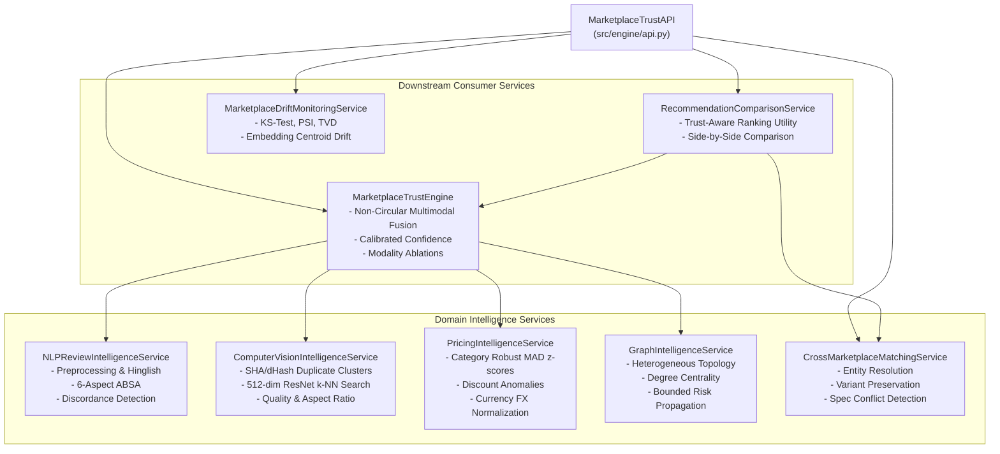

# Marketplace Trust Intelligence Engine — System Architecture
## AI-Powered Marketplace Trust Intelligence Platform — v1.7 Integration

### 1. High-Level Architecture Overview

The **Marketplace Trust Intelligence Engine** is structured into specialized, decoupled micro-services coordinated by the unified `MarketplaceTrustEngine` and exposed through the programmatic `MarketplaceTrustAPI`.

---

### 2. Non-Circular Fusion Governance
1. **Traceability:** Every penalty is mathematically tied to an observed anomaly (e.g. `RATING_SENTIMENT_DISCORDANCE`, `EXTREME_HIGH_PRICE_OUTLIER_MAD`).
2. **Missing Modality Neutrality:** Products lacking images or reviews receive lower confidence, but their trust penalty is **0.00**. Missingness is never treated as fraud.
3. **No Target Leakage:** Weak supervision heuristic scores are strictly separated from supervised classification targets.
